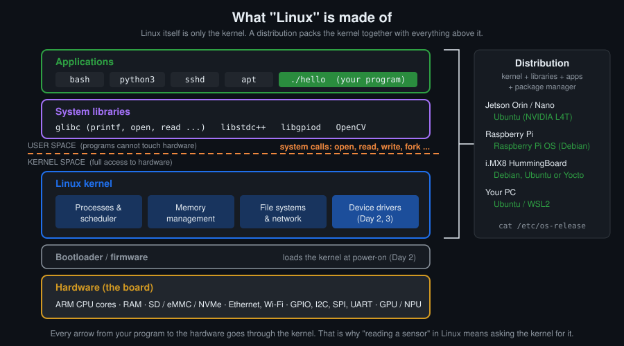
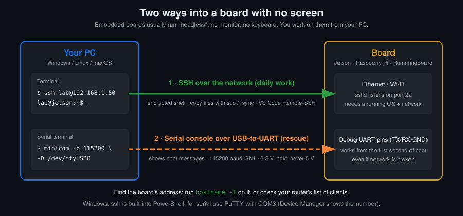
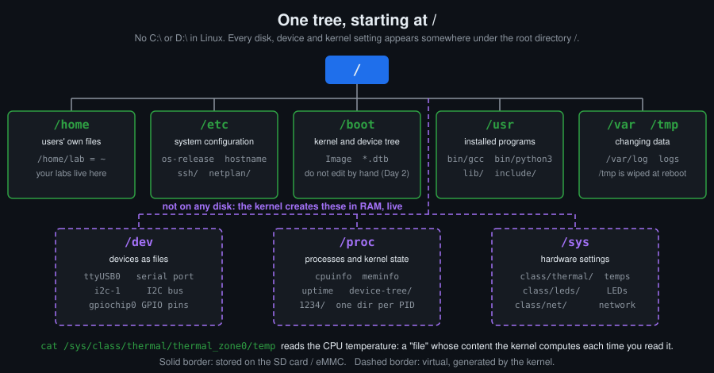
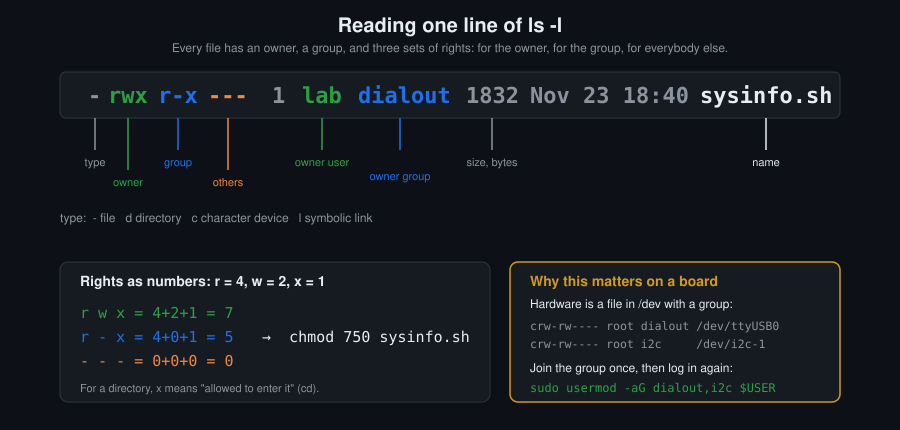
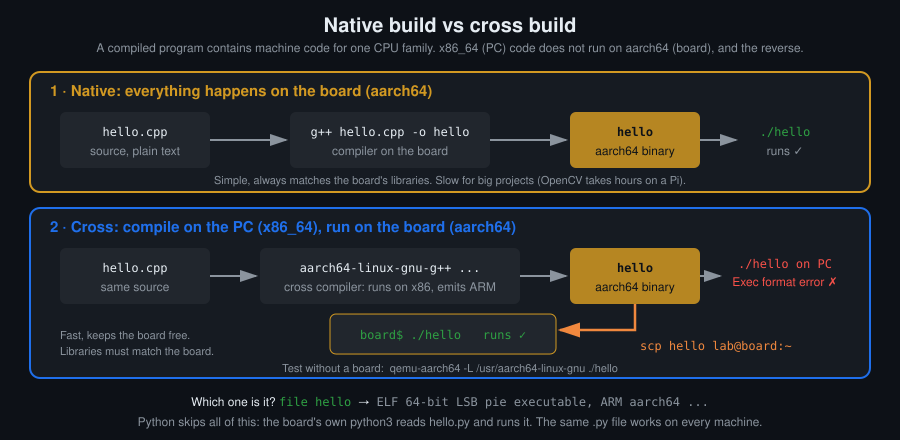

# Day 1: Linux from Zero, on Your Board · Օր 1. Linux-ը զրոյից՝ քո բորդի վրա

## Objectives · Նպատակներ
- Բացատրել, թե ինչ է Linux-ը. **kernel**-ի և **distribution**-ի տարբերությունը, և ինչու են embedded սարքերը գրեթե միշտ Linux օգտագործում
- Միանալ բորդին PC-ից՝ **SSH**-ով network-ով և **serial console**-ով, ֆայլեր պատճենել `scp`-ով
- Ազատ աշխատել **shell**-ում. շարժվել ֆայլային ծառով, ստեղծել, պատճենել, ջնջել, կարդալ ֆայլեր, օգտագործել `|` և `>`
- Կարդալ `ls -l`-ի տողը և փոխել **permission**-ները, հասկանալ, թե ինչու է բորդի վրա կարևոր user-ի **group**-ը
- Դիտել և կանգնեցնել **process**-ներ, տեղադրել package-ներ `apt`-ով
- Հավաքել նույն ծրագիրը C-ով, C++-ով և Python-ով, **native** (բորդի վրա) և **cross** (PC-ի վրա) եղանակով, և ստուգել արդյունքը `file`-ով

## Key Concepts · Հիմնական գաղափարներ
- Linux kernel, distribution, user space, kernel space
- Headless բորդ. SSH, serial console, IP հասցե
- Shell, prompt, հրամանի կառուցվածքը, `man`, `--help`
- Ֆայլային ծառ `/`-ից. իրական ֆայլեր և վիրտուալ `/dev`, `/proc`, `/sys`
- Users, groups, permissions, `sudo`
- Processes. `ps`, `top`, `kill`
- Packages. `apt`, Python `venv`
- Native build, cross build, `aarch64` և `x86_64`, `qemu-aarch64`

## Definitions · Սահմանումներ

*Այսօր ներմուծվող տերմինները։ Նույն տեքստը կա [GLOSSARY.md](../GLOSSARY.md)-ում։*

**Linux kernel** — Operating system-ի այն մասը, որն ուղիղ աշխատում է hardware-ի հետ. բաշխում է CPU-ի ժամանակը process-ների միջև, կառավարում է memory-ն, filesystem-ները, network-ը և driver-ների միջոցով սարքերը։ Բառի խիստ իմաստով «Linux»-ը միայն kernel-ն է։

**Distribution** — Kernel-ը՝ library-ների, ծրագրերի և package manager-ի հետ միասին, պատրաստ տեղադրման համար։ Օրինակներ՝ Ubuntu, Debian, Raspberry Pi OS։ Jetson-ի վրա NVIDIA-ի Ubuntu-ն է (L4T), Raspberry Pi-ի վրա՝ Raspberry Pi OS-ը։

**User space և kernel space** — Սովորական ծրագրերն աշխատում են user space-ում և hardware-ին ուղիղ դիմել չեն կարող։ Ամեն ինչ, ինչ պահանջում է hardware (ֆայլ կարդալ, network-ով տվյալ ուղարկել, GPIO փոխել), անցնում է kernel-ով՝ **system call**-ի միջոցով։

**System call** — Ծրագրի խնդրանքը kernel-ին. `open`, `read`, `write`, `fork` և այլն։ C-ի `printf`-ը, Python-ի `print`-ը վերջում կանչում են `write` system call-ը։

**Headless** — Առանց մոնիտորի և ստեղնաշարի աշխատող սարք։ Embedded բորդերի մեծ մասն այդպես են աշխատում, և նրանց հետ աշխատում ենք PC-ից՝ network-ով կամ serial կապով։

**SSH (Secure Shell)** — Protocol, որով PC-ից network-ով բացում ենք shell բորդի վրա։ Կապը կոդավորված է։ Բորդի վրա աշխատում է `sshd` server-ը (port 22), PC-ից միանում ենք `ssh user@IP` հրամանով։

**Serial console** — Shell կամ boot-ի հաղորդագրություններ UART-ի միջոցով, սովորաբար USB-to-UART մալուխով։ Աշխատում է network-ից անկախ, boot-ի առաջին վայրկյանից, այդ պատճառով այն «փրկության» path-ը է, երբ SSH-ը չի աշխատում։

**Shell** — Ծրագիր, որը կարդում է մեր գրած հրամանները և կատարում դրանք։ Linux-ում ամենատարածվածը `bash`-ն է։ **Terminal**-ը պատուհանն է, որում shell-ն աշխատում է։

**Prompt** — Shell-ի տողը, որը սպասում է հրամանի. `lab@jetson:~$`։ Ցույց է տալիս user-ին (`lab`), համակարգչի անունը (`jetson`), ընթացիկ directory-ն (`~`) և permission-ները (`$`՝ սովորական user, `#`՝ `root`)։

**Path** — Ֆայլի հասցեն ծառում։ **Absolute** path-ը սկսվում է `/`-ով (`/home/lab/day01`), **relative**-ը հաշվվում է ընթացիկ directory-ից (`day01/hello.c`)։ `~`-ը user-ի home directory-ն է, `.`-ը՝ ընթացիկը, `..`-ը՝ վերևինը։

**Root** — Երկու իմաստ ունի. ֆայլային ծառի սկիզբը `/`, և գերuser-ը `root`, որին ամեն ինչ թույլատրված է։

**Permission** — Ֆայլի վրա թույլատրված գործողությունները. `r` (կարդալ), `w` (գրել), `x` (կատարել), առանձին owner-ի, group-ի և մնացած բոլորի համար։

**Group** — User-ների խումբ։ Բորդի վրա սարքերի ֆայլերը (`/dev/ttyUSB0`, `/dev/i2c-1`) պատկանում են որոշակի group-ի (`dialout`, `i2c`), և դրանց հետ աշխատելու համար user-ը պետք է լինի այդ group-ում։

**`sudo`** — Մեկ հրամանը կատարում է `root`-ի permission-ներով։ Պահանջում է քո password-ը։

**Process** — Աշխատող ծրագիր։ Ունի իր համարը՝ **PID**-ը, իր memory-ն և իր owner-ը։ Նույն ծրագիրը երկու անգամ գործարկելով ստանում ենք երկու process։

**Exit status** — Թիվ, որը ծրագիրը վերադարձնում է ավարտվելիս. `0`՝ հաջող, այլ թիվ՝ սխալ։ Վերջին հրամանի exit status-ը `$?`-ն է։

**Package manager** — Ծրագիր, որը ներբեռնում և տեղադրում է պատրաստի ծրագրեր (packages)՝ իրենց կախվածություններով։ Ubuntu-ում, Debian-ում և Raspberry Pi OS-ում դա `apt`-ն է։

**Architecture (aarch64, x86_64)** — CPU-ի հրամանների համակարգը։ PC-ների մեծ մասը `x86_64` են, մեր երեք բորդը (Jetson, Raspberry Pi 4/5, i.MX8)՝ `aarch64` (64-bit ARM)։ Մեկի համար հավաքված ծրագիրը մյուսի վրա չի աշխատում։

**Native build** — Ծրագիրը հավաքվում է նույն մեքենայի վրա, որտեղ աշխատելու է։

**Cross build (cross-compilation)** — Ծրագիրը հավաքվում է մի architecture-ի վրա (PC, `x86_64`) մյուսի համար (բորդ, `aarch64`)՝ **cross compiler**-ով, օրինակ `aarch64-linux-gnu-g++`։

**ELF** — Linux-ի կատարվող ֆայլերի ձևաչափը։ `file` հրամանը ELF-ից կարդում է, թե որ architecture-ի համար է ծրագիրը։

**Device tree** — Տեքստային նկարագրություն, որն ասում է kernel-ին, թե ինչ hardware կա բորդի վրա։ PC-ն այն չունի, ARM բորդերն ունեն։ Այսօր միայն կկարդանք բորդի անունը `/proc/device-tree/model`-ից, մանրամասները Օր 2-ում են։

## Commands · Հրամաններ

*Այսօրվա հրամանները՝ խմբերով։ Բոլոր օրերի հրամանների ամբողջական ցանկը [COMMANDS.md](../COMMANDS.md)-ում է։*

```bash
# Միանալ և ֆայլեր փոխանցել
ssh lab@192.168.1.50            # shell բորդի վրա
scp hello lab@192.168.1.50:~    # ֆայլը PC-ից բորդի home directory
ssh-keygen && ssh-copy-id lab@192.168.1.50   # մուտք առանց password-ի
exit                             # դուրս գալ (կամ Ctrl+D)

# Օգնություն
man ls          # ձեռնարկ (q՝ դուրս գալ, /բառ՝ փնտրել)
ls --help       # կարճ օգնություն

# Շարժվել ծառով
pwd             # որտեղ եմ
ls -la          # ինչ կա այստեղ, ներառյալ թաքնված ֆայլերը
cd /etc         # գնալ /etc
cd ~  ;  cd ..  ;  cd -     # home, վերև, նախորդ directory

# Ֆայլեր և directory-ներ
mkdir -p lab/day01          # ստեղծել directory (parent-ներով)
touch notes.txt             # ստեղծել դատարկ ֆայլ
cp a.txt b.txt ; cp -r dir1 dir2   # պատճենել ֆայլ / directory
mv a.txt docs/              # տեղափոխել կամ վերանվանել
rm file.txt ; rm -r dir     # ջնջել. Աղբարկղ չկա։
find ~ -name "*.c"          # փնտրել ֆայլ ըստ անվան

# Կարդալ և գրել տեքստ
cat file ; less file ; head -n 5 file ; tail -n 5 file
tail -f /var/log/syslog     # հետևել ֆայլին իրական ժամանակում
nano file                   # պարզ խմբագրիչ (Ctrl+O՝ պահել, Ctrl+X՝ դուրս)
echo "hi" > f.txt ; echo "again" >> f.txt   # գրել / ավելացնել
grep -i error /var/log/syslog               # տողեր, որոնք պարունակում են բառը
dmesg | tail -n 20                          # pipe. մի հրամանի ելքը՝ մյուսի մուտք

# User-ներ և permission-ներ
whoami ; id ; groups
sudo apt update             # մեկ հրաման root-ի permission-ներով
chmod +x run.sh ; chmod 750 run.sh
sudo usermod -aG dialout $USER   # ավելանալ group-ին (հետո նորից մուտք գործել)

# Process-ներ
ps aux | grep python ; top ; htop
kill 1234 ; pkill -f hello
./long_task &               # գործարկել ֆոնում
echo $?                     # վերջին հրամանի exit status-ը

# Package-ներ
sudo apt update && sudo apt install -y htop build-essential
python3 -m venv ~/venv && source ~/venv/bin/activate && pip install numpy

# Համակարգի տեղեկություն
uname -a ; cat /etc/os-release ; tr -d '\0' < /proc/device-tree/model
nproc ; lscpu ; free -h ; df -h ; lsblk
ip a ; hostname -I ; uptime ; date
cat /sys/class/thermal/thermal_zone0/temp

# Հավաքել և գործարկել
gcc -Wall -O2 hello.c -o hello_c ; g++ -std=c++17 -Wall -O2 hello.cpp -o hello_cpp
python3 hello.py ; file hello_cpp
aarch64-linux-gnu-g++ -std=c++17 -O2 hello.cpp -o hello_arm   # cross, PC-ի վրա

# Անջատել ճիշտ ձևով
sudo reboot ; sudo poweroff
```

## Functions · Ֆունկցիաներ

*Այսօրվա C/C++ ծրագրերում օգտագործվող ֆունկցիաները։ Ամբողջական ցանկը [API.md](../API.md)-ում է։*

```c
#include <sys/utsname.h>
// Լրացնում է struct utsname-ը. sysname ("Linux"), nodename (համակարգչի անունը),
// release (kernel-ի տարբերակը), machine ("aarch64" կամ "x86_64"). Հաջողության դեպքում՝ 0
int uname(struct utsname *buf);

#include <unistd.h>
// Ընթացիկ process-ի համարը (PID)
pid_t getpid(void);
// Համակարգի պարամետր. _SC_NPROCESSORS_ONLN՝ աշխատող CPU core-երի քանակը
long sysconf(int name);

#include <stdio.h>
// Տպում է msg-ը և վերջին system call-ի սխալի բացատրությունը (errno-ից)
void perror(const char *msg);
```

Python-ում նույնը տալիս են `platform.uname()`, `os.getpid()` և `os.cpu_count()`։

---

## 1. Ի՞նչ է Linux-ը

### Visual


Երբ ասում ենք «բորդի վրա Linux է», իրականում նկատի ունենք երեք բան միասին.

1. **Kernel**-ը՝ ամենացածր ծրագրային շերտը։ Միայն այն permission ունի ուղիղ դիմելու hardware-ին։ Այն որոշում է, թե որ process-ը երբ աշխատի, ով որքան memory ստանա, և driver-ների միջոցով «խոսում» է սարքերի հետ։
2. **Library-ները**՝ `glibc`, `libstdc++` և այլն։ Երբ C-ում գրում ենք `printf`, library-ն պատրաստում է տեքստը, իսկ էկրանին հանելու համար կանչում է kernel-ի `write` system call-ը։
3. **Ծրագրերը**՝ `bash`, `python3`, `sshd`, `apt`, և մեր սեփական ծրագրերը։

Kernel-ը գումարած մնացած երկու շերտը և package manager-ը կազմում են **distribution**։ Մեր երեք բորդը տարբեր distribution-ներ ունեն, բայց բոլորն էլ Debian-ի ընտանիքից են (Yocto-ն բացառություն է, տե՛ս ստորև), այնպես որ այսօրվա հրամանները բոլորի վրա նույնն են։

### Ինչու՞ Linux embedded սարքերում

- **Driver-ները պատրաստ են.** տեսախցիկներ, Wi-Fi, USB, GPU. Ամենը, ինչ կա PC-ում, կա նաև բորդի վրա։
- **Network-ը պատրաստ է.** SSH, TCP/IP, Wi-Fi. Կարիք չկա ամեն ինչ զրոյից գրել, ինչպես microcontroller-ի վրա։
- **Նույն գործիքները, ինչ PC-ում.** `gcc`, `python3`, OpenCV, PyTorch, ROS։ Ծրագիրը PC-ի վրա գրում ենք, բորդի վրա գործարկում։
- **Անվճար է և բաց.** Կարող ենք կարդալ և փոխել kernel-ի կոդը (Օր 3)։

Գինը. Linux-ը microcontroller չէ։ Այն boot է լինում վայրկյաններով, ոչ թե միլիվայրկյաններով, պահանջում է հարյուրավոր MB memory, և ամեն process չէ, որ աշխատում է ճշգրիտ ժամանակին։ Վերջինիս մասին կխոսենք Օր 3-ում (real-time)։

### Մեր բորդերը

| | Jetson Orin / Nano | Raspberry Pi 4 / 5 | HummingBoard (i.MX8) |
|---|---|---|---|
| **Արտադրող** | NVIDIA | Raspberry Pi | SolidRun (SoC-ը՝ NXP) |
| **CPU** | ARM Cortex-A78AE (Orin), Cortex-A57 (հին Nano) | Cortex-A72 (Pi 4), Cortex-A76 (Pi 5) | Cortex-A53 (i.MX8M ընտանիք) |
| **Architecture** | `aarch64` | `aarch64` (64-bit OS-ով) | `aarch64` |
| **Արագացուցիչ** | NVIDIA GPU (CUDA) | — | NPU (միայն i.MX8M Plus) |
| **Սովորական OS** | Ubuntu (JetPack / L4T) | Raspberry Pi OS (Debian) | Debian, Ubuntu կամ Yocto (կախված image-ից) |
| **Բորդի հատուկ գործիք** | `tegrastats`, `jtop` | `vcgencmd measure_temp` | — |

Ստուգել, թե ինչի վրա ես.

```bash
tr -d '\0' < /proc/device-tree/model ; echo     # բորդի անունը
cat /etc/os-release                             # distribution-ը
uname -m                                        # architecture-ը
```

> **Yocto-ի մասին.** Եթե HummingBoard-ի image-ը Yocto-ով է հավաքված, այնտեղ կարող է չլինել `apt`, իսկ որոշ հրամաններ (`htop`, `nano`) կարող են բացակայել։ Yocto-ն distribution չէ, այլ գործիք, որով յուրաքանչյուր արտադրանքի համար հավաքում են իր սեփական փոքր Linux-ը։ Այդ դեպքում հարցրու դասախոսին, թե ինչպես է այդ image-ում ծրագրեր ավելացվում։

## 2. Միանալ բորդին

### Visual


### SSH՝ ամենօրյա path-ը

1. Բորդը և PC-ն պետք է լինեն նույն network-ում (նույն router-ը, Wi-Fi-ը կամ ուղիղ Ethernet մալուխ)։
2. Իմանալ բորդի IP հասցեն։ Եթե բորդին արդեն միացված է էկրան՝ `hostname -I`։ Եթե ոչ՝ router-ի client-ների ցանկից, կամ serial console-ով։
3. PC-ից (Linux, macOS, Windows PowerShell).

```bash
ssh lab@192.168.1.50          # lab-ը user-ը է բորդի վրա, IP-ն՝ քո բորդինը
```

Առաջին անգամ SSH-ը կհարցնի. *"Are you sure you want to continue connecting?"*։ Սա բորդի «մատնահետքն» է։ Գրիր `yes`։ Եթե հետո նույն IP-ի համար մատնահետքը փոխվի (օրինակ՝ բորդը վերատեղադրեցինք), SSH-ը կհրաժարվի միանալ. դա պաշտպանություն է, ոչ թե սխալ։ Լուծումը՝ `ssh-keygen -R 192.168.1.50`։

Password-ը ամեն անգամ չգրելու համար ստեղծիր key PC-ի վրա և պատճենիր բորդին.

```bash
ssh-keygen -t ed25519          # մեկ անգամ, PC-ի վրա. Enter-ով ընդունիր լռելյայն արժեքները
ssh-copy-id lab@192.168.1.50   # key-ը պատճենվում է բորդի ~/.ssh/authorized_keys ֆայլ
```

Windows-ում `ssh-copy-id` չկա. ֆայլը կարելի է պատճենել ձեռքով կամ օգտագործել **VS Code Remote-SSH**, որը բորդի ֆայլերը բացում է PC-ի խմբագրիչում։ Դա ամենահարմար ձևն է կոդ գրելու համար։

Ֆայլեր փոխանցել.

```bash
scp hello.c lab@192.168.1.50:~/day01/        # PC → բորդ
scp lab@192.168.1.50:~/day01/report.txt .    # բորդ → PC (կետը՝ ընթացիկ directory-ն)
rsync -av day01/ lab@192.168.1.50:~/day01/   # ամբողջ directory, միայն փոխվածները
```

### Serial console՝ երբ SSH-ը չի աշխատում

USB-to-UART մալուխը միացնում ենք բորդի debug UART-ին (TX, RX, GND)։ Կարևոր է.

- Մալուխի TX-ը միանում է բորդի **RX**-ին, RX-ը՝ **TX**-ին, GND-ն՝ GND-ին։
- Լարումը **3.3 V** է։ 5 V-ով մալուխը կարող է փչացնել բորդը։
- Արագությունը սովորաբար **115200** baud է։

Որոշ բորդեր (Jetson developer kit-երը, HummingBoard-ը) ունեն micro-USB port, որը PC-ին երևում է որպես serial սարք. այդ դեպքում առանձին մալուխ պետք չէ։ Թե որ pin-երն են կամ որ port-ն է՝ նայիր բորդի փաստաթղթերում։

```bash
# Linux PC-ի վրա
ls /dev/ttyUSB* /dev/ttyACM*       # ո՞ր անունով երևաց մալուխը
sudo apt install picocom
picocom -b 115200 /dev/ttyUSB0     # դուրս գալ՝ Ctrl+A, ապա Ctrl+X
```

Windows-ում՝ Device Manager → Ports-ում նայիր COM համարը (օրինակ COM3) և միացիր PuTTY-ով (Connection type: Serial, Speed: 115200)։

Serial console-ով երևում են նաև boot-ի հաղորդագրությունները։ Եթե բորդը չի boot լինում, միայն այստեղ կտեսնես, թե ինչու։

## 3. Shell-ի հիմունքները

Հրամանի կառուցվածքը.

```
ls    -l -a     /etc
│     │         └── argument՝ ինչի հետ աշխատել
│     └── option-ներ՝ ինչպես աշխատել (-la նույնն է, ինչ -l -a)
└── հրամանը՝ ինչ անել
```

Linux-ը տարբերում է մեծատառն ու փոքրատառը. `File.txt`-ը և `file.txt`-ը երկու տարբեր ֆայլ են, `ls -L`-ը և `ls -l`-ը՝ երկու տարբեր option։

Ստեղներ, որոնք խնայում են ժամանակ.

| Ստեղն | Ինչ է անում |
|---|---|
| **Tab** | Լրացնում է հրամանի կամ ֆայլի անունը։ Երկու անգամ Tab՝ ցույց է տալիս տարբերակները։ Օգտագործիր միշտ. դա նաև սխալներից է պաշտպանում։ |
| **↑ / ↓** | Նախորդ հրամանները։ `history`-ն ցույց է տալիս ամբողջ ցանկը։ |
| **Ctrl+C** | Կանգնեցնում է աշխատող հրամանը։ |
| **Ctrl+D** | Փակում է shell-ը (նույնն է, ինչ `exit`)։ |
| **Ctrl+L** | Մաքրում է էկրանը (նույնն է, ինչ `clear`)։ |
| **Ctrl+R** | Փնտրում է նախորդ հրամանների մեջ։ |

Երբ չգիտես, թե ինչպես է աշխատում հրամանը.

```bash
ls --help | less     # կարճ օգնություն, էջ առ էջ
man ls               # ամբողջական ձեռնարկ. Space՝ հաջորդ էջ, /word՝ փնտրել, q՝ դուրս գալ
```

Ամեն հրաման ավարտվելիս վերադարձնում է **exit status**. `0`՝ հաջող, այլ թիվ՝ սխալ։

```bash
ls /etc > /dev/null ; echo $?          # 0
ls /nothing-here     ; echo $?          # 2. ls-ը չգտավ directory-ն
```

Սա shell script-երում պայմանների հիմքն է. `cmd1 && cmd2` կատարում է `cmd2`-ը միայն եթե `cmd1`-ը վերադարձրեց `0`, իսկ `cmd1 || cmd2`՝ միայն եթե չվերադարձրեց։

## 4. Ֆայլային ծառը

### Visual


Windows-ում յուրաքանչյուր disk ունի իր տառը (`C:\`, `D:\`)։ Linux-ում ամեն ինչ մեկ ծառ է՝ `/`-ից սկսած։ Նոր disk-ը կամ USB flash-ը «կախվում» է այդ ծառի որևէ ճյուղից (**mount**), օրինակ `/media/lab/USB`։

Երեք directory առանձնահատուկ են. նրանք disk-ի վրա չկան։ Kernel-ը դրանք ստեղծում է memory-ի մեջ, և ամեն անգամ կարդալիս ֆայլի պարունակությունը հաշվվում է նորից.

- **`/proc`**՝ process-ների և kernel-ի վիճակը. `/proc/cpuinfo`, `/proc/meminfo`, `/proc/uptime`, և յուրաքանչյուր process-ի համար directory իր PID-ով։
- **`/sys`**՝ hardware-ի պարամետրերը. ջերմաստիճան, LED-ներ, network ինտերֆեյսներ, GPIO։
- **`/dev`**՝ սարքերը որպես ֆայլեր. serial port, I2C bus, GPIO chip, disk-ներ։

Սա Linux-ի գլխավոր գաղափարն է. **«ամեն ինչ ֆայլ է»**։ Սենսորից կարդալը, LED վառելը, port-ով տվյալ ուղարկելը նույն `open` / `read` / `write` գործողություններն են, ինչ սովորական ֆայլի հետ։ Օր 2-ն ամբողջությամբ սրա մասին է։ Այսօր փորձիր.

```bash
cat /proc/uptime                                  # վայրկյաններ boot-ից ի վեր
cat /sys/class/thermal/thermal_zone0/temp         # CPU-ի ջերմաստիճանը, millidegree-ով
ls /dev | head -n 20                              # սարքերը
```

Շարժվել ծառով.

```bash
pwd                  # /home/lab
cd /etc              # absolute path
cd ssh               # relative path. հիմա /etc/ssh
cd ..                # մեկ մակարդակ վերև. /etc
cd ~                 # home. /home/lab
cd -                 # նախորդ directory-ն
ls -la               # -l՝ մանրամասն, -a՝ նաև թաքնված ֆայլերը (որոնց անունը սկսվում է կետով)
```

Ֆայլերի հետ աշխատանք.

```bash
mkdir -p ~/lab/day01 && cd ~/lab/day01   # ստեղծել և մտնել
echo "first line" > notes.txt            # ստեղծել ֆայլ տեքստով
cat notes.txt
cp notes.txt backup.txt
mv backup.txt old_notes.txt              # վերանվանել
ls *.txt                                 # * նշանակում է «ցանկացած տեքստ»
rm old_notes.txt
```

> **`rm`-ը վերջնական է.** Linux-ի shell-ում աղբարկղ չկա։ `rm -r` ջնջում է ամբողջ directory-ն՝ առանց հարցնելու։ Երբեք մի գրիր `sudo rm -rf /` կամ նման հրամաններ, նույնիսկ «կատակի համար» ինտերնետից պատճենված։ Ջնջելուց առաջ ստուգիր `ls`-ով, թե ինչ է ջնջվելու։

## 5. Տեքստ, pipe և redirection

Linux-ի գրեթե բոլոր կարգավորումները և log-երը պարզ տեքստ են, և հրամանների մեծ մասը տեքստ են կարդում և տեքստ են տպում։ Դրա շնորհիվ փոքր հրամանները կարելի է միացնել իրար։

```bash
cat /etc/os-release                  # ամբողջ ֆայլը
less /var/log/syslog                 # մեծ ֆայլ, էջ առ էջ (q՝ դուրս գալ)
head -n 3 /proc/meminfo              # առաջին 3 տողը
tail -n 3 /proc/meminfo              # վերջին 3 տողը
tail -f /var/log/syslog              # նոր տողերը, երբ հայտնվում են (Ctrl+C՝ կանգնեցնել)
nano notes.txt                       # խմբագրել. Ctrl+O՝ պահել, Ctrl+X՝ դուրս գալ
```

**Redirection.** հրամանի ելքը ֆայլ գրել.

```bash
uname -a > info.txt         # > ստեղծում կամ վերագրում է ֆայլը
date >> info.txt            # >> ավելացնում է վերջում
ls /nothing 2> errors.txt   # 2> գրում է սխալների stream-ը
ls /nothing 2> /dev/null    # /dev/null-ը «սև անցք» է. սխալները պարզապես անհետանում են
```

**Pipe `|`.** մի հրամանի ելքը տալիս է մյուսի մուտքին.

```bash
dmesg | tail -n 20                       # kernel-ի վերջին 20 հաղորդագրությունը
dmesg | grep -i usb                      # միայն USB-ի մասին տողերը
ps aux | grep python                     # աշխատող python process-ները
grep PRETTY_NAME /etc/os-release | cut -d= -f2    # միայն distribution-ի անունը
```

`grep`-ը ֆայլից կամ pipe-ից ընտրում է միայն տրված բառը պարունակող տողերը, `-i`-ն անտեսում է մեծատառ/փոքրատառ տարբերությունը։ Այս երեքը՝ `|`, `grep` և `tail`, բավական են log-երում սխալ գտնելու համար։

## 6. Users, groups և permissions

### Visual


```bash
whoami          # lab
id              # uid=1000(lab) gid=1000(lab) groups=1000(lab),20(dialout),27(sudo),...
ls -l ~/lab/day01
```

`r`, `w`, `x`-ը կարելի է գրել թվով. `r = 4`, `w = 2`, `x = 1`, և յուրաքանչյուր խմբի համար գումարում ենք.

```bash
chmod +x sysinfo.sh      # ավելացնել x բոլորի համար. հիմա ./sysinfo.sh աշխատում է
chmod 750 sysinfo.sh     # owner՝ rwx, group՝ r-x, others՝ ոչինչ
chmod 644 notes.txt      # owner՝ rw-, մնացածը՝ r--. սովորական տեքստային ֆայլի համար
```

**`sudo`** կատարում է մեկ հրամանը `root`-ի permission-ներով։ Այն պետք է package-ներ տեղադրելու, համակարգային ֆայլեր փոխելու, network-ը կարգավորելու համար։ Մի գործարկիր ամեն ինչ `sudo`-ով «որ աշխատի». `root`-ով ստեղծված ֆայլերը հետո չես կարողանա փոխել առանց `sudo`-ի, իսկ սխալ հրամանը `root`-ով կարող է վնասել համակարգը։

**Ինչու է սա կարևոր բորդի վրա.** սարքերը `/dev`-ում ֆայլեր են, և նրանք նույնպես owner և group ունեն.

```bash
ls -l /dev/ttyUSB0 /dev/i2c-1
# crw-rw---- 1 root dialout ... /dev/ttyUSB0
# crw-rw---- 1 root i2c     ... /dev/i2c-1
```

Սովորական user-ը այս սարքերը կարող է կարդալ և գրել միայն եթե `dialout` կամ `i2c` group-ում է։ Ավելանալ group-ին (մեկ անգամ).

```bash
sudo usermod -aG dialout,i2c $USER   # -a՝ ավելացնել, ոչ թե փոխարինել. -a-ն առանց մի՛ գրիր
# դուրս արի (exit) և նորից մուտք գործիր SSH-ով, որ group-ը կիրառվի
groups
```

Օր 2-ում մեզ սա պետք կգա. «Permission denied» սարքը բացելիս գրեթե միշտ նշանակում է, որ group-ը բացակայում է։

## 7. Process-ներ

Ամեն աշխատող ծրագիր process է՝ իր PID-ով։

```bash
ps aux                      # բոլոր process-ները
ps aux | grep sshd          # գտնել կոնկրետը
top                         # իրական ժամանակում. q՝ դուրս գալ
htop                        # նույնը՝ գունավոր և հարմար (sudo apt install htop)
sleep 300 &                 # & գործարկում է ֆոնում և տպում PID-ը
jobs                        # ֆոնի աշխատանքները այս shell-ում
kill 1234                   # խնդրել process 1234-ին ավարտվել (SIGTERM)
kill -9 1234                # ստիպել ավարտվել (SIGKILL). միայն եթե առաջինը չօգնեց
pkill -f sysinfo            # կանգնեցնել ըստ անվան
```

Բորդի բեռնվածությունը դիտելու հատուկ գործիքներ.

```bash
tegrastats                  # Jetson. CPU, GPU, memory, ջերմաստիճան, հզորություն
vcgencmd measure_temp       # Raspberry Pi. ջերմաստիճան
```

Process-ների ստեղծման և կառավարման մանրամասները (`fork`, `exec`, thread-եր, scheduling) Օր 3-ում են։

## 8. Package-ներ

```bash
sudo apt update                  # թարմացնել հասանելի package-ների ցանկը (ոչինչ չի տեղադրում)
apt search picocom               # փնտրել
sudo apt install -y htop build-essential cmake picocom   # տեղադրել
sudo apt upgrade                 # թարմացնել տեղադրվածները. Jetson-ի վրա զգույշ, տե՛ս ստորև
```

`build-essential`-ը բերում է `gcc`, `g++`, `make`. Այն պետք է այսօրվա լաբորատորիայի համար։

**Python package-ներ.** Նոր distribution-ներում (Raspberry Pi OS Bookworm, Ubuntu 23.04 և նոր) `pip install`-ը համակարգային Python-ի մեջ արգելված է և տալիս է `externally-managed-environment` սխալը։ Ճիշտ ձևը վիրտուալ environment-ը է.

```bash
python3 -m venv ~/venv           # մեկ անգամ
source ~/venv/bin/activate       # ամեն նոր shell-ում. prompt-ի սկզբում կհայտնվի (venv)
pip install numpy
deactivate                       # դուրս գալ venv-ից
```

> **Jetson-ի վրա** `sudo apt upgrade`-ից առաջ ստուգիր դասախոսի հետ։ JetPack-ի package-ները (kernel, CUDA, driver-ներ) կապված են իրար, և պատահական թարմացումը կարող է խախտել այդ կապը։

## 9. Համակարգի մասին տեղեկություն

Այս հրամանները կօգտագործես լաբորատորիայում.

| Ինչ | Հրաման | Որտեղից է գալիս տեղեկությունը |
|---|---|---|
| Բորդի անունը | `tr -d '\0' < /proc/device-tree/model` | device tree |
| Distribution | `cat /etc/os-release` | սովորական ֆայլ |
| Kernel և architecture | `uname -r`, `uname -m` | `uname()` system call |
| CPU core-երի քանակը | `nproc`, `lscpu` | `/proc/cpuinfo`, `/sys/devices/system/cpu` |
| Memory | `free -h` | `/proc/meminfo` |
| Disk | `df -h /`, `lsblk` | kernel-ի filesystem-ներ |
| Network | `ip a`, `hostname -I` | kernel-ի network stack |
| Աշխատանքի ժամանակը | `uptime -p` | `/proc/uptime` |
| Ջերմաստիճան | `cat /sys/class/thermal/thermal_zone0/temp` | thermal driver |
| Kernel-ի հաղորդագրություններ | `dmesg \| tail` (կարող է պահանջել `sudo`) | kernel log buffer |

Ուշադրություն դարձրու երրորդ սյունակին. `free`-ն, `uptime`-ը և մյուսները պարզապես կարդում են `/proc`-ի և `/sys`-ի ֆայլերը և գեղեցիկ տպում։ Լաբորատորիայի երկրորդ մասում նույնը կանես քո C++ և Python ծրագրերում։

## 10. Մեր առաջին ծրագրերը. native և cross build

### Visual


Նույն ծրագիրը՝ երեք լեզվով. [`hello.c`](hello.c), [`hello.cpp`](hello.cpp), [`hello.py`](hello.py)։ Երեքն էլ տպում են համակարգչի անունը, architecture-ը, kernel-ը և PID-ը։

### Native՝ բորդի վրա

```bash
sudo apt install -y build-essential          # եթե gcc-ն դեռ չկա
gcc -Wall -O2 hello.c -o hello_c
g++ -std=c++17 -Wall -O2 hello.cpp -o hello_cpp
./hello_c ; ./hello_cpp
python3 hello.py
file hello_cpp        # ELF 64-bit LSB pie executable, ARM aarch64, ...
```

`./`-ը պարտադիր է. shell-ը ծրագրերը փնտրում է միայն `$PATH`-ում նշված directory-ներում (`echo $PATH`), և ընթացիկ directory-ն այնտեղ չէ։ `./hello_c`-ը նշանակում է «`hello_c`-ը հենց այս directory-ից»։

Python-ը հավաքում չի պահանջում. `python3` interpreter-ը կարդում է `.py` ֆայլը և կատարում։ Եթե ֆայլի առաջին տողը `#!/usr/bin/env python3` է (**shebang**), այն կարելի է գործարկել ուղիղ.

```bash
chmod +x hello.py
./hello.py
```

### Cross՝ PC-ի վրա

PC-ն պետք է լինի Linux կամ Windows՝ **WSL2**-ով (Ubuntu)։

```bash
sudo apt install -y g++-aarch64-linux-gnu qemu-user     # մեկ անգամ
aarch64-linux-gnu-g++ -std=c++17 -Wall -O2 hello.cpp -o hello_cpp
file hello_cpp            # ARM aarch64. ոչ թե x86-64
./hello_cpp               # Exec format error. PC-ի CPU-ն չի հասկանում ARM-ի կոդը
qemu-aarch64 -L /usr/aarch64-linux-gnu ./hello_cpp      # QEMU-ն emulate է անում ARM CPU. machine: aarch64
scp hello_cpp lab@192.168.1.50:~/
ssh lab@192.168.1.50 ./hello_cpp
```

Նույն բանը CMake-ով՝ բոլոր օրերի ծրագրերի համար միանգամից.

```bash
cd embedded
cmake -S . -B build && cmake --build build                    # native
cmake -S . -B build-arm64 -DCMAKE_TOOLCHAIN_FILE=cmake/aarch64-linux-gnu.cmake
cmake --build build-arm64                                     # cross
ls build-arm64/bin
```

**Ե՞րբ որը.** Փոքր ծրագրերի համար native-ը ամենապարզն է։ Cross-ը պետք է, երբ նախագիծը մեծ է (OpenCV-ն Raspberry Pi-ի վրա հավաքվում է ժամերով) կամ երբ բորդը շատ թույլ է։ Cross-ի գլխավոր թակարդը library-ներն են. եթե PC-ի cross compiler-ը բորդի OS-ից նոր է, բորդի վրա կստանաս `GLIBC_2.xx not found`։ Այդ դեպքում հավաքիր բորդի վրա կամ օգտագործիր բորդի **sysroot**-ը (Օր 2)։

## 11. Անջատել ճիշտ ձևով

Բորդի disk-ը SD քարտ կամ eMMC է։ Եթե հոսանքն անջատես, երբ համակարգը ֆայլ է գրում, filesystem-ը կարող է վնասվել, և բորդը հաջորդ անգամ չի boot լինի։

```bash
sudo poweroff        # անջատել. սպասիր, մինչև LED-ները դադարեն թարթել
sudo reboot          # վերագործարկել
```

---

## Resources · Աղբյուրներ
- [The Linux Command Line](https://linuxcommand.org/tlcl.php), William Shotts. անվճար գիրք, Մաս 1-ը համապատասխանում է այսօրվա նյութին
- [Linux man pages](https://man7.org/linux/man-pages/). ամեն հրամանի և system call-ի պաշտոնական նկարագրությունը
- [Raspberry Pi documentation: remote access](https://www.raspberrypi.com/documentation/computers/remote-access.html)
- [NVIDIA Jetson documentation](https://docs.nvidia.com/jetson/)
- [SolidRun](https://www.solid-run.com/). HummingBoard-ի փաստաթղթերը և image-ները
- [VS Code Remote-SSH](https://code.visualstudio.com/docs/remote/ssh)

## Hands-On Task · Գործնական առաջադրանք

Պատրաստիր քո բորդի «անձնագիրը»։

1. **Միացում.** Միացիր բորդին SSH-ով, կարգավորիր key-ով մուտքը (`ssh-copy-id`), ստեղծիր `~/lab/day01` directory-ն և պատճենիր այնտեղ այս directory-ի ֆայլերը (`scp` կամ `rsync`)։
2. **Shell script.** Լրացրու [`sysinfo.sh`](sysinfo.sh)-ի TODO-ները։ Գործարկիր `bash sysinfo.sh > report-<board>.txt` և ֆայլը պատճենիր PC-ին։
3. **C++.** Լրացրու [`template.cpp`](template.cpp)-ի TODO-ները։ Հավաքիր **երկու ձևով**. բորդի վրա (native) և PC-ի վրա (cross)։ Երկու binary-ների վրա գործարկիր `file` և `ls -l`. համեմատիր։ Գործարկիր cross binary-ն բորդի վրա։
4. **Python.** Լրացրու [`template.py`](template.py)-ը։ Ստուգիր, որ երեք տարբերակների արդյունքները համընկնում են։

Հանձնել. `report-<board>.txt`-ը, երեք ծրագրերի ելքը, և մեկ նախադասություն. ի՞նչ եղավ, երբ cross binary-ն փորձեցիր գործարկել PC-ի վրա և ինչու։

## Self-Learning · Ինքնուրույն աշխատանք
1. Գործարկիր `hello_c`-ը մի քանի անգամ։ Ինչու՞ է PID-ը ամեն անգամ տարբեր։ Գործարկիր `echo $$` (shell-ի PID-ը) և `cat /proc/$$/status | head`։
2. `ls /proc` տպում է շատ թվեր։ Ի՞նչ են դրանք։ Գտիր `sshd`-ի PID-ը `ps`-ով և նայիր `/proc/<PID>/cmdline`-ը։
3. Գործարկիր `tail -f /var/log/syslog` (կամ `journalctl -f`) մի terminal-ում, իսկ մյուսում՝ միացրու USB flash։ Ի՞նչ տողեր հայտնվեցին։ Նույնը փորձիր `dmesg -w`-ով։
4. Գրիր մեկ տող, որը տպում է միայն MemAvailable-ի արժեքը MB-ով (`grep`, `awk` կամ `cut`)։
5. Ստեղծիր ֆայլ, տուր նրան `chmod 000` և փորձիր կարդալ։ Հետո `sudo cat`-ով։ Ինչու՞ երկրորդն աշխատեց։
6. Համեմատիր `hello_c`-ի և `hello_cpp`-ի չափերը (`ls -l`)։ Հետո հավաքիր `-static`-ով և նորից համեմատիր։ Ինչու՞ է static binary-ն այդքան մեծ, և ինչու՞ այն `GLIBC not found` խնդիրը չունի։
7. Ժամաչափիր `time gcc hello.c -o h` բորդի վրա և PC-ի վրա։ Քանի՞ անգամ է տարբերությունը։
8. Raspberry Pi-ի կամ Jetson-ի վրա գործարկիր `stress` կամ `yes > /dev/null &` բոլոր core-երի վրա և հետևիր ջերմաստիճանին ամեն վայրկյան. `watch -n 1 cat /sys/class/thermal/thermal_zone0/temp`։ Չմոռանաս կանգնեցնել (`pkill yes`)։

## Self-Check · Ինքնաստուգում
Պատասխաններ չկան։ Մտածիր ինքնուրույն կամ քննարկիր ընկերոջ կամ դասախոսի հետ։

1. Ի՞նչ տարբերություն կա «Linux»-ի և «Ubuntu»-ի միջև։ Կարո՞ղ են երկու բորդ ունենալ նույն kernel-ը և տարբեր distribution-ներ։
2. Ինչու՞ սովորական ծրագիրը չի կարող ուղիղ փոխել GPIO pin-ի վիճակը։ Ո՞վ է դա անում նրա փոխարեն։
3. SSH-ն աշխատում էր երեկ, այսօր չի աշխատում, բորդը կարծես միացած է։ Ինչպե՞ս կպարզես, թե ինչ է կատարվում, եթե բորդին էկրան միացնել հնարավոր չէ։
4. `/home/lab/day01/hello.c` և `day01/hello.c`. ո՞րն է absolute, ո՞րն է relative path, և երբ են դրանք նույն ֆայլը։
5. `/proc/meminfo`-ն ունի 0 բայթ չափ (`ls -l`), բայց `cat`-ը տպում է տասնյակ տողեր։ Ինչպե՞ս է դա հնարավոր։
6. `-rw-r--r--` և `-rwxr-x---`. գրիր թվով և բացատրիր, թե ով ինչ կարող է անել ֆայլի հետ։
7. Ծրագիրը `/dev/ttyUSB0`-ը բացելիս տալիս է «Permission denied», բայց `sudo`-ով աշխատում է։ Ո՞րն է ճիշտ լուծումը, և ինչու՞ «միշտ `sudo`-ով գործարկել»-ը ճիշտ լուծում չէ։
8. Ինչու՞ է `./hello` գրելիս պետք `./`-ը, իսկ `ls` գրելիս՝ ոչ։
9. PC-ի վրա հավաքած ծրագիրը բորդի վրա տալիս է «Exec format error»։ Ի՞նչ է սխալ, և ինչպե՞ս կստուգես `file`-ով։
10. Ինչու՞ Python ծրագիրը չի պահանջում cross build, իսկ C++-ը պահանջում է։ Ի՞նչ է պետք, որ նույն `.py` ֆայլը աշխատի բորդի վրա։
11. Ինչու՞ չի կարելի բորդի հոսանքը պարզապես անջատել։ Ի՞նչ կարող է պատահել SD քարտի հետ։
12. `cmd1 && cmd2` և `cmd1 ; cmd2`. ո՞րն է տարբերությունը։ Բեր օրինակ, երբ առաջինը ճիշտ ընտրություն է։

## Code Template · Կոդի ձևանմուշ

| Ֆայլ | Ինչ է |
|---|---|
| [`hello.c`](hello.c), [`hello.cpp`](hello.cpp), [`hello.py`](hello.py) | Պատրաստի օրինակներ native և cross build-ը փորձելու համար |
| [`sysinfo.sh`](sysinfo.sh) | Առաջադրանք 2. shell script TODO-ներով |
| [`template.cpp`](template.cpp) | Առաջադրանք 3. C++ ծրագիր TODO-ներով |
| [`template.py`](template.py) | Առաջադրանք 4. Python ծրագիր TODO-ներով |
| [`solution/`](solution/) | Լուծումներ. նայիր միայն ինքդ փորձելուց հետո |

Բորդ չկա՞։ Բոլոր հրամանները և ծրագրերը աշխատում են սովորական Ubuntu-ի վրա (PC կամ Windows WSL2)։ `/proc/device-tree/model`-ը և ջերմաստիճանի ֆայլը այնտեղ կարող են բացակայել. ծրագրերը այդ դեպքում տպում են `unknown` կամ `n/a`։ Cross binary-ները կարելի է ստուգել `qemu-aarch64`-ով։
