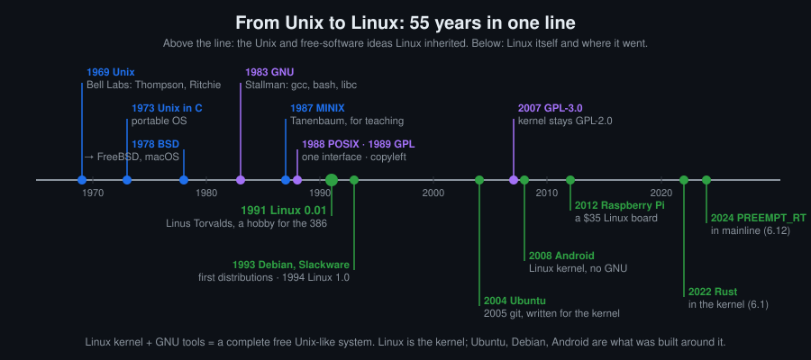
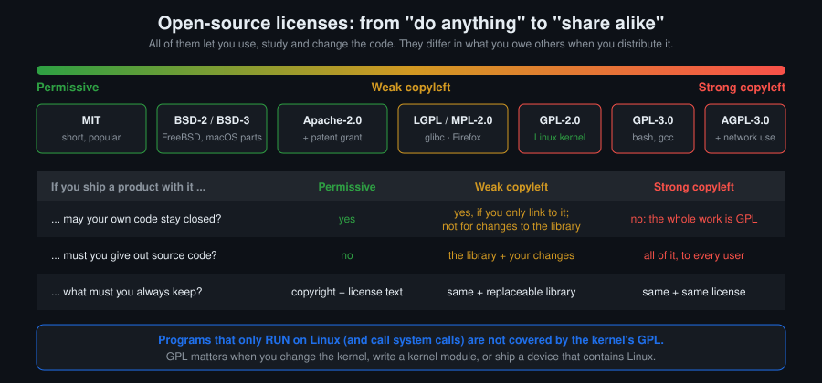
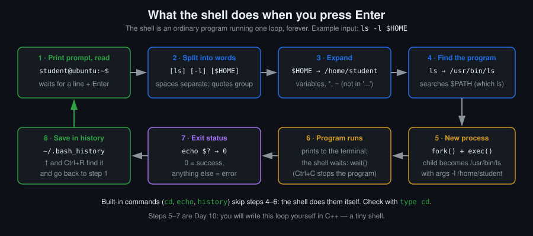

# Day 1: Introduction to Linux · Օր 1. Linux-ի ներածություն

## Objectives · Նպատակներ
- Բացատրել, թե ինչ է օպերացիոն համակարգը, և ինչ տեղ ունի Linux-ը Unix-ի ընտանիքում
- Պատմել Linux-ի ծագումը. Unix, GNU, MINIX, Linus Torvalds, POSIX
- Նկարագրել Linux kernel-ի կառուցվածքը (monolithic, modules) և համեմատել այն microkernel-ի հետ
- Տարբերել distribution-ները և ընտրել աշխատանքային միջավայր. WSL2, virtual machine, server, բորդ
- Բացատրել open source-ի գաղափարը և հիմնական license-ների տարբերությունը. MIT, BSD, Apache, LGPL, GPL
- Միանալ Linux համակարգին և կատարել առաջին հրամանները. shell, հրամանի կառուցվածք, history, օգնություն (`man`, `--help`)

## Key Concepts · Հիմնական գաղափարներ
- Operating system, kernel, Unix, GNU, POSIX
- Unix-ի փիլիսոփայությունը. «փոքր ծրագրեր, որոնք մեկ բան են անում լավ»
- Monolithic kernel, loadable modules, microkernel
- Distribution-ներ և դրանց ընտանիքներ
- Free software, open source, copyleft, permissive license
- Shell, prompt, command, option, argument
- `man`-ի բաժինները

## Definitions · Սահմանումներ

*Այսօր ներմուծվող տերմինները։ Նույն տեքստը կա [GLOSSARY.md](../GLOSSARY.md)-ում։*

**Operating system (օպերացիոն համակարգ)** — Ծրագրային շերտ hardware-ի և կիրառական ծրագրերի միջև։ Բաշխում է ռեսուրսները (CPU, հիշողություն, սարքեր) ծրագրերի միջև և նրանց տալիս է պարզ ինտերֆեյս՝ ֆայլեր, process-ներ, ցանց։

**Kernel (միջուկ)** — Օպերացիոն համակարգի կենտրոնական մասը, որն աշխատում է պրոցեսորի արտոնյալ ռեժիմում (kernel mode) և միակն է, որ ուղիղ դիմում է hardware-ին։ Linux-ը, խիստ իմաստով, միայն kernel է։

**Unix** — Օպերացիոն համակարգ, որը ստեղծվել է 1969 թ. AT&T-ի Bell Labs-ում (Ken Thompson, Dennis Ritchie)։ Multiuser և multitasking համակարգ է, որի գաղափարներն ու հրամանները ժառանգել են Linux-ը, BSD-ները և macOS-ը։

**GNU** — Richard Stallman-ի 1983 թ. հայտարարած նախագիծը՝ ստեղծել ազատ Unix-անման համակարգ։ GNU-ից են `bash`-ը, `gcc`-ն, `glibc`-ն, `ls`, `cp` և հարյուրավոր այլ ծրագրեր։ Linux kernel + GNU ծրագրեր = ամբողջական ազատ Unix-անման համակարգ։

**POSIX** — IEEE ստանդարտ, որը սահմանում է Unix-անման համակարգի ինտերֆեյսը. system call-եր, shell, հիմնական հրամաններ։ POSIX-ին համապատասխանող ծրագիրը հեշտությամբ տեղափոխվում է Linux-ից macOS կամ BSD և հակառակը։

**Monolithic kernel** — Kernel, որի բոլոր հիմնական մասերը (process-ների կառավարում, հիշողություն, ֆայլային համակարգեր, ցանց, driver-ներ) աշխատում են kernel space-ում՝ որպես մեկ ծրագիր։ Linux-ը monolithic է։

**Loadable kernel module** — Kernel-ի կոդի կտոր (սովորաբար driver), որը կարելի է բեռնել և հեռացնել աշխատող համակարգում՝ առանց վերագործարկման։ Ֆայլի ընդլայնումը `.ko` է, ցանկը՝ `lsmod`։

**Microkernel** — Kernel, որում kernel space-ում մնում է միայն նվազագույնը (process-ներ, հիշողություն, հաղորդագրություններ), իսկ driver-ները և ֆայլային համակարգերը աշխատում են որպես առանձին user space ծրագրեր։ Օրինակներ՝ MINIX 3, QNX, seL4։

**Distribution (դիստրիբուտիվ)** — Linux kernel-ը՝ GNU և այլ ծրագրերի, package manager-ի և կարգավորումների հետ միասին, պատրաստ տեղադրման համար։ Օրինակներ՝ Debian, Ubuntu, Fedora, Arch։

**Free software (ազատ ծրագիր)** — Ծրագիր, որը տալիս է չորս ազատություն. գործարկել ցանկացած նպատակով, ուսումնասիրել և փոխել կոդը, տարածել պատճենները, տարածել փոփոխված տարբերակները։ «Free»-ն այստեղ նշանակում է ազատություն, ոչ թե անվճար։

**Open source** — Ծրագիր, որի կոդը բաց է, և license-ը թույլ է տալիս այն օգտագործել, փոխել և տարածել։ Գործնականում նույն ծրագրերն են, ինչ free software-ը, բայց շեշտը գործնական օգուտի վրա է, ոչ թե ազատության։

**License** — Իրավական տեքստ, որն ասում է, թե ինչ կարելի է անել ծրագրի հետ և ինչ պայմաններով։ Առանց license-ի կոդը, նույնիսկ եթե այն հրապարակված է, օգտագործել չի կարելի։

**Permissive license** — License, որը թույլ է տալիս գրեթե ամեն ինչ, այդ թվում՝ օգտագործել կոդը փակ ծրագրում։ Պահանջում է միայն պահել հեղինակի անունը և license-ի տեքստը։ Օրինակներ՝ MIT, BSD, Apache 2.0։

**Copyleft** — License-ի պայման. եթե տարածում ես ծրագիրը կամ նրա փոփոխված տարբերակը, պետք է տարածես նույն license-ով և տաս կոդը։ GPL-ը ամենահայտնի copyleft license-ն է։

**SPDX identifier** — License-ի կարճ, ստանդարտ անունը, օրինակ `GPL-2.0-only` կամ `MIT`։ Linux kernel-ի յուրաքանչյուր ֆայլի առաջին տողում կա `SPDX-License-Identifier:` մեկնաբանություն։

**Tainted kernel** — Kernel, որը նշել է իր մեջ, որ աշխատում է «ոչ մաքուր» վիճակում. օրինակ՝ բեռնված է ոչ GPL module կամ եղել է սխալ։ Kernel-ի ծրագրավորողները նման kernel-ի սխալների հաղորդումները սովորաբար չեն քննարկում։ Վիճակը `/proc/sys/kernel/tainted`-ում է։

**Shell** — Ծրագիր, որը կարդում է մեր գրած հրամանները, մեկնաբանում և գործարկում է դրանք։ Միաժամանակ ծրագրավորման լեզու է՝ փոփոխականներով, պայմաններով և ցիկլերով։ Linux-ում ամենատարածվածը `bash`-ն է։

**Prompt** — Shell-ի տողը, որը սպասում է հրամանի. `student@ubuntu:~$`։ `$`-ը սովորական օգտատիրոջ նշանն է, `#`-ը՝ `root`-ինը։

**Option (switch)** — Հրամանի պարամետր, որը փոխում է նրա վարքը։ Ունի կարճ (`-u`) և երկար (`--universal`) ձև։

**Man page** — Հրամանի, system call-ի կամ ֆայլի ձևաչափի պաշտոնական նկարագրությունը, որը բացվում է `man`-ով։ Բաժանված է բաժինների. `1`՝ հրամաններ, `2`՝ system call-եր, `3`՝ գրադարանային ֆունկցիաներ, `5`՝ ֆայլերի ձևաչափեր, `8`՝ ադմինիստրատորի հրամաններ։

---

## 1. Ի՞նչ է Linux-ը

### Visual


Օպերացիոն համակարգը ծրագիր է, որը կանգնած է hardware-ի և մեր ծրագրերի միջև։ Առանց դրա յուրաքանչյուր ծրագիր ինքը պետք է իմանար, թե ինչպես կարդալ սկավառակից, ինչպես կիսել պրոցեսորը մյուս ծրագրերի հետ, ինչպես ուղարկել ցանցային փաթեթ։ OS-ը այդ ամենը վերցնում է իր վրա և ծրագրերին տալիս է պարզ գաղափարներ. **ֆայլ**, **process**, **socket**։

**Unix** (1969, Bell Labs). Ken Thompson-ը և Dennis Ritchie-ն գրեցին փոքր, multiuser և multitasking համակարգ։ 1973-ին այն վերագրվեց C լեզվով, որը Ritchie-ն ստեղծել էր հենց այդ նպատակով։ Դա առաջին OS-ն էր, որը կարելի էր համեմատաբար հեշտ տեղափոխել մի տեսակի համակարգչից մյուսը։ Unix-ի կոդը տարածվեց համալսարաններով, և Բերքլիում ստեղծվեց նրա ճյուղը՝ **BSD**-ն, որից հետագայում ծագեցին FreeBSD-ն, OpenBSD-ն և macOS-ի հիմքը (Darwin)։ Այդ պատճառով macOS-ի Terminal-ում աշխատում են գրեթե նույն հրամանները, ինչ Linux-ում։

**GNU** (1983). Unix-ը դարձավ առևտրային և փակ։ Richard Stallman-ը հայտարարեց GNU նախագիծը («GNU's Not Unix»)՝ ազատ Unix-անման համակարգ, և գրեց դրա համար **GPL** license-ը։ Մինչև 1990-ականների սկիզբը GNU-ն ուներ գրեթե ամեն ինչ՝ compiler (`gcc`), shell (`bash`), հիմնական հրամաններ, C գրադարան։ Բացակայում էր միայն աշխատող kernel-ը։

**MINIX** (1987). Andrew Tanenbaum-ը գրեց փոքր Unix-անման համակարգ՝ OS դասավանդելու համար, իր դասագրքի կոդով։ Այն microkernel էր և ուներ սահմանափակ license։

**Linux** (1991). Ֆինն ուսանող Linus Torvalds-ը, MINIX-ով աշխատելով, որոշեց գրել իր սեփական kernel-ը 386 պրոցեսորի համար։ 1991 թ. օգոստոսին նա հայտարարեց այն որպես «հոբբի, ոչ մեծ և պրոֆեսիոնալ, ինչպես GNU-ն»։ 1992-ին Linux-ն անցավ GPL license-ի, և GNU-ի ծրագրերը kernel-ի հետ միասին կազմեցին ամբողջական ազատ համակարգ։ Այդ պատճառով որոշ մարդիկ ասում են **GNU/Linux**։

**POSIX** (1988). Unix-ի շատ տարբերակներ կային, և ծրագրերը մեկից մյուսը տեղափոխելը դժվար էր։ IEEE-ն ստանդարտացրեց ինտերֆեյսը՝ POSIX։ Linux-ը և BSD-ները ձգտում են համապատասխանել POSIX-ին, և այս դասընթացի ծրագրերը մեծ մասամբ կաշխատեն նաև macOS-ում։

Այսօր Linux-ն աշխատում է սերվերների մեծ մասում, 2017-ից ի վեր աշխարհի 500 ամենահզոր սուպերհամակարգիչներից բոլորում, Android հեռախոսներում (Android-ն օգտագործում է Linux kernel, բայց ոչ GNU ծրագրերը), ցանցային սարքերում, մեքենաներում և embedded բորդերում։

## 2. Unix-ի փիլիսոփայությունը

Doug McIlroy-ն, Unix-ի pipe-ի հեղինակը, ամփոփեց Unix-ի ծրագրերի գրելաձևը երեք կանոնով։ Մեր բառերով.

1. **Յուրաքանչյուր ծրագիր թող մեկ բան անի, բայց լավ։** Նոր խնդրի համար գրիր նոր ծրագիր, հին ծրագրին նոր հնարավորություններ ավելացնելու փոխարեն։
2. **Ծրագրի ելքը թող լինի ուրիշ ծրագրի մուտք**, որը դեռ գոյություն չունի։ Մի խառնիր ելքը ավելորդ տեքստով, մի պահանջիր ինտերակտիվ մուտք։
3. **Օգտագործիր գործիքներ** աշխատանքը հեշտացնելու համար, նույնիսկ եթե նախ պետք է այդ գործիքները գրել։

Այդ պատճառով Linux-ում կան հարյուրավոր փոքր հրամաններ, որոնք միանում են իրար `|`-ով.

| Խումբ | Հրամաններ | Օր |
|---|---|---|
| Համակարգի մասին | `whoami`, `hostname`, `date`, `cal`, `free`, `w`, `uptime`, `uname` | 1 |
| Օգնություն | `man`, `info`, `--help`, `which` | 1 |
| Shell | `bash`, `echo`, `history`, `alias`, `set`, `env` | 1–2 |
| Ֆայլային համակարգ | `ls`, `cd`, `pwd`, `mkdir`, `mv`, `cp`, `ln`, `touch`, `cat`, `file`, `find`, `du`, `df` | 2–3 |
| Ֆիլտրեր | `grep`, `head`, `tail`, `less`, `sort`, `uniq`, `wc`, `cut` | 4 |
| Տողերի խմբագրում | `sed`, `awk` | 4 |
| Արխիվներ | `tar`, `gzip`, `xz`, `zip` | 5 |
| Իրավունքներ | `chmod`, `chown`, `sudo`, `umask` | 7 |
| Process-ներ | `ps`, `top`, `kill`, `fg`, `bg`, `systemctl` | 8 |
| Ցանց | `ssh`, `scp`, `ping`, `ip`, `ss`, `nc`, `curl` | 1, 11 |

Մի փորձիր հիշել դրանք միանգամից։ Ամեն օր կավելացնենք մի խումբ։

## 3. Linux kernel-ի կառուցվածքը

### Visual


Linux kernel-ը **monolithic** է. բոլոր հիմնական ենթահամակարգերը մեկ ծրագիր են և աշխատում են kernel space-ում.

- **System call interface**՝ դուռը user space-ից դեպի kernel (`open`, `read`, `fork`...)
- **Process management և scheduler**՝ ով, երբ և որ CPU-ի վրա աշխատի (Օր 8, 10)
- **Memory management**՝ վիրտուալ հիշողություն, page-եր, swap
- **VFS (Virtual File System)**՝ մեկ ինտերֆեյս բոլոր ֆայլային համակարգերի համար (ext4, FAT, NFS, `/proc`) (Օր 3)
- **Network stack**՝ TCP/IP, socket-ներ (Օր 11)
- **Device drivers**՝ կոդ կոնկրետ սարքերի համար (Օր 9)

Monolithic լինելու առավելությունը արագությունն է. ենթահամակարգերը կանչում են իրար ուղիղ, ինչպես սովորական ֆունկցիաներ։ Թերությունը. driver-ի մեկ սխալը կարող է կանգնեցնել ամբողջ համակարգը։

**Microkernel**-ում kernel-ը շատ փոքր է, իսկ driver-ները և ֆայլային համակարգերը առանձին process-ներ են։ Driver-ի սխալը կանգնեցնում է միայն այդ process-ը, որը կարելի է վերագործարկել։ Գինը. ամեն գործողություն պահանջում է հաղորդագրություններ process-ների միջև, և դա ավելի դանդաղ է։ QNX-ը (microkernel) լայնորեն օգտագործվում է մեքենաներում և արդյունաբերական սարքերում, որտեղ հուսալիությունն ավելի կարևոր է։ 1992-ին Tanenbaum-ը և Torvalds-ը հայտնի բանավեճ ունեցան այս թեմայով, և դրա փաստարկները արդիական են մինչև այսօր։

Linux-ը մասամբ լուծում է monolithic-ի ճկունության խնդիրը **module**-ներով. driver-ը կարելի է բեռնել և հեռացնել առանց վերագործարկման.

```bash
lsmod | head                  # բեռնված module-ները
modinfo ext4 | head           # module-ի մասին. ֆայլը, license-ը, հեղինակը
```

Linux-ի հիմնական հատկությունները.

- **Multiuser**՝ շատ օգտատերեր միաժամանակ, յուրաքանչյուրն իր իրավունքներով (Օր 7)
- **Multitasking, preemptive**՝ kernel-ը կարող է ցանկացած պահի ընդհատել process-ը և CPU-ն տալ մյուսին
- **Portable**՝ աշխատում է x86, ARM, RISC-V, PowerPC և տասնյակ այլ architecture-ների վրա
- **«Ամեն ինչ ֆայլ է»**՝ սարքերը, process-ների տեղեկությունը, kernel-ի պարամետրերը երևում են որպես ֆայլեր (Օր 3, 9)

Kernel-ի տարբերակը և այն, թե ինչով է այն հավաքվել.

```bash
uname -r                      # 6.8.0-49-generic
cat /proc/version             # Linux version 6.8.0-49-generic (buildd@...) (gcc-12 ...) #49-Ubuntu SMP ...
```

`/proc/version`-ը ցույց է տալիս, որ kernel-ը նույնպես սովորական C ծրագիր է, որը ինչ-որ մեկը հավաքել է `gcc`-ով։ Կոդը բաց է. [git.kernel.org](https://git.kernel.org/)։

## 4. Distribution-ներ

Kernel-ը միայնակ անօգուտ է. պետք են shell, հրամաններ, գրադարաններ, package manager։ Distribution-ը դրանք հավաքում, ստուգում և թարմացնում է։

| Ընտանիք | Distribution-ներ | Package manager | Որտեղ ենք հանդիպում |
|---|---|---|---|
| Debian | Debian, **Ubuntu**, Linux Mint, Raspberry Pi OS, NVIDIA L4T | `apt`, `.deb` | Այս դասընթացը, desktop, սերվեր, բորդեր |
| Red Hat | Fedora, RHEL, Rocky Linux, AlmaLinux, CentOS Stream | `dnf`, `.rpm` | Ընկերությունների սերվերներ, կլաստերներ |
| Arch | Arch Linux, Manjaro | `pacman` | Փորձառու օգտատերեր |
| Alpine | Alpine Linux | `apk` | Docker container-ներ (շատ փոքր է) |
| Embedded | Yocto, Buildroot | ինքդ ես հավաքում | Արտադրանքներ, բորդեր |
| Android | Android | `.apk` | Հեռախոսներ (Linux kernel, առանց GNU-ի) |

Դասընթացում կօգտագործենք **Ubuntu** (22.04 կամ 24.04)։ Ստուգել, թե ինչի վրա ես.

```bash
cat /etc/os-release
# PRETTY_NAME="Ubuntu 24.04.1 LTS"
# ID=ubuntu
# ID_LIKE=debian        ← ընտանիքը
```

**LTS (Long Term Support)** տարբերակները թարմացումներ են ստանում 5 տարի և ավելի։ Դրանք են դրվում սերվերներում և բորդերում։

## 5. Open source և license-ներ

### Visual


Կոդը, նույնիսկ GitHub-ում հրապարակված, ավտոմատ «ազատ» չէ։ Հեղինակային իրավունքը պատկանում է հեղինակին, և միայն **license**-ն է թույլ տալիս ուրիշներին այն օգտագործել։ License-ները երկու մեծ խումբ են.

**Permissive** (MIT, BSD, Apache 2.0). Կարող ես անել գրեթե ամեն ինչ, այդ թվում՝ օգտագործել փակ, վաճառվող ծրագրում։ Պետք է պահել հեղինակի անունը և license-ի տեքստը։ Apache 2.0-ն բացի դրանից տալիս է patent-ների օգտագործման թույլտվություն։

**Copyleft** (GPL, LGPL, AGPL). Կարող ես օգտագործել և փոխել, բայց եթե **տարածում** ես ծրագիրը (վաճառում, ուղարկում, տեղադրում սարքի մեջ), պետք է տաս նաև կոդը՝ նույն license-ով։ Նպատակն է, որ ազատ կոդը մնա ազատ։

- **GPL-2.0** — Linux kernel-ի license-ը։ Kernel-ը `GPL-2.0-only` է, և դրա ֆայլերի գլխին կա `SPDX-License-Identifier: GPL-2.0` տողը։
- **GPL-3.0** — ավելացնում է պաշտպանություն patent-ներից և այսպես կոչված «tivoization»-ից. սպառողական սարքում GPL-3.0 ծրագիր տեղադրողը պետք է տա նաև փոփոխված տարբերակը սարքում տեղադրելու տեղեկությունները։
- **LGPL** — «թույլ» copyleft գրադարանների համար։ Փակ ծրագիրը կարող է link անել LGPL գրադարանի հետ (օրինակ՝ `glibc`-ի), պետք է միայն թույլ տալ գրադարանը փոխարինել։
- **AGPL-3.0** — GPL, որը գործում է նաև այն դեպքում, երբ ծրագիրը տարածվում չէ, այլ աշխատում է սերվերում և հասանելի է ցանցով։

**Կարևոր պարզաբանում ծրագրավորողի համար.** Linux kernel-ի GPL-ը **չի** տարածվում այն ծրագրերի վրա, որոնք աշխատում են Linux-ի վրա և կանչում են system call-եր։ Kernel-ի license-ին կցված է հատուկ նշում հենց այդ մասին։ Քո C++ ծրագիրը, որը կարդում է ֆայլեր Linux-ում, կարող է ունենալ ցանկացած license։ GPL-ը կարևոր է դառնում, երբ.

- փոխում ես kernel-ը կամ գրում ես kernel module (Օր 9 և embedded դասընթացի Օր 3),
- տարածում ես սարք, որում կա Linux (router, տեսախցիկ, բորդ). պետք է տաս kernel-ի և GPL ծրագրերի կոդը՝ քո փոփոխություններով,
- քո կոդի մեջ պատճենում ես GPL կոդ։

Kernel-ն ինքը հետևում է module-ների license-ներին։ Յուրաքանչյուր module հայտարարում է իր license-ը (`MODULE_LICENSE("GPL")`), և ոչ GPL module-ը.

- չի կարող օգտագործել kernel-ի որոշ ֆունկցիաներ (որոնք արտահանված են `EXPORT_SYMBOL_GPL`-ով),
- բեռնվելիս kernel-ը նշում է որպես **tainted** (`P` դրոշ)։

```bash
cat /proc/sys/kernel/tainted          # 0 նշանակում է՝ ամեն ինչ GPL է, սխալներ չեն եղել
modinfo -F license ext4               # GPL
```

Լաբորատորիայում կգրես ծրագիր, որը վերծանում է այս թիվը։

**Ինչպես ընտրել license քո նախագծի համար.** Եթե ուզում ես, որ բոլորը ազատ օգտագործեն՝ MIT։ Եթե ուզում ես, որ փոփոխությունները նույնպես բաց մնան՝ GPL։ Եթե աշխատում ես ընկերությունում կամ համալսարանի նախագծում՝ հարցրու, թե ինչ է ընդունված, մինչև կոդ հրապարակելը։ Մանրամասն համեմատությունը. [choosealicense.com](https://choosealicense.com/)։

## 6. Աշխատանքային միջավայր

Դասընթացի համար պետք է Linux համակարգ։ Տարբերակները.

| Տարբերակ | Ինչպես | Առավելություն | Թերություն |
|---|---|---|---|
| **WSL2** (Windows) | PowerShell-ում `wsl --install`, ապա Microsoft Store-ից Ubuntu | Արագ, աշխատում է Windows-ի կողքին, իրական Linux kernel | Hardware-ին (USB, GPIO) հասանելիությունը սահմանափակ է |
| **Virtual machine** | VirtualBox կամ VMware, Ubuntu-ի ISO | Ամբողջական համակարգ, snapshot-ներ | Ավելի շատ հիշողություն է պահանջում |
| **Native / dual boot** | Ubuntu USB flash-ից | Ամենաարագը, ամբողջ hardware-ը | Վտանգ՝ սխալ տեղադրելիս կորցնել տվյալներ |
| **Հեռավոր սերվեր** | `ssh user@server` | Ոչինչ տեղադրել պետք չէ | Պետք է ցանց և հաշիվ |
| **Embedded բորդ** | Jetson, Raspberry Pi, HummingBoard | Իրական hardware | Տե՛ս [embedded դասընթացը](../../embedded/README.md) |

macOS-ում Terminal-ը արդեն Unix է (BSD-ից), և հրամանների մեծ մասն աշխատում է, բայց `/proc`-ը և Linux-ի system call-երի մի մասը չկան։ Այս դասընթացի համար օգտագործիր VM կամ հեռավոր սերվեր։

Առաջին անգամ Ubuntu-ում.

```bash
sudo apt update
sudo apt install -y build-essential cmake git man-db manpages-dev ncal netcat-openbsd
```

`manpages-dev`-ը ավելացնում է system call-երի man page-երը (`man 2 ...`), `ncal`-ը՝ `cal` հրամանը, `netcat-openbsd`-ը՝ `nc`-ը։

### Միանալ այլ Linux համակարգի

Սերվերների և կլաստերների հետ աշխատում ենք **client-server** ձևով. դու նստած ես քո համակարգչի (client) առջև և **SSH**-ով միանում ես սերվերին.

```bash
ssh student@192.168.1.10      # առաջին անգամ հաստատիր սերվերի key-ը՝ yes
```

Եթե միանալ չի ստացվում, ստուգիր քայլ առ քայլ.

```bash
ping -c 3 192.168.1.10        # սերվերը ցանցում հասանելի՞ է
nc -vz 192.168.1.10 22        # SSH-ի port 22-ը բա՞ց է
```

Windows-ում `ssh`-ը կա PowerShell-ում, իսկ գրաֆիկական տարբերակը PuTTY-ն է։

**Փորձ. ձեռքով «զրուցել» web սերվերի հետ։** Շատ ինտերնետային արձանագրություններ պարզ տեքստ են։ `nc`-ով կարող ես ուղարկել նույն տեքստը, ինչ browser-ը.

```bash
printf 'GET / HTTP/1.1\r\nHost: example.com\r\nConnection: close\r\n\r\n' | nc example.com 80
```

Պատասխանը HTTP header-ներն են և HTML էջը՝ նույնը, ինչ browser-ը ստանում և նկարում է։ Սա ցանցի մասին Օր 11-ի նախաբանն է։

## 7. Shell. առաջին հրամանները

### Visual


**Shell**-ը ծրագիր է, որը կարդում է քո հրամանը, մեկնաբանում է այն և գործարկում։ Միաժամանակ այն ծրագրավորման լեզու է (Օր 6)։ Ubuntu-ում լռելյայն shell-ը `bash`-ն է.

```bash
echo $SHELL                   # /bin/bash
which bash                    # /usr/bin/bash. որտեղ է ծրագիրը
```

Չակերտների տարբերությունը.

```bash
echo $SHELL                   # /bin/bash      shell-ը բացում է փոփոխականը
echo "$SHELL"                 # /bin/bash      կրկնակի չակերտներում նույնպես
echo '$SHELL'                 # $SHELL         միակ չակերտներում ամեն ինչ բառացի է
```

Համակարգի մասին առաջին հարցերը.

```bash
whoami                        # ով եմ ես
hostname                      # համակարգչի անունը
date                          # ամսաթիվը և ժամը
cal                           # այս ամսվա օրացույցը
free -h                       # հիշողությունը, մարդու համար հարմար միավորներով
w                             # ով է մուտք գործել և ինչ է անում
uptime                        # որքան ժամանակ է աշխատում համակարգը
```

### Հրամանի կառուցվածքը

Հրամանն ունի երեք մաս.

```
cal   -j   3 1999
│     │    └──┴── argument-ներ (parameters)՝ ինչի հետ աշխատել. մարտ, 1999
│     └── option (switch)՝ ինչպես աշխատել. -j՝ տարվա օրերի համարներով
└── հրամանը
```

Option-ները հաճախ ունեն կարճ և երկար ձև.

```bash
date -u                       # կարճ
date --universal              # երկար, նույն իմաստով. ավելի հասկանալի script-երում
ls -l -a ; ls -la             # կարճ option-ները կարելի է միացնել
```

Linux-ը տարբերում է մեծատառն ու փոքրատառը. `ls -l`-ը և `ls -L`-ը տարբեր option-ներ են, `File.txt`-ը և `file.txt`-ը՝ տարբեր ֆայլեր։

### History և տողի խմբագրում

`bash`-ը հիշում է քո հրամանները (`~/.bash_history` ֆայլում).

```bash
history                       # ցանկը համարներով
!42                           # կրկնել 42-րդ հրամանը
!!                            # կրկնել վերջին հրամանը
sudo !!                       # վերջին հրամանը, բայց sudo-ով
```

| Ստեղն | Գործողություն |
|---|---|
| **↑ / ↓** | Նախորդ / հաջորդ հրամանը |
| **Ctrl+R** | Փնտրել history-ում. գրիր բառի մի մասը, նորից Ctrl+R՝ հաջորդ արդյունքը |
| **Tab** | Լրացնել հրամանի կամ ֆայլի անունը |
| **Ctrl+A / Ctrl+E** | Տողի սկիզբ / վերջ |
| **Alt+F / Alt+B** | Մեկ բառ առաջ / հետ |
| **Ctrl+U / Ctrl+K** | Ջնջել մինչև տողի սկիզբը / վերջը |
| **Ctrl+W** | Ջնջել նախորդ բառը |
| **Ctrl+C** | Կանգնեցնել աշխատող հրամանը |
| **Ctrl+D** | Դատարկ տողում՝ փակել shell-ը |
| **Ctrl+L** | Մաքրել էկրանը |

Սրանք նույն ստեղներն են, ինչ Emacs խմբագրիչում, և աշխատում են նաև շատ այլ ծրագրերում (`python3`, `gdb`)։

### Օգնություն

```bash
hostname --help               # կարճ օգնություն. ծրագրի մեծ մասն ունի
man hostname                  # ամբողջական ձեռնարկ
info hostname                 # GNU-ի ձեռնարկները. երբեմն ավելի մանրամասն
```

`man`-ում. **Space**՝ հաջորդ էջ, **b**՝ նախորդ, **/բառ**՝ փնտրել, **n**՝ հաջորդ արդյունքը, **q**՝ դուրս գալ։

Man page-երը բաժանված են **բաժինների**, և նույն անունը կարող է լինել մի քանի բաժնում.

| Բաժին | Ինչ կա | Օրինակ |
|---|---|---|
| 1 | Հրամաններ | `man 1 uname`, `man ls` |
| 2 | System call-եր | `man 2 uname`, `man 2 open` |
| 3 | C գրադարանի ֆունկցիաներ | `man 3 printf`, `man 3 getenv` |
| 5 | Ֆայլերի ձևաչափեր | `man 5 passwd`, `man 5 os-release` |
| 7 | Ընդհանուր նկարագրություններ | `man 7 signal`, `man 7 man-pages` |
| 8 | Ադմինիստրատորի հրամաններ | `man 8 mount`, `man 8 lsmod` |

`man uname`-ը կբացի բաժին 1-ը (հրամանը), իսկ C ծրագրի համար մեզ պետք է `man 2 uname`-ը (system call-ը)։ Եթե չգիտես անունը՝ `man -k բառ` (կամ `apropos բառ`) փնտրում է բոլոր նկարագրություններում։ Եվ, իհարկե, կարելի է փնտրել ինտերնետում. պաշտոնական տարբերակը [man7.org](https://man7.org/linux/man-pages/)-ում է։

### Առաջին pipe

`|` նշանը մի հրամանի **ելքը** տալիս է մյուսի **մուտքին**։ Ամենապարզ օգտագործումը ֆիլտրելն է.

```bash
w                                     # բոլոր օգտատերերը
w | grep root                         # միայն root-ի տողերը
ps -e -o ruser,comm | grep bash       # ով է աշխատեցնում bash
```

`ps`-ն այստեղ ունի և՛ option-ներ (`-e`՝ բոլոր process-ները, `-o`՝ ինչ սյունակներ), և՛ argument (`ruser,comm`)։ Pipe-երի և ֆիլտրերի մանրամասները Օր 4-ում են։

---

## Commands · Հրամաններ

*Ամփոփում. այս օրվա հրամանները, որոնք բացատրված են վերևում։ Անգիր անել պետք չէ. վերադարձիր այստեղ, երբ մոռանաս գրելաձևը։ Բոլոր օրերի հրամանների ցանկը [COMMANDS.md](../COMMANDS.md)-ում է։*

```bash
# Ով, որտեղ, ինչ համակարգ
whoami ; hostname ; date ; cal ; free -h ; w ; uptime
uname -a                      # kernel-ի անունը, տարբերակը, architecture-ը
cat /proc/version             # ինչով և երբ է հավաքվել kernel-ը
cat /etc/os-release           # distribution-ը
cat /proc/sys/kernel/tainted  # 0՝ kernel-ը «մաքուր» է

# Shell
echo $SHELL ; which bash      # որ shell-ն է, որտեղ է
echo "$SHELL" ; echo '$SHELL' # "..."-ում փոփոխականը բացվում է, '...'-ում՝ ոչ

# Հրամանի կառուցվածքը
cal -j 3 1999                 # հրաման, option, երկու argument
date -u ; date --universal    # կարճ և երկար option-ներ

# History և խմբագրում
history ; !42 ; !!            # ցանկը, 42-րդ հրամանը, վերջին հրամանը
# Ctrl+R՝ փնտրել, Ctrl+A / Ctrl+E՝ տողի սկիզբ / վերջ, Ctrl+U / Ctrl+K՝ ջնջել մինչև սկիզբ / վերջ

# Օգնություն
hostname --help ; man hostname ; info hostname
man 1 uname ; man 2 uname     # uname հրամանը և uname() system call-ը
man -k partition              # փնտրել բոլոր man page-երում

# Առաջին pipe
w | grep root
ps -e -o ruser,comm | grep bash

# Միանալ այլ Linux համակարգի
ssh student@192.168.1.10
ping -c 3 192.168.1.10        # հասանելի՞ է
nc -vz 192.168.1.10 22        # բա՞ց է SSH port-ը
```

## Functions · Ֆունկցիաներ

*Ամփոփում. այս օրվա C/C++ ֆունկցիաները։ Ամբողջական ցանկը [API.md](../API.md)-ում է։*

```c
#include <sys/utsname.h>
// Լրացնում է struct utsname-ը. sysname, nodename, release, version, machine։
// Հաջողության դեպքում՝ 0, սխալի դեպքում՝ -1 և errno
int uname(struct utsname *buf);

#include <string.h>
// errno-ի թվային կոդը դարձնում է տեքստ. ENOENT → "No such file or directory"
char *strerror(int errnum);

// common/sys_check.h
// Փաթաթում է system call-ը. եթե այն վերադարձրեց -1, տպում է ֆայլը, տողը,
// կանչը և strerror(errno), ապա ավարտում ծրագիրը
SYS_CHECK(call);
```

## Resources · Աղբյուրներ
- [Introduction to Linux](http://www.bu.edu/tech/files/2012/09/Introduction-to-Linux.pptx), Boston University IS&T. դասի սլայդները. 1–31 սլայդները՝ այսօրվա նյութը, մնացածը՝ Օր 3, 4, 6, 7
- [The Linux Command Line](https://linuxcommand.org/tlcl.php), William Shotts. անվճար գիրք, Մաս 1
- [What is Free Software?](https://www.gnu.org/philosophy/free-sw.html), GNU
- [Licenses](https://opensource.org/licenses), Open Source Initiative
- [Linux kernel licensing rules](https://docs.kernel.org/process/license-rules.html)
- [Tainted kernels](https://docs.kernel.org/admin-guide/tainted-kernels.html)
- [choosealicense.com](https://choosealicense.com/). license-ների պարզ համեմատություն
- [Linux man pages](https://man7.org/linux/man-pages/)
- [Install WSL](https://learn.microsoft.com/windows/wsl/install)

## Hands-On Task · Գործնական առաջադրանք

Պատրաստիր աշխատանքային միջավայրը և քո kernel-ի «անձնագիրը»։

1. Տեղադրիր Ubuntu (WSL2, VM կամ native) և կատարիր [§6](#6-աշխատանքային-միջավայր)-ի `apt install` հրամանը։
2. Կատարիր [Commands](#commands--հրամաններ) բաժնի բոլոր հրամանները և ամեն մեկի համար մեկ նախադասությամբ գրիր, թե ինչ տպեց։
3. Լրացրու [`template.cpp`](template.cpp)-ի TODO-ները. ծրագիրը պետք է տպի kernel-ի տարբերակը, ով է այն հավաքել, distribution-ը և ընտանիքը, բեռնված module-ների քանակը և taint դրոշները՝ վերծանված։
4. Համեմատիր ծրագրի ելքը `uname -a`-ի, `cat /proc/version`-ի և `lsmod | wc -l`-ի հետ։

## Self-Learning · Ինքնուրույն աշխատանք
1. Գտիր Linus Torvalds-ի 1991 թ. օգոստոսի 25-ի նամակը `comp.os.minix` խմբին և կարդա այն։ Ի՞նչ architecture-ի համար էր kernel-ը, և ինչ էր նա ասում portability-ի մասին։
2. `man man`. կարդա բաժինների ցանկը։ Գտիր `printf`-ը երեք բաժնում (`man -a printf` կամ `man -k printf`)։ Ինչո՞վ են դրանք տարբերվում։
3. Գործարկիր `cal 9 1752`։ Ինչու՞ են այդ ամսում 11 օր բացակայում։
4. Գտիր քո համակարգի 5 ամենամեծ module-ները. `lsmod | sort -k2 -n | tail -5`։ Յուրաքանչյուրի համար `modinfo -F description`-ով պարզիր, թե ինչ սարքի համար է։
5. Գտիր 3 ծրագիր քո համակարգում և պարզիր դրանց license-ը. `ls /usr/share/doc/bash/` և `cat /usr/share/doc/bash/copyright`։ Ի՞նչ license ունեն `bash`-ը, `openssh-client`-ը և `zlib1g`-ը։
6. Ներբեռնիր Linux kernel-ի կոդի ցանկացած ֆայլ [git.kernel.org](https://git.kernel.org/)-ից և գտիր `SPDX-License-Identifier` տողը։
7. Գրիր `printf ... | nc example.com 80` փորձը, ապա փոխիր `Host:`-ը գոյություն չունեցող անունով։ Ի՞նչ պատասխան տվեց սերվերը և ինչ HTTP կոդով։
8. Տեղադրիր `zsh` և `fish` (`sudo apt install zsh fish`), գործարկիր դրանք և համեմատիր `bash`-ի հետ։ Վերադառնալու համար՝ `exit`։

## Self-Check · Ինքնաստուգում
Պատասխաններ չկան։ Մտածիր ինքնուրույն։

1. Ի՞նչ տարբերություն կա «Linux»-ի, «GNU/Linux»-ի և «Ubuntu»-ի միջև։
2. Android-ը Linux է՞։ Ի՞նչ ունի ընդհանուր Ubuntu-ի հետ, և ինչով է տարբերվում։
3. Ինչու՞ macOS-ի Terminal-ում աշխատում են գրեթե նույն հրամանները, ինչ Linux-ում, թեև macOS-ը Linux չէ։
4. Linux-ի driver-ում սխալը կարող է կանգնեցնել ամբողջ համակարգը, իսկ QNX-ում՝ ոչ։ Ինչու՞։ Ինչու՞ է այդ դեպքում Linux-ն ավելի տարածված։
5. Ընկերությունը վաճառում է Wi-Fi router, որում Linux է։ Ինչ պարտավորություններ ունի GPL-ի պատճառով։ Իսկ եթե router-ի web ինտերֆեյսը իր սեփական փակ ծրագիրն է, որն աշխատում է user space-ում։
6. Կարելի՞ է MIT license-ով գրադարանը օգտագործել GPL ծրագրում։ Իսկ GPL գրադարանը՝ MIT ծրագրում։
7. `/proc/sys/kernel/tainted` = `4097`։ Ի՞նչ դրոշներ են դրված։ Ի՞նչ կարող էր պատահել։
8. Ինչու՞ `echo '$HOME'`-ը և `echo "$HOME"`-ը տարբեր բան են տպում։
9. `man uname` և `man 2 uname`. ինչու՞ են տարբեր, և որ մեկն է պետք C ծրագիր գրելիս։
10. SSH-ով միանալ չի ստացվում։ Ի՞նչ հերթականությամբ կստուգես խնդիրը, և ինչ է ցույց տալիս յուրաքանչյուր քայլը։

## Code Template · Կոդի ձևանմուշ
Տե՛ս [`template.cpp`](template.cpp)-ը։ Այն օգտագործում է [`common/sys_check.h`](../common/sys_check.h)-ը system call-երի սխալները ստուգելու համար։

```bash
g++ -std=c++17 -Wall -Wextra -O2 template.cpp -o day01 && ./day01
# կամ բոլոր օրերը միանգամից, linux/ թղթապանակից.
cmake -S . -B build && cmake --build build && ./build/bin/day01
```
