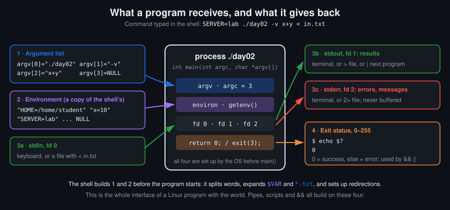
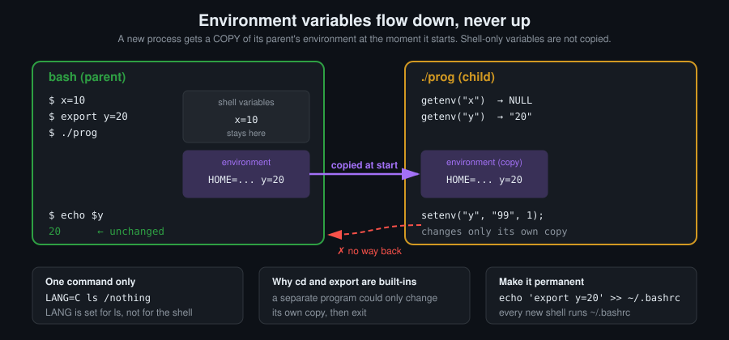

# Day 2: The Shell and the Program's Environment · Օր 2. Shell-ը և ծրագրի environment-ը

## Objectives · Նպատակներ
- Բացատրել, թե ինչ է ստանում ծրագիրը գործարկվելիս. argument-ների ցանկ, environment, երեք ստանդարտ stream, և ինչ է վերադարձնում՝ exit status
- Կարդալ argument-ները C/C++-ում (`argc`, `argv`) և մշակել option-ները `getopt_long`-ով՝ GNU-ի կանոններով
- Տարբերել `stdout`-ը և `stderr`-ը, ուղղորդել դրանք ֆայլ (`>`, `2>`, `2>&1`) և բացատրել buffering-ը
- Օգտագործել exit status-ը shell-ում (`$?`, `&&`, `||`, `!`) և ճիշտ exit code վերադարձնել ծրագրից
- Տարբերել shell-ի variable-ը environment variable-ից, օգտագործել `export`, `env`, `PATH`-ը, և բացատրել, թե ինչպես է environment-ը ժառանգվում
- Օգտագործել համակարգի մասին տեղեկություն տվող հրամանները. `who`, `tty`, `last`, `stat`, `du`, `df`, `vmstat`, `lsof`, `strace`, `dmesg`

## Key Concepts · Հիմնական գաղափարներ
- Argument list. `argc`, `argv`, short և long option-ներ
- Standard streams. file descriptor-ներ 0, 1, 2
- Redirection և buffering
- Exit status. `$?`, հատուկ կոդեր (126, 127, 128+n)
- Shell variable, environment variable, `export`, ժառանգում
- `PATH` և հրամանների որոնումը
- Ժամանակավոր ֆայլեր. `mktemp`, `mkstemp`

## Definitions · Սահմանումներ

*Այսօր ներմուծվող տերմինները։ Նույն տեքստը կա [GLOSSARY.md](../GLOSSARY.md)-ում։*

**Argument list** — Բառերի ցանկը, որ ծրագիրը ստանում է գործարկվելիս՝ ներառյալ իր անունը։ `ls -s /` հրամանի դեպքում `ls`-ը ստանում է երեք տարր. `ls`, `-s`, `/`։ C/C++-ում հասանելի է `main`-ի `argc` (քանակը) և `argv` (տողերի զանգվածը) պարամետրերով։

**Short option / long option** — GNU-ի կանոնով option-ը ունի կարճ ձև՝ մեկ գծիկ և մեկ տառ (`-v`), և երկար ձև՝ երկու գծիկ և բառ (`--verbose`)։ Կարճը արագ է գրելու, երկարը՝ հեշտ կարդալու script-երում։

**Standard streams** — Երեք stream, որոնք բաց են յուրաքանչյուր process-ում սկզբից. **stdin** (մուտք, file descriptor 0), **stdout** (ելք, 1), **stderr** (սխալներ, 2)։ Լռելյայն երեքն էլ կապված են terminal-ին։

**File descriptor** — Փոքր ամբողջ թիվ, որով process-ը դիմում է բաց ֆայլին, pipe-ին կամ սարքին։ 0, 1, 2-ը ստանդարտ stream-ներն են, հաջորդ բացված ֆայլը ստանում է 3։

**Redirection** — Shell-ի գործողություն, որը փոխում է, թե ուր են գնում հրամանի stream-ները. `>` (stdout ֆայլ), `2>` (stderr ֆայլ), `<` (stdin ֆայլից), `2>&1` (stderr այնտեղ, ուր stdout-ը)։

**Buffering** — `stdout`-ի տվյալները նախ հավաքվում են memory-ի մեջ և ուղարկվում մեծ կտորներով. երբ buffer-ը լցվում է, երբ տող է ավարտվում (terminal-ի դեպքում) կամ ծրագիրը ավարտվում է։ `stderr`-ը buffer չունի և տպում է անմիջապես։

**Exit status (exit code)** — 0-ից 255 թիվ, որ ծրագիրը վերադարձնում է ավարտվելիս. `0`՝ հաջող, մնացածը՝ սխալ։ C/C++-ում դա `main`-ի վերադարձրած արժեքն է կամ `exit()`-ի argument-ը, shell-ում՝ `$?`-ը։

**Shell variable** — Variable, որ գոյություն ունի միայն ընթացիկ shell-ում. `x=10`։ Shell-ից գործարկված ծրագրերը այն չեն տեսնում։

**Environment variable** — Անուն=արժեք զույգ, որը process-ը ժառանգում է իր parent-ից և փոխանցում իր child-ներին։ Shell-ի variable-ը դառնում է environment variable `export`-ով։ Ըստ սովորության անունները գրվում են մեծատառերով. `HOME`, `PATH`, `USER`։

**Environment** — Process-ի բոլոր environment variable-ների ամբողջությունը։ Memory-ի մեջ այն `"NAME=value"` տողերի զանգված է, որի վերջում `NULL` է։ C-ում հասանելի է `environ` գլոբալ variable-ով։

**`PATH`** — Environment variable, որը պարունակում է directory-ների ցանկ՝ `:`-ով բաժանված։ Երբ գրում ես `ls`, shell-ը փնտրում է `ls` անունով ծրագիր այդ directory-ներում՝ հերթով։

**Built-in command** — Հրաման, որը shell-ն ինքն է կատարում՝ առանց նոր ծրագիր գործարկելու. `cd`, `export`, `echo`, `exit`։ `cd`-ն չի կարող լինել առանձին ծրագիր. առանձին process-ը չի կարող փոխել shell-ի ընթացիկ directory-ն։

**Temporary file** — Ֆայլ՝ տվյալները կարճ ժամանակով պահելու համար, սովորաբար `/tmp`-ում։ Անունը պետք է լինի եզակի և անկանխատեսելի, permission-ները՝ միայն owner-ի համար. դա ապահովում են `mktemp` հրամանը և `mkstemp()` ֆունկցիան։

---

## 1. Ի՞նչ է ստանում ծրագիրը գործարկվելիս

### Visual


Երբ C++-ում գրում ես `int main()`, թվում է, թե ծրագիրը սկսվում է դատարկ տեղից։ Իրականում OS-ը ծրագրին տալիս է չորս բան.

1. **Argument list**՝ բառերը, որ գրեցիր հրամանի տողում (§2)
2. **Երեք բաց stream**՝ stdin, stdout, stderr (§3)
3. **Environment**՝ անուն=արժեք զույգերի ցանկ (§5)
4. Իսկ ավարտվելիս ծրագիրը **վերադարձնում** է մեկ թիվ՝ **exit status** (§4)

Սա Linux-ի ծրագրերի «ինտերֆեյսն» է աշխարհի հետ։ Ով այն հասկանում է, կարող է իր ծրագիրը միացնել ցանկացած այլ ծրագրի՝ pipe-երով, script-երով, `&&`-ով։

## 2. Argument-ների ցանկ

`ls -s /` գրելիս `ls`-ը ստանում է ոչ թե մեկ տող, այլ երեք առանձին բառ. `"ls"`, `"-s"`, `"/"`։ Բառերի բաժանումը անում է shell-ը, ոչ թե ծրագիրը։

```cpp
int main(int argc, char *argv[])
{
    // ./prog hello "big world"  →  argc = 3
    // argv[0] = "./prog", argv[1] = "hello", argv[2] = "big world", argv[3] = NULL
}
```

Shell-ը argument-ները պատրաստում է ծրագրի համար, և ծրագիրը չգիտի, թե ինչ էր իրականում գրված.

| Գրում ես | Ծրագիրը ստանում է | Ինչու |
|---|---|---|
| `./prog a b` | `a`, `b` | բացատը բաժանում է բառերը |
| `./prog "a b"` | `a b` | չակերտները միացնում են |
| `./prog $HOME` | `/home/student` | shell-ը բացեց variable-ը |
| `./prog '$HOME'` | `$HOME` | միակ չակերտներում ամեն ինչ բառացի է |
| `./prog *.txt` | `a.txt`, `b.txt` | shell-ը `*`-ը փոխարինեց ֆայլերի անուններով (**globbing**) |
| `./prog '*'` | `*` | չակերտներում `*`-ը չի բացվում |

Վերջին երկու տողը կարևոր են լաբորատորիայի համար. `./day02 x*y` հրամանում shell-ը կփորձի `x*y`-ը համեմատել ֆայլերի անունների հետ։ Ճիշտ է գրել `./day02 'x*y'`։

### GNU-ի option-ների կանոնները

Գրեթե բոլոր GNU/Linux ծրագրերը հետևում են նույն կանոններին.

- **Short option**՝ մեկ գծիկ, մեկ տառ. `-h`, `-v`, `-o file`։ Կարճ option-ները կարելի է միացնել. `-lah` = `-l -a -h`։
- **Long option**՝ երկու գծիկ, բառ. `--help`, `--verbose`, `--output file` կամ `--output=file`։
- Գրեթե ամեն ծրագիր ընդունում է `-h` / `--help`։
- `--`-ը նշանակում է «option-ները վերջացան». `rm -- -file` ջնջում է `-file` անունով ֆայլը։
- Option-ներից հետո գալիս են մնացած argument-ները, սովորաբար ֆայլերի անուններ։

C/C++-ում option-ները ձեռքով մշակելը ձանձրալի է և սխալներով լի։ GNU C library-ն տալիս է `getopt_long`-ը.

```cpp
#include <getopt.h>

const char *const short_options = "hvo:";      // o-ից հետո ':' → -o-ն ունի argument
const option long_options[] = {
    {"help",    no_argument,       nullptr, 'h'},
    {"verbose", no_argument,       nullptr, 'v'},
    {"output",  required_argument, nullptr, 'o'},
    {nullptr,   0,                 nullptr, 0},  // պարտադիր վերջում
};

auto opt = 0;
while (-1 != (opt = getopt_long(argc, argv, short_options, long_options, nullptr))) {
    switch (opt) {
    case 'h': print_usage(stdout); return 0;
    case 'v': verbose = true;      break;
    case 'o': output = optarg;     break;   // optarg-ը option-ի argument-ն է
    default:  print_usage(stderr); return 1; // '?'՝ անհայտ option
    }
}
// argv[optind] ... argv[argc - 1]՝ մնացած argument-ները
```

## 3. Ստանդարտ stream-ներ և redirection

### Visual


Յուրաքանչյուր process սկսվում է երեք բաց **file descriptor**-ով.

| fd | Անուն | C | C++ | Լռելյայն |
|---|---|---|---|---|
| 0 | stdin | `stdin`, `scanf` | `std::cin` | ստեղնաշար |
| 1 | stdout | `stdout`, `printf` | `std::cout` | terminal |
| 2 | stderr | `stderr`, `fprintf(stderr, ...)` | `std::cerr` | terminal |

**Կանոն.** արդյունքը գրիր stdout, սխալներն ու հաղորդագրությունները՝ stderr։ Այդ դեպքում user-ը կարող է արդյունքը ուղարկել ֆայլ կամ pipe, իսկ սխալները դեռ կտեսնի terminal-ում.

```bash
ls / /nothing > out.txt         # terminal-ում միայն սխալը, out.txt-ում՝ / directory-ի ցանկը
ls / /nothing 2> err.txt        # հակառակը
ls / /nothing > all.txt 2>&1    # երկուսն էլ all.txt-ում
ls / /nothing &> all.txt        # նույնը, bash-ի կարճ ձևը
```

`2>&1` նշանակում է «2-ը թող գնա այնտեղ, ուր **հիմա** գնում է 1-ը»։ Այդ պատճառով հերթականությունը կարևոր է.

```bash
ls / /nothing > all.txt 2>&1    # նախ 1 → ֆայլ, հետո 2 → ուր 1-ն է (ֆայլ)։ Երկուսն էլ ֆայլում են
ls / /nothing 2>&1 > all.txt    # նախ 2 → ուր 1-ն է (terminal), հետո 1 → ֆայլ։ Սխալը terminal-ում է
ls / /nothing 2>&1 | less       # pipe-ի դեպքում 2>&1-ը գրվում է |-ից առաջ
```

`<`-ը նույն ձևով փոխում է fd 0-ն. ծրագիրը կարդում է ֆայլը՝ կարծելով, թե կարդում է ստեղնաշարից։ Օրինակ՝ `wc`-ը (word count) հաշվում է տողերը (`-l`), բառերը (`-w`) և բայթերը (`-c`).

```bash
wc -l /etc/passwd          # 42 /etc/passwd. wc-ը ինքն է բացում ֆայլը և գիտի նրա անունը
wc -l < /etc/passwd        # 42. ֆայլը բացում է shell-ը, wc-ը տեսնում է միայն stdin-ը
```

### Buffering

`stdout`-ը **buffer** ունի. տվյալները ուղարկվում են մեծ կտորներով։ `stderr`-ը buffer չունի։ Փորձիր երկու ծրագիր.

```cpp
while (true) { printf(".");          sleep(1); }   // կետերը չեն երևում վայրկյանը մեկ, այլ խմբերով
while (true) { fprintf(stderr, "."); sleep(1); }   // կետերը երևում են ամեն վայրկյան
```

Առաջինը կտպի միայն երբ buffer-ը լցվի։ Լուծումը՝ `fflush(stdout)` կամ C++-ում `std::flush`։ Նույն պատճառով C++-ում `std::endl`-ը տողից բացի նաև դատարկում է buffer-ը, իսկ `'\n'`-ը՝ ոչ, ուստի մեծ ծավալի ելքի համար `'\n'`-ն արագ է։

## 4. Exit status

Ամեն հրաման ավարտվելիս վերադարձնում է թիվ։ `0`-ն նշանակում է հաջողություն, իսկ 0-ից տարբեր արժեքը սովորաբար՝ սխալ, և վերջին հրամանի exit status-ը պահվում է `$?`-ում։

```bash
ls /          ; echo $?     # 0
ls /nothing   ; echo $?     # 2
nosuchcmd     ; echo $?     # 127
```

C/C++ ծրագրում exit status-ը `main`-ի վերադարձրած արժեքն է կամ `exit(n)`-ի argument-ը.

```cpp
int main()
{
    if (error) {
        std::cerr << "error: ...\n";
        return 1;              // կամ exit(1)
    }
    return 0;                  // EXIT_SUCCESS
}
```

Թիվը 0–255 միջակայքում է. `exit(256)`-ը shell-ին կհասնի որպես `0`։ Որոշ կոդեր ունեն հատուկ իմաստ, և դրանք պետք չէ օգտագործել քո ծրագրում.

| Կոդ | Իմաստ |
|---|---|
| 1 | Ընդհանուր սխալ |
| 2 | Shell-ի built-in-ի սխալ օգտագործում (շատ ծրագրեր 2-ով նաև սխալ argument-ներ են նշում) |
| 126 | Ծրագիրը գտնվեց, բայց կատարել հնարավոր չէ (permission չկա, `x` չկա) |
| 127 | Հրամանը չի գտնվել (`PATH`-ում չկա, կամ սխալ անուն) |
| 128+n | Ծրագիրը սպանվեց signal n-ով. `kill -9`-ից հետո `$?` = 137, Ctrl+C-ից հետո (signal 2)՝ 130 |

Աղյուսակը TLDP-ի Bash ուղեցույցի «Exit Codes With Special Meanings» հավելվածից է։

Exit status-ը shell-ում պայմանների հիմքն է.

```bash
mkdir build && cd build             # && . երկրորդը՝ միայն եթե առաջինը վերադարձրեց 0
ping -c1 server || echo "down"      # || . երկրորդը՝ միայն եթե առաջինը ձախողվեց
make && ./app || echo "failed"      # շղթա
! grep -q root /etc/passwd ; echo $?   # ! շրջում է արդյունքը
```

`!`-ից հետո բացատը պարտադիր է. `!true` գրելաձևը history-ի բացում է և կտա «command not found»։ Pipe-ից հետո `$?`-ը վերջին հրամանի status-ն է։ Բոլոր հրամանների status-ները կան `${PIPESTATUS[@]}` զանգվածում.

```bash
false | true ; echo $? ${PIPESTATUS[@]}    # 0  1 0
```

## 5. Variable-ներ և environment

### Visual


**Shell variable**-ը գոյություն ունի միայն shell-ում.

```bash
x=10            # = նշանի շուրջ բացատ չի կարելի. x = 10-ը կփորձի գործարկել x ծրագիրը
echo $x         # 10
bash -c 'echo "child sees: [$x]"'    # child sees: []. նոր process-ը x-ը չի տեսնում
```

**Environment variable**-ը փոխանցվում է բոլոր child process-ներին.

```bash
export x        # x-ը հիմա environment-ում է
bash -c 'echo "child sees: [$x]"'    # child sees: [10]
export EDITOR=nano                   # ստեղծել և export անել միանգամից
```

Երեք կանոն, որոնք պետք է հիշել.

1. **Child-ը ստանում է պատճեն։** Երբ process-ը ստեղծվում է, նրա environment-ը parent-ի environment-ի պատճենն է։
2. **Child-ը չի կարող փոխել parent-ին։** Եթե script-ը փոխում է `PATH`-ը, այն փոխվում է միայն script-ի ներսում. script-ի ավարտից հետո shell-ի `PATH`-ը նույնն է։ Դրա համար են `cd`-ն և `export`-ը built-in. դրանք պետք է փոխեն հենց shell-ը։
3. **Մեկ հրամանի համար.** `LANG=C ls /nothing`՝ variable-ը միայն `ls`-ի environment-ում է, shell-ում՝ ոչ։

```bash
env                     # բոլոր environment variable-ները
printenv HOME           # մեկը
set | less              # բոլորը՝ ներառյալ shell variable-ները և ֆունկցիաները
unset x                 # ջնջել
```

### Կարևոր variable-ներ

| Variable | Ինչ է պահում |
|---|---|
| `HOME` | User-ի home directory-ն. `cd`-ն առանց argument-ի գնում է այստեղ |
| `USER` | User-ի անունը |
| `SHELL` | Մուտքի shell-ը (`/etc/passwd`-ից) |
| `PWD` | Ընթացիկ directory-ն |
| `PATH` | Directory-ներ, որտեղ shell-ը փնտրում է ծրագրերը, `:`-ով բաժանված |
| `PS1` | Prompt-ի տեսքը |
| `LANG` | Լեզուն և կոդավորումը. `LANG=C`՝ անգլերեն հաղորդագրություններ |
| `EDITOR` | Խմբագրիչ, որը բացում են մյուս ծրագրերը (`crontab -e`, `git commit`) |

Shell-ի հատուկ variable-ներ, որոնք environment-ում չեն.

| Variable | Ինչ է պահում |
|---|---|
| `$?` | Վերջին հրամանի exit status-ը |
| `$$` | Shell-ի PID-ը |
| `$!` | Ֆոնում գործարկված վերջին process-ի PID-ը |
| `$0`, `$1`, ... `$#` | Script-ի անունը, argument-ները, դրանց քանակը (Օր 6) |
| `$RANDOM` | Պատահական թիվ 0–32767 |
| `$SECONDS` | Վայրկյաններ shell-ի գործարկումից |

### `PATH` և հրամանների որոնումը

```bash
echo $PATH | tr ':' '\n'
# /usr/local/bin
# /usr/bin
# /bin
# ...
which ls           # /usr/bin/ls. առաջին համընկնումը
type -a echo       # echo is a shell builtin / echo is /usr/bin/echo
```

Ընթացիկ directory-ն `PATH`-ում չէ. դրա համար ենք գրում `./day02`։ Սա պաշտպանություն է. եթե `.`-ը `PATH`-ի սկզբում լիներ, ուրիշի directory-ում `ls` անունով վնասակար ծրագիրը կգործարկվեր `ls` գրելիս։

Քո ծրագրերի համար directory ավելացնել (մշտապես).

```bash
mkdir -p ~/bin
echo 'export PATH="$HOME/bin:$PATH"' >> ~/.bashrc    # ~/.bashrc-ն կատարվում է ամեն նոր shell-ում
source ~/.bashrc                                     # կիրառել հենց հիմա
```

### Environment-ը C/C++-ում

```cpp
#include <cstdlib>
#include <unistd.h>    // extern char **environ

auto const home = getenv("HOME");          // const char* կամ nullptr
auto const server = getenv("SERVER_NAME");
auto const name = server ? server : "server.example.com";   // լռելյայն արժեք

setenv("MODE", "debug", 1);                // փոխել (միայն այս process-ում և նրա child-ներում)
unsetenv("MODE");

for (auto var = environ; nullptr != *var; ++var)   // բոլոր "NAME=value" տողերը
    std::cout << *var << '\n';
```

Environment variable-ները հարմար են կարգավորումների համար, որոնք հազվադեպ են փոխվում. server-ի հասցե, debug ռեժիմ, directory-ի path։ Ծրագիրը կարդում է variable-ը, իսկ եթե այն չկա՝ օգտագործում լռելյայն արժեքը։

Մի փոխիր `environ`-ը ուղիղ. օգտագործիր `setenv`-ը և `unsetenv`-ը։

## 6. Ժամանակավոր ֆայլեր

Երբեմն ծրագրին պետք է ֆայլ՝ տվյալները կարճ ժամանակով պահելու կամ այլ ծրագրի փոխանցելու համար։ Դրանք պահվում են `/tmp`-ում։ Երեք վտանգ.

- Ծրագիրը կարող է աշխատել միաժամանակ մի քանի օրինակով. անունները չպետք է համընկնեն։
- Ուրիշ user-ը չպետք է կարողանա կարդալ կամ փոխել ֆայլը։
- Անունը չպետք է լինի կանխատեսելի (`/tmp/myprog.tmp`), այլապես հարձակվողը կարող է նախապես ստեղծել այդ անունով ֆայլ կամ link։

Shell-ում.

```bash
f=$(mktemp)                 # /tmp/tmp.k3J9xQ2aBc, permission-ները՝ -rw-------
echo data > "$f"
rm "$f"
d=$(mktemp -d)              # ժամանակավոր directory
```

C/C++-ում՝ `mkstemp`.

```cpp
char name[] = "/tmp/day02.XXXXXX";       // XXXXXX-ը կփոխարինվի եզակի տառերով
auto const fd = SYS_CHECK(mkstemp(name));
unlink(name);                            // անունը ջնջվում է, ֆայլը մնում է, քանի դեռ fd-ն բաց է
// ... write(fd, ...), read(fd, ...)
close(fd);                               // հիմա ֆայլն ամբողջովին վերացավ
```

`unlink`-ը բացելուց անմիջապես հետո հնարք է. ֆայլը կվերանա ինքնաբերաբար, նույնիսկ եթե ծրագիրը վթարի ենթարկվի։ Մի օգտագործիր `tmpnam`-ը և `mktemp()` ֆունկցիան. դրանք անվտանգ չեն։

## 7. Համակարգի մասին տեղեկություն

Linux-ը multiuser համակարգ է. մի քանի մարդ կարող է միաժամանակ աշխատել նույն մեքենայում։

```bash
who                 # ով է մուտք գործել և որ terminal-ից
w                   # նույնը, և ինչ է անում յուրաքանչյուրը
tty                 # իմ terminal-ը. /dev/pts/0
last | head         # մուտքերի պատմությունը
write student pts/1 # գրել ուրիշի terminal-ում (Ctrl+D՝ ավարտել)
mesg n              # արգելել ուրիշներին գրել իմ terminal-ում
```

Փորձիր երկու terminal-ով. մեկում գործարկիր `tty`, մյուսից՝ `write $USER pts/N` (N-ը առաջին terminal-ի համարն է)։

| Ինչ | Հրաման | Նշում |
|---|---|---|
| Architecture | `arch`, `uname -m` | |
| Memory | `free -h`, `vmstat 1 5` | `vmstat`-ը ցույց է տալիս նաև CPU-ի բեռնվածությունը և I/O-ն |
| Ֆայլի մանրամասներ | `stat file` | inode, չափ, permission-ներ, երեք ժամանակ (Օր 3) |
| Directory-ի չափը | `du -sh dir` | `-s`՝ միայն ընդհանուրը, `-h`՝ KB/MB/GB |
| Disk-ների ազատ տեղը | `df -h` | |
| Բաց ֆայլեր | `lsof -p PID`, `lsof file` | ով է պահում ֆայլը բաց |
| Kernel-ի հաղորդագրություններ | `dmesg`, `journalctl -k` | կարող է պահանջել `sudo` |
| Ֆայլի վերջը | `tail file`, `tail -n 20 file`, `tail -f log` | վերջին 10 (20) տողը. `-f`՝ շարունակել տպել նոր տողերը. `sudo dmesg \| tail`՝ kernel-ի վերջին հաղորդագրությունները |
| Signal-ներ | `kill -l` | Օր 8 |

### `strace`. ինչ է իրականում անում ծրագիրը

`strace`-ը ցույց է տալիս ծրագրի բոլոր system call-երը։ Սա Linux ծրագրավորողի ամենաօգտակար գործիքներից է.

```bash
sudo apt install -y strace ltrace
strace -c ls > /dev/null                     # ամփոփում. որ system call-երը, քանի անգամ, որքան ժամանակ
strace -e trace=openat cat /etc/hostname     # ինչ ֆայլեր է բացում cat-ը
strace -e trace=execve bash -c 'ls'          # ինչ ծրագրեր է գործարկում
ltrace -c ls > /dev/null                     # գրադարանային ֆունկցիաների կանչերը
```

Երբ ծրագիրը «լուռ» չի աշխատում, `strace`-ը հաճախ միանգամից ցույց է տալիս պատճառը. `openat(... "config.txt" ...) = -1 ENOENT (No such file or directory)`։

---

## Commands · Հրամաններ

*Ամփոփում. այս օրվա հրամանները, որոնք բացատրված են վերևում։ Անգիր անել պետք չէ. վերադարձիր այստեղ, երբ մոռանաս գրելաձևը։ Բոլոր օրերի հրամանների ցանկը [COMMANDS.md](../COMMANDS.md)-ում է։*

```bash
# Ստանդարտ stream-ներ և redirection
ls / /nothing                       # stdout և stderr միասին terminal-ում
ls / /nothing > out.txt             # stdout՝ ֆայլ, stderr՝ terminal
ls / /nothing 2> err.txt            # stderr՝ ֆայլ
ls / /nothing > all.txt 2>&1        # երկուսն էլ ֆայլ (հերթականությունը կարևոր է)
ls / /nothing 2>&1 | less           # երկուսն էլ pipe
wc -l < /etc/passwd                 # stdin ֆայլից

# Exit status
ls / ; echo $?                      # 0
ls /nothing ; echo $?               # 2
mkdir d && cd d                     # cd միայն եթե mkdir-ը հաջողվեց
cd /nothing || echo "no such dir"   # echo միայն եթե cd-ն ձախողվեց
! false ; echo $?                   # 0. ! շրջում է արդյունքը
true ; false                        # հրամաններ, որոնք միայն 0 կամ 1 են վերադարձնում

# Variable-ներ և environment
x=10 ; echo $x                      # shell variable. = նշանի շուրջ բացատ չի կարելի
export x                            # դարձնել environment variable
export EDITOR=nano                  # ստեղծել և export անել միանգամից
env ; printenv HOME                 # environment-ը / մեկ variable
set | less                          # բոլոր variable-ները՝ նաև shell-ինը
unset x                             # ջնջել
LANG=C ls /nothing                  # variable-ը միայն այս հրամանի համար
echo $PATH | tr ':' '\n'            # PATH-ը՝ տող առ տող
type cd ls                          # built-in է, թե ծրագիր

# Ժամանակավոր ֆայլեր
f=$(mktemp) ; echo $f ; rm $f       # /tmp/tmp.k3J9xQ2aBc

# Համակարգի մասին
who ; tty ; last | head             # ով է մուտք գործել, իմ terminal-ը, մուտքերի պատմությունը
arch ; uname -m                     # architecture
stat /etc/passwd                    # ֆայլի մանրամասները՝ inode, չափ, ժամեր
du -sh ~ ; df -h /                  # directory-ի չափը, disk-ի ազատ տեղը
vmstat 1 5                          # memory, CPU, I/O. 5 անգամ, ամեն վայրկյան
lsof -p $$ | head                   # shell-ի բաց ֆայլերը
sudo dmesg | tail                   # kernel-ի հաղորդագրությունները
strace -c ls > /dev/null            # ինչ system call-եր արեց ls-ը և քանի անգամ
strace -e trace=openat cat /etc/hostname   # միայն ֆայլերի բացումը
ltrace -c ls > /dev/null            # գրադարանային ֆունկցիաների կանչերը
kill -l                             # signal-ների ցանկը
write student pts/1 ; mesg n        # հաղորդագրություն ուրիշի terminal-ին / արգելել
```

## Functions · Ֆունկցիաներ

*Ամփոփում. այս օրվա C/C++ ֆունկցիաները։ Ամբողջական ցանկը [API.md](../API.md)-ում է։*

```c
// Ծրագրի մուտքի կետը. argc՝ argument-ների քանակը (ներառյալ ծրագրի անունը),
// argv՝ argc հատ տող, argv[argc] == NULL
int main(int argc, char *argv[]);

#include <getopt.h>
// Մեկ կանչ՝ մեկ option. վերադարձնում է option-ի կարճ տառը, '?' անհայտ option-ի դեպքում,
// -1 երբ option-ները վերջացան։ optarg՝ option-ի argument-ը, optind՝ առաջին ոչ-option-ի ինդեքսը
int getopt_long(int argc, char *const argv[], const char *optstring,
                const struct option *longopts, int *longindex);

#include <stdlib.h>
// Environment variable-ի արժեքը, կամ NULL եթե այն չկա
char *getenv(const char *name);
// Ստեղծել կամ փոխել (overwrite != 0) / ջնջել environment variable. 0 կամ -1
int setenv(const char *name, const char *value, int overwrite);
int unsetenv(const char *name);
// Ավարտել ծրագիրը status կոդով. stdout-ի buffer-ները դատարկվում են
void exit(int status);
// Ստեղծել և բացել եզակի ժամանակավոր ֆայլ. template-ը պետք է ավարտվի "XXXXXX"-ով.
// վերադարձնում է file descriptor կամ -1
int mkstemp(char *template);

#include <unistd.h>
// NULL-ով ավարտվող "NAME=value" տողերի զանգված. ամբողջ environment-ը
extern char **environ;
// Ջնջել ֆայլի անունը. ֆայլը վերանում է, երբ այն այլևս ոչ ոք բաց չի պահում
int unlink(const char *pathname);

#include <stdio.h>
// Տպել ընտրված stream-ում. stderr՝ սխալների համար
int fprintf(FILE *stream, const char *format, ...);
// Դատարկել stdout-ի buffer-ը հիմա
int fflush(FILE *stream);
```

## Resources · Աղբյուրներ
- *Advanced Linux Programming*, Mitchell, Oldham, Samuel. Chapter 2.1 «Interaction With the Execution Environment» և 2.2 «Coding Defensively». գիրքը կա ռեպոզիտորիայում՝ [`docs/linux_book.pdf`](../docs/linux_book.pdf) (Open Publication License)
- [Advanced Bash-Scripting Guide](https://tldp.org/LDP/abs/html/), TLDP. [Exit and Exit Status](https://tldp.org/LDP/abs/html/exit-status.html), [Internal Variables](https://tldp.org/LDP/abs/html/internalvariables.html), [Exit Codes With Special Meanings](https://tldp.org/LDP/abs/html/exitcodes.html)
- [`getopt_long(3)`](https://man7.org/linux/man-pages/man3/getopt_long.3.html), [`environ(7)`](https://man7.org/linux/man-pages/man7/environ.7.html), [`mkstemp(3)`](https://man7.org/linux/man-pages/man3/mkstemp.3.html), [`strace(1)`](https://man7.org/linux/man-pages/man1/strace.1.html)
- [GNU Coding Standards: Command-Line Interfaces](https://www.gnu.org/prep/standards/html_node/Command_002dLine-Interfaces.html)

## Hands-On Task · Գործնական առաջադրանք

Գրիր հաշվիչ, որի թվերը կարող են լինել environment variable-ներ։

```bash
export x=10 y=20
./day02 x+y            # 30
./day02 -v 'x*y'       # stderr-ում. x = 10, y = 20 ; stdout-ում. 200
z=7 ./day02 z/2        # 3. z-ը միայն այս հրամանի համար
./day02 x/0 ; echo $?  # stderr. division by zero ; exit status 3
./day02 q+1 ; echo $?  # stderr. q is not set ; exit status 2
./day02 --list         # բոլոր environment variable-ները, որոնց արժեքը ամբողջ թիվ է
```

Լրացրու [`template.cpp`](template.cpp)-ի TODO-ները. option-ները `getopt_long`-ով, արժեքները `getenv`-ով, ամբողջ environment-ը `environ`-ով, սխալները stderr-ում, և ճիշտ exit code-եր (0, 1, 2, 3)։ Ստուգիր յուրաքանչյուր exit code-ը `echo $?`-ով, իսկ սխալների ոredirection-ը՝ `./day02 q+1 2> err.txt`-ով։

## Self-Learning · Ինքնուրույն աշխատանք
1. Գրիր ծրագիր, որը տպում է իր բոլոր argument-ները քառակուսի փակագծերում՝ `[a] [b c]`։ Գործարկիր `./args a "b c" *.txt '$HOME' $HOME`-ով և բացատրիր ամեն արդյունքը։
2. Գործարկիր `bash`, նրա մեջ՝ ևս մեկ `bash`, և երրորդ մակարդակում փոխիր `export X=3`։ Դուրս արի (`exit`) և ստուգիր `X`-ը ամեն մակարդակում։ Ամեն մակարդակում տպիր `$$`-ը և `$PPID`-ը։
3. Գրիր C++ ծրագիր, որը տպում է `.`-ներ վայրկյանը մեկ `printf`-ով, ապա `fprintf(stderr, ...)`-ով, ապա `printf` + `fflush`-ով։ Համեմատիր։ Գործարկիր առաջինը `./dots | cat`-ով. ինչ փոխվեց։
4. Գործարկիր `sleep 100`, ապա Ctrl+C։ Ի՞նչ է `$?`-ը։ Նույնը՝ `kill -9`-ով ուրիշ terminal-ից։ Համեմատիր `kill -l`-ի ցանկի հետ։
5. `strace -f -e trace=execve bash -c 'ls | wc -l'`. քանի՞ ծրագիր գործարկվեց, և ով գործարկեց դրանք։
6. Գտիր, թե ինչ ֆայլեր է բացում `ls`-ը, մինչև կհասնի directory-ն կարդալուն. `strace -e trace=openat ls 2>&1 | grep -v ENOENT`։ Որո՞նք են library-ներ (`.so`), և որո՞նք՝ կարգավորումներ։
7. Գրիր ծրագիր, որը ստեղծում է ժամանակավոր ֆայլ `mkstemp`-ով, գրում է այնտեղ 1 MB, ապա `sleep(30)`։ Մինչ ծրագիրը քնած է, գտիր ֆայլը `lsof -p PID`-ով։ Կրկնիր `unlink`-ով և առանց դրա։ Ի՞նչ է ցույց տալիս `lsof`-ը առաջին դեպքում։
8. Փոխիր `PS1`-ը, որ prompt-ում երևա ժամը և վերջին հրամանի exit status-ը։ Կարդա `man bash`, PROMPTING բաժինը։

## Self-Check · Ինքնաստուգում
Պատասխաններ չկան։ Մտածիր ինքնուրույն։

1. `./prog *.c` հրամանում ով է փոխարինում `*.c`-ն ֆայլերի անուններով՝ shell-ը, թե ծրագիրը։ Ի՞նչ կստանա ծրագիրը, եթե `.c` ֆայլ չկա։
2. Ինչո՞ւ է `argv`-ի վերջում `NULL`, եթե `argc`-ն արդեն ասում է քանակը։ Իսկ ինչպե՞ս է ծրագիրը իմանում `environ`-ի չափը, եթե «envc» չկա։
3. Ինչո՞ւ `=` նշանը չի կարող լինել environment variable-ի անվան մեջ։
4. Parent-ը փոխանցում է environment-ը child-ին։ Եթե child-ը փոխի variable-ի արժեքը, կտեսնի՞ parent-ը։ Իսկ child-ի child-ը։ Իսկ եթե parent-ը փոխի արժեքը child-ին գործարկելուց հետո։
5. Ինչո՞ւ `cd`-ն չի կարող լինել առանձին ծրագիր, ինչպես `ls`-ը։
6. `cmd > f 2>&1` և `cmd 2>&1 > f`. որտե՞ղ կհայտնվեն սխալները ամեն դեպքում և ինչու։
7. Ծրագիրը տպում է `printf("start")`, ապա վթարի է ենթարկվում (segmentation fault)։ `start`-ը չի երևում։ Ինչո՞ւ։
8. Ի՞նչ կնշանակի `$?` = 126, 127, 137, 130։
9. Ինչո՞ւ է ընթացիկ directory-ն բացակայում `PATH`-ից։
10. Եթե server-ի հասցեն կարելի է տալ և՛ argument-ով, և՛ environment variable-ով, որ մեկը պետք է գերակայի և ինչու։
11. Ինչո՞ւ է վտանգավոր ժամանակավոր ֆայլի համար օգտագործել `/tmp/myprog.tmp` ֆիքսված անունը։
12. `./day02 -5+x`-ը տպում է «invalid option -- '5'»։ Ինչո՞ւ, և ինչ է փոխում `./day02 -- -5+x`-ը։ Նույն պատճառով ինչպե՞ս ջնջել `-file` անունով ֆայլը։

## Code Template · Կոդի ձևանմուշ
Տե՛ս [`template.cpp`](template.cpp)-ը։

```bash
g++ -std=c++17 -Wall -Wextra -O2 template.cpp -o day02
export x=10 y=20 && ./day02 x+y
```
