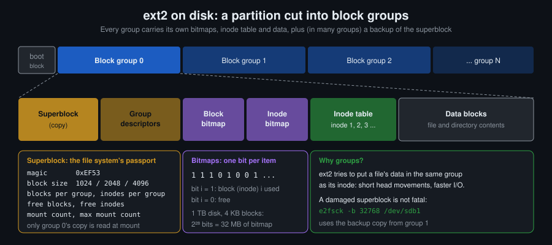

# Day 3: Files and Directories · Օր 3. Ֆայլեր և թղթապանակներ

## Objectives · Նպատակներ
- Տարբերել ֆայլերի տեսակները (regular, directory, link, device, socket, pipe) և ճանաչել դրանք `ls -l`-ով, `ls -F`-ով, `file`-ով, `stat`-ով
- Կողմնորոշվել ստանդարտ ֆայլային ծառում, հասկանալ partition-ները, mount point-ները և `/etc/fstab`-ը
- Ստեղծել, պատճենել, տեղափոխել, ջնջել ֆայլեր և թղթապանակներ, օգտագործել `ls`-ի հիմնական option-ները
- Բացատրել, թե ինչ է **inode**-ը, ինչ կա նրանում և ինչ՝ ոչ (անունը)
- Նկարագրել ext2-ի կառուցվածքը. block-եր, block group-եր, superblock, bitmap-եր, inode table, direct և indirect block-եր
- Բացատրել, թե ինչպես է kernel-ը գտնում ֆայլը ճանապարհով, և ինչ է directory-ն ներսից
- Տարբերել hard link-ը և symbolic link-ը, բացատրել link count-ը
- Բացատրել sparse ֆայլերը (holes) և EOF-ի իրական իմաստը

## Key Concepts · Հիմնական գաղափարներ
- «Ամեն ինչ ֆայլ է». ֆայլերի յոթ տեսակ
- Filesystem Hierarchy. `/bin`, `/etc`, `/home`, `/usr`, `/var` ...
- Partition, mount point, `mount`, `/etc/fstab`
- Inode, inode number, link count, երեք ժամանակ
- ext2. block, block group, superblock, inode table, bitmap
- Direct, single/double/triple indirect block-եր
- Directory entry, path lookup, root inode 2
- Hard link, symbolic link
- Ֆայլի տեղաբաշխման եղանակներ. contiguous, linked (FAT), indexed (inode)
- Sparse ֆայլ, hole, EOF

## Definitions · Սահմանումներ

*Այսօր ներմուծվող տերմինները։ Նույն տեքստը կա [GLOSSARY.md](../GLOSSARY.md)-ում։*

**Regular file** — Սովորական տվյալներով ֆայլ. տեքստ, ծրագիր, նկար։ `ls -l`-ում տողը սկսվում է `-`-ով։

**Directory (թղթապանակ)** — Ֆայլ, որի պարունակությունը այլ ֆայլերի ցանկ է. անուն → inode number զույգեր։ `ls -l`-ում՝ `d`։

**Special file (device file)** — Ֆայլ, որը ներկայացնում է սարք, սովորաբար `/dev`-ում։ **Character device** (`c`)՝ բայթ առ բայթ (terminal, serial port), **block device** (`b`)՝ block-երով (սկավառակ)։

**Named pipe (FIFO)** — Ֆայլ, որով երկու process փոխանակում են տվյալներ. մեկը գրում է, մյուսը կարդում։ `ls -l`-ում՝ `p`, ստեղծվում է `mkfifo`-ով։

**Socket** — Ֆայլ process-ների միջև ցանցային ձևով հաղորդակցության համար։ `ls -l`-ում՝ `s` (Օր 11)։

**Mount point** — Դատարկ թղթապանակ, որին «կախվում» է partition-ի կամ սարքի ֆայլային համակարգը։ Դրանից հետո թղթապանակի պարունակությունը այդ սարքի պարունակությունն է։

**Partition** — Սկավառակի առանձին մաս՝ իր ֆայլային համակարգով։ Մի partition-ի լցվելը կամ վնասվելը չի ազդում մյուսների վրա։

**Inode** — Տվյալների կառուցվածք, որը նկարագրում է մեկ ֆայլ. տեսակ, իրավունքներ, owner, չափ, ժամանակներ, link-երի քանակ և տվյալների block-երի տեղը։ Inode-ը **չի** պարունակում ֆայլի անունը։ Յուրաքանչյուր inode ունի համար՝ **inode number**։

**Link count** — Քանի directory entry է ցույց տալիս տվյալ inode-ին։ Ֆայլի տվյալները ջնջվում են միայն երբ link count-ը դառնում է 0, և ֆայլը ոչ մի process բաց չի պահում։

**Block** — Ֆայլային համակարգի տվյալների նվազագույն միավորը. 1, 2 կամ 4 KB։ Ֆայլը միշտ զբաղեցնում է ամբողջ թվով block-եր. 1025 բայթանոց ֆայլը 1024-բայթանոց block-երով զբաղեցնում է երկու block։

**Superblock** — Ֆայլային համակարգի «անձնագիրը». block-ի չափը, block-երի և inode-ների քանակը, ազատ block-երի և inode-ների քանակը, mount-երի քանակը։ ext2-ում պարունակում է magic number `0xEF53`։

**Block group** — ext2-ի partition-ի մաս՝ իր bitmap-երով, inode table-ով և տվյալների block-երով։ Superblock-ի պատճենը պահվում է շատ group-երում՝ պահուստի համար։

**Bitmap** — Բիթերի զանգված, որտեղ բիթ i-ն ցույց է տալիս՝ block (կամ inode) i-ն զբաղված է, թե ազատ։

**Direct / indirect block** — Inode-ը պահում է ֆայլի առաջին 12 block-երի համարները ուղիղ (**direct**)։ Ավելի մեծ ֆայլերի համար՝ **single indirect** block (block, որը լցված է block համարներով), **double indirect** (block, որը ցույց է տալիս single indirect-ների վրա) և **triple indirect**։

**Directory entry (dentry)** — Directory-ի տվյալների մեկ գրառում. inode number, անվան երկարություն, անուն։ Յուրաքանչյուր directory-ի առաջին երկու entry-ները `.`-ն (ինքը) և `..`-ն (ծնողը) են։

**Hard link** — ԵՒս մեկ directory entry նույն inode-ի համար. նույն ֆայլ, երկու անուն։ Ստեղծվում է `ln`-ով և ավելացնում է link count-ը։

**Symbolic link (symlink, soft link)** — Առանձին փոքր ֆայլ, որի պարունակությունը մեկ այլ ֆայլի ճանապարհն է։ Ստեղծվում է `ln -s`-ով։ Եթե թիրախը ջնջվի, symlink-ը «կախված» է մնում (dangling)։

**VFS (Virtual File System)** — Kernel-ի շերտ, որը բոլոր ֆայլային համակարգերին (ext4, FAT, NFS, `/proc`) տալիս է նույն ինտերֆեյսը։ Դրա շնորհիվ `cat`-ը նույն կերպ կարդում է ֆայլը սկավառակից, flash-ից և `/proc`-ից։

**Sparse file, hole** — Ֆայլ, որի որոշ հատվածները (**hole**-եր) սկավառակի վրա block չունեն։ Hole-ը կարդալիս վերադարձվում են զրոներ։ Hole առաջանում է, երբ գրում ես ֆայլի վերջից շատ հեռու կամ մեծացնում ֆայլը `truncate`-ով։

**EOF (end of file)** — Ֆայլի վերջին հասնելու **պայմանը**, ոչ թե նիշ։ Linux-ում ֆայլը չունի հատուկ «վերջի նշան». `read()`-ը վերադարձնում է 0, երբ կարդալու բան չկա։

## Commands · Հրամաններ

*Այսօրվա հրամանները։ Բոլոր օրերի հրամանների ցանկը [COMMANDS.md](../COMMANDS.md)-ում է։*

```bash
# Շարժվել
pwd ; cd /usr/local/lib ; cd .. ; cd ~ ; cd -
ls -d */                         # միայն թղթապանակները
tree -L 2 -d /usr | less         # ծառը, 2 մակարդակ (sudo apt install tree)

# ls-ի option-ներ
ls -a        # նաև թաքնված ֆայլերը (կետով սկսվող)
ls -l        # մանրամասն
ls -lh       # չափերը KB/MB/GB-ով
ls -lS       # դասավորել ըստ չափի
ls -lt       # դասավորել ըստ փոփոխման ժամի
ls -ld dir   # թղթապանակն ինքը, ոչ թե պարունակությունը
ls -F        # նշան անվան վերջում. / թղթապանակ, * կատարվող, @ link, | pipe, = socket
ls -i        # inode number-ները

# Ստեղծել, տեղափոխել, ջնջել
mkdir -p a/b/c ; rmdir a/b/c     # rmdir-ը ջնջում է միայն դատարկ թղթապանակ
touch f.txt                      # ստեղծել դատարկ ֆայլ կամ թարմացնել ժամը
cp f.txt g.txt ; cp -r a a2 ; cp -a a a3    # -a՝ պահպանել ամեն ինչ (իրավունքներ, ժամեր, link-եր)
mv g.txt a/ ; mv a2 b2           # տեղափոխել / վերանվանել
rm f.txt ; rm -r a3 ; rm -i *.txt          # -i՝ հարցնել ամեն ֆայլի համար

# Ֆայլի մասին
file /bin/ls /etc/passwd /dev/sda       # տեսակը ըստ պարունակության
stat f.txt                              # inode-ի բոլոր դաշտերը
ls -li f.txt                            # inode number + link count

# Link-եր
ln f.txt hard.txt                       # hard link
ln -s f.txt soft.txt                    # symbolic link
readlink -f soft.txt                    # ուր է ցույց տալիս
find . -samefile f.txt                  # բոլոր hard link-երը
find / -inum 1234 2>/dev/null           # ֆայլը ըստ inode number-ի

# Ֆայլային համակարգեր
df -h ; df -i                           # ազատ տեղ / ազատ inode-ներ
lsblk -f                                # սկավառակներ, partition-ներ, ֆայլային համակարգեր
findmnt ; mount | column -t             # ինչ է mount արված և ուր
cat /etc/fstab                          # ինչ է mount արվում boot-ի ժամանակ
cat /proc/filesystems                   # kernel-ի աջակցած ֆայլային համակարգերը
sudo dumpe2fs -h image.ext4             # superblock-ը
sudo debugfs -R 'stat <2>' image.ext4   # root inode-ը

# Sparse ֆայլեր
truncate -s 1G sparse.img ; ls -lh sparse.img ; du -h sparse.img
mkfifo mypipe                           # named pipe
```

## Functions · Ֆունկցիաներ

*Ֆայլային համակարգի C ֆունկցիաները, որոնք պետք են Self-Learning առաջադրանքների համար։ Ամբողջական ցանկը [API.md](../API.md)-ում է։*

```c
#include <sys/stat.h>
// Inode-ի տվյալները. st_ino, st_mode (տեսակ + իրավունքներ), st_nlink, st_size,
// st_blocks (512-բայթանոց միավորներով), st_atime/st_mtime/st_ctime. 0 կամ -1
int stat(const char *path, struct stat *st);
// Նույնը, բայց symlink-ի համար տալիս է link-ի, ոչ թե թիրախի տվյալները
int lstat(const char *path, struct stat *st);
// Տեսակը ստուգող macro-ներ. S_ISREG(m), S_ISDIR(m), S_ISLNK(m), S_ISCHR(m), S_ISBLK(m), S_ISFIFO(m), S_ISSOCK(m)
int mkdir(const char *path, mode_t mode);

#include <dirent.h>
// Կարդալ directory-ն entry առ entry. readdir-ը վերադարձնում է NULL, երբ entry-ները վերջացան
DIR *opendir(const char *path);
struct dirent *readdir(DIR *dir);       // d_ino՝ inode number, d_name՝ անուն, d_type՝ տեսակ
int closedir(DIR *dir);

#include <unistd.h>
int link(const char *target, const char *new_path);      // hard link
int symlink(const char *target, const char *link_path);  // symbolic link
ssize_t readlink(const char *path, char *buf, size_t size);  // symlink-ի պարունակությունը, առանց '\0'-ի
int unlink(const char *path);                            // ջնջել անունը
int rmdir(const char *path);                             // ջնջել դատարկ թղթապանակ
int truncate(const char *path, off_t length);            // փոխել չափը. մեծացնելիս՝ hole

#include <stdio.h>
int rename(const char *old_path, const char *new_path);  // mv նույն ֆայլային համակարգում
```

---

## 1. «Ամեն ինչ ֆայլ է»

Unix-ի և Linux-ի հիմնական սկզբունքը. ամեն ինչ ֆայլ է։ Թղթապանակը ֆայլ է, որը պարունակում է այլ ֆայլերի ցանկ։ Սարքերը ֆայլեր են `/dev`-ում։ Process-ների միջև կապի միջոցները (pipe, socket) նույնպես ֆայլեր են։ Դրա շնորհիվ նույն `open`, `read`, `write`, `close` գործողությունները աշխատում են բոլորի հետ։

Ֆայլերի յոթ տեսակ.

| `ls -l` | `ls -F` | Տեսակ | Օրինակ |
|---|---|---|---|
| `-` | | Regular file | `/etc/passwd`, `/usr/bin/ls` |
| `d` | `/` | Directory | `/home` |
| `l` | `@` | Symbolic link | `/bin` (ժամանակակից Ubuntu-ում՝ link դեպի `/usr/bin`) |
| `c` | | Character device | `/dev/tty`, `/dev/null`, `/dev/ttyUSB0` |
| `b` | | Block device | `/dev/sda`, `/dev/nvme0n1`, `/dev/mmcblk0` |
| `p` | `\|` | Named pipe (FIFO) | `mkfifo mypipe` |
| `s` | `=` | Socket | `/run/systemd/notify` |

`ls -F`-ը կատարվող ֆայլերին ավելացնում է նաև `*`։ Տեսակը ըստ պարունակության՝ `file`.

```bash
ls -l /dev/null /dev/sda /bin
file /usr/bin/ls /etc/passwd /dev/null
# /usr/bin/ls: ELF 64-bit LSB pie executable, x86-64, ...
# /etc/passwd: ASCII text
# /dev/null:   character special (1/3)
```

`1/3`-ը սարքի **major/minor** համարներն են. major-ը ասում է, որ driver-ն է սպասարկում սարքը, minor-ը՝ որ սարքը այդ driver-ի միջից (Օր 9)։

## 2. Ֆայլային ծառը և mount point-ները

Windows-ում յուրաքանչյուր սկավառակ ունի իր տառը։ Linux-ում կա **մեկ** ծառ՝ `/`-ից, և բոլոր սկավառակները «կախվում» են նրա ճյուղերից։

| Թղթապանակ | Ինչ կա |
|---|---|
| `/bin`, `/sbin` | Հիմնական ծրագրեր. ժամանակակից distribution-ներում link-եր դեպի `/usr/bin`, `/usr/sbin` |
| `/boot` | Kernel-ը և boot-ի ֆայլերը |
| `/dev` | Սարքերի ֆայլեր |
| `/etc` | Համակարգի կարգավորումներ |
| `/home` | Սովորական օգտատերերի home թղթապանակները |
| `/lib` | Ծրագրերի համար անհրաժեշտ գրադարաններ և kernel module-ներ |
| `/media`, `/mnt` | Mount point-ներ. USB flash, լրացուցիչ սկավառակներ |
| `/opt` | Լրացուցիչ, երրորդ կողմի ծրագրեր |
| `/proc`, `/sys` | Վիրտուալ ֆայլային համակարգեր՝ kernel-ի տեղեկություններով |
| `/root` | `root` օգտատիրոջ home թղթապանակը |
| `/tmp` | Ժամանակավոր ֆայլեր, մաքրվում է վերագործարկելիս |
| `/usr` | Օգտատիրոջ ծրագրեր, գրադարաններ, փաստաթղթեր |
| `/var` | Փոփոխվող տվյալներ. log-եր (`/var/log`), cache, հերթեր |

Սա պայմանավորվածություն է (**Filesystem Hierarchy Standard**), և distribution-ները մի փոքր տարբերվում են։

**Partition-ներ.** Սկավառակը կարելի է բաժանել մասերի, յուրաքանչյուրը իր ֆայլային համակարգով։ Առավելությունը. եթե `/var`-ը լցվի log-երով կամ վնասվի, `/`-ը և `/home`-ը կշարունակեն աշխատել։ Առանձին partition են դնում `/boot`-ը, `/home`-ը, `/var`-ը։ Կա նաև **swap** partition, որով kernel-ը ընդլայնում է RAM-ը սկավառակի հաշվին։

**Mount.** Partition-ը միանում է ծառին դատարկ թղթապանակի՝ **mount point**-ի միջոցով.

```bash
lsblk -f                         # սարքերը և դրանց ֆայլային համակարգերը
sudo mount /dev/sdb1 /mnt        # USB flash-ը հիմա /mnt-ում է
ls /mnt
sudo umount /mnt                 # անջատել. միշտ՝ նախքան flash-ը հանելը
findmnt                          # ինչ է mount արված
cat /etc/fstab                   # ինչ է mount արվում boot-ի ժամանակ
df -h                            # mount արված ֆայլային համակարգերը և ազատ տեղը
```

## 3. Աշխատանք ֆայլերի և թղթապանակների հետ

**Absolute** path-ը սկսվում է `/`-ով, **relative**-ը՝ հաշվվում է ընթացիկ թղթապանակից.

```bash
cd /usr/local/lib        # absolute
echo $HOME               # /home/student
cd ..                    # relative. /usr/local
cd ../..                 # /
cd /lib && ls -d */      # միայն թղթապանակները
```

Ստեղծել և փոխել.

```bash
cd ~
mkdir test
echo 'Hello everyone' > test/myfile.txt
echo 'Goodbye all' >> test/myfile.txt
less test/myfile.txt
mkdir test/subdir1/subdir2          # սխալ. subdir1 չկա
mkdir -p test/subdir1/subdir2       # -p-ն ստեղծում է նաև ծնողները
mv test/myfile.txt test/subdir1/subdir2/
rmdir test                          # սխալ. test-ը դատարկ չէ
rm -rv test                         # ջնջում է ամբողջը և ցույց է տալիս, թե ինչ ջնջեց
```

`ls`-ի ամենաօգտակար option-ները.

| Option | Ինչ է անում |
|---|---|
| `-a` | Ցույց տալ նաև թաքնված ֆայլերը (`.`-ով սկսվող) |
| `-l` | Մանրամասն. տեսակ, իրավունքներ, link-եր, owner, չափ, ժամ |
| `-h` | Չափերը մարդու համար. `4.0K`, `1.2M` |
| `-S` / `-t` | Դասավորել ըստ չափի / ժամի |
| `-r` | Հակառակ հերթականություն |
| `-d` | Թղթապանակն ինքը, ոչ պարունակությունը |
| `-F` | Տեսակի նշանը անվան վերջում |
| `-i` | Inode number |
| `-R` | Ռեկուրսիվ. բոլոր ենթաթղթապանակները |

## 4. Inode. ինչ գիտի ֆայլը իր մասին

### Visual


Յուրաքանչյուր ֆայլ ներկայացված է մեկ **inode**-ով։ Inode-ը պահում է.

- ֆայլի **տեսակը** և **իրավունքները** (`mode`)
- **owner**-ին և **group**-ը
- **չափը** բայթերով
- **link count**-ը
- երեք **ժամանակ**. **atime** (վերջին կարդալը), **mtime** (պարունակության վերջին փոփոխությունը), **ctime** (inode-ի վերջին փոփոխությունը. իրավունքներ, owner, link-եր). ext4-ը պահում է նաև ստեղծման ժամը (**birth**)
- տվյալների **block-երի համարները**

Inode-ը **չի** պահում ֆայլի անունը։ Անունները պահվում են directory-ներում, որոնք կապում են անունը inode number-ի հետ։ Այդ պատճառով մեկ ֆայլը կարող է ունենալ մի քանի անուն (hard link-եր), և `mv`-ն նույն ֆայլային համակարգում ակնթարթային է. այն փոխում է միայն directory entry-ն, ոչ թե տվյալները։

```bash
stat /etc/passwd
#   File: /etc/passwd
#   Size: 2847        Blocks: 8          IO Block: 4096   regular file
# Device: 259,2       Inode: 1310833     Links: 1
# Access: (0644/-rw-r--r--)  Uid: (0/root)   Gid: (0/root)
# Access: 2026-11-25 09:12:01 ...
# Modify: 2026-11-10 14:30:22 ...
# Change: 2026-11-10 14:30:22 ...
#  Birth: 2026-11-10 14:30:22 ...
ls -i /etc/passwd          # 1310833 /etc/passwd
```

`Blocks: 8`-ը 512-բայթանոց միավորներով է. 8 × 512 = 4096, այսինքն մեկ 4 KB block, թեև ֆայլը 2847 բայթ է։

**Inode-ների քանակը սահմանափակ է։** Այն որոշվում է ֆայլային համակարգը ստեղծելիս, սովորաբար մեկ inode 2–16 KB տարածքի համար։ Եթե ստեղծես միլիոնավոր փոքր ֆայլեր, inode-ները կարող են վերջանալ, երբ սկավառակում դեռ տեղ կա. սխալը նույնն է՝ «No space left on device»։

```bash
df -i                      # IUsed, IFree՝ ըստ ֆայլային համակարգի
```

## 5. ext2-ի կառուցվածքը

### Visual


ext2-ը (Second Extended File System) Linux-ի դասական ֆայլային համակարգն է։ ext3-ը և ext4-ը նրա զարգացումներն են, և հիմնական գաղափարները նույնն են։

**Block-եր.** Ամբողջ partition-ը բաժանված է նույն չափի block-երի (1, 2 կամ 4 KB), որը ընտրվում է ֆայլային համակարգը ստեղծելիս (`mke2fs`)։ Ֆայլը միշտ զբաղեցնում է ամբողջ թվով block-եր։

**Block group-եր.** Block-երը խմբավորված են։ Յուրաքանչյուր group-ում.

1. **Superblock**-ի պատճեն. ֆայլային համակարգի չափը և ձևը, magic number `0xEF53`, block-ի չափը, block-երի քանակը group-ում, ազատ block-երի և inode-ների քանակը, mount count։ Սովորաբար կարդացվում է միայն group 0-ի պատճենը, մյուսները պահուստ են վնասման դեպքի համար։
2. **Group descriptor table**՝ յուրաքանչյուր group-ի համար. որտեղ են նրա bitmap-երը և inode table-ը, քանի ազատ block և inode ունի։
3. **Block bitmap**՝ մեկ բիթ յուրաքանչյուր block-ի համար. զբաղված է, թե ազատ։
4. **Inode bitmap**՝ նույնը inode-ների համար։
5. **Inode table**՝ այս group-ի inode-ները։
6. **Data block-եր**՝ ֆայլերի և directory-ների պարունակությունը։

Group-ի գաղափարը արագության համար է. kernel-ը փորձում է ֆայլի տվյալները դնել նույն group-ում, ինչ նրա inode-ը, որ սկավառակի գլխիկը քիչ շարժվի։

### Ինչպես է inode-ը գտնում տվյալները

ext2 inode-ն ունի 15 block pointer.

- **12 direct**՝ ֆայլի առաջին 12 block-երի համարները։ 4 KB block-երով՝ մինչև 48 KB. փոքր ֆայլերի համար ամեն ինչ արդեն inode-ում է։
- **1 single indirect**՝ block, որը լցված է block համարներով։ 4 KB block-ում տեղավորվում է 1024 համար (4 բայթ յուրաքանչյուրը) → ևս 4 MB։
- **1 double indirect**՝ block, որի համարները ցույց են տալիս single indirect block-երի վրա → 1024 × 1024 block = 4 GB։
- **1 triple indirect**՝ ևս մեկ մակարդակ → 1024³ block = 4 TB։

Ինչու այսպես. ֆայլերի մեծ մասը փոքր է, և դրանց համար ամեն ինչ արագ է (ոչ մի լրացուցիչ block չկարդալ)։ Բայց մի քանի մեծ ֆայլ զբաղեցնում է սկավառակի մեծ մասը, և դրանք նույնպես պետք է աջակցել։

ext4-ը indirect block-երի փոխարեն օգտագործում է **extent**-ներ. «block 1000-ից սկսած 500 հաջորդական block» գրառում, որը մեծ ֆայլերի համար շատ ավելի խնայողական է։

### Ֆայլի տեղաբաշխման եղանակներ

Ինչպես է ֆայլային համակարգը որոշում, թե որ block-երն են ֆայլինը. երեք դասական պատասխան.

| Եղանակ | Ինչպես | Առավելություն | Թերություն | Որտեղ |
|---|---|---|---|---|
| **Contiguous** | Ֆայլը՝ մեկ անընդհատ հատված. պահվում է սկիզբը և երկարությունը | Ամենաարագ կարդալը | Fragmentation, ֆայլը դժվար է մեծացնել | CD-ROM (ISO 9660) |
| **Linked (FAT)** | Յուրաքանչյուր block գիտի հաջորդը. աղյուսակը առանձին է (File Allocation Table) | Պարզ է մեծացնել | Պատահական դիմումը դանդաղ է. block N-ին հասնելու համար պետք է անցնել N քայլ | FAT32, exFAT (USB flash, SD քարտ) |
| **Indexed (inode)** | Inode-ը պահում է block-երի ցանկը, մեծ ֆայլերի համար՝ indirect block-երով | Արագ պատահական դիմում, հեշտ է մեծացնել | Overhead փոքր ֆայլերի համար | ext2/3/4, Unix-ի ֆայլային համակարգեր |

Ազատ block-երը ext2-ում հաշվվում են **bitmap**-ով. 1 TB սկավառակը 4 KB block-երով ունի 2²⁸ block, և bitmap-ը զբաղեցնում է ընդամենը 32 MB։

## 6. Directory-ներ և ֆայլի որոնումը ճանապարհով

### Visual


Directory-ն սովորական ֆայլ է, որի տվյալները entry-ների ցանկ են։ Յուրաքանչյուր entry-ում կա **inode number**, անվան երկարություն և **անուն**։ Առաջին երկու entry-ները միշտ `.`-ն են (ինքը) և `..`-ն (ծնողը)։

Ինչպես է kernel-ը գտնում `/home/student/a.txt`-ը.

1. Root directory-ի inode number-ը հայտնի է. ext2-ում այն **2** է։
2. Կարդում է inode 2-ը, ապա նրա data block-երը, և գտնում `home` entry-ն → inode number։
3. Կարդում է այդ inode-ը, նրա data block-երը, գտնում `student`-ը → inode number։
4. Նույնը `a.txt`-ի համար։
5. Վերջին inode-ը տալիս է ֆայլի data block-երի համարները։

Այսինքն `/A/B/C` ճանապարհը պահանջում է 8 կարդալ. չորս inode և չորս directory block։ Այդ պատճառով kernel-ը պահում է **dentry cache**՝ վերջերս օգտագործված ճանապարհների և inode-ների աղյուսակ, և relative path-երը սկսում է ընթացիկ թղթապանակից, ոչ թե `/`-ից։

```bash
ls -ia /                     # 2 .   2 ..   ← root-ի . և .. երկուսն էլ inode 2 են
ls -id /home /home/$USER
```

**Թղթապանակի link count-ը.** Նոր թղթապանակն ունի 2 link. իր անունը ծնողում և իր `.`-ը։ Ամեն ենթաթղթապանակ ավելացնում է ևս մեկը (իր `..`-ը)։ Այսինքն թղթապանակի link count-ը = 2 + ենթաթղթապանակների քանակը.

```bash
mkdir -p d/x d/y d/z
ls -ld d                     # drwxr-xr-x 5 ...   ← 2 + 3
```

## 7. Hard link և symbolic link

### Visual


```bash
echo data > a.txt
ln a.txt b.txt              # hard link
ln -s a.txt s.txt           # symbolic link
ls -li a.txt b.txt s.txt
# 1045 -rw-r--r-- 2 student student  5 ... a.txt
# 1045 -rw-r--r-- 2 student student  5 ... b.txt      ← նույն inode, links = 2
# 2077 lrwxrwxrwx 1 student student  5 ... s.txt -> a.txt
rm a.txt
cat b.txt                   # data. տվյալները դեռ այստեղ են
cat s.txt                   # No such file or directory. symlink-ը կախված է
```

| | Hard link | Symbolic link |
|---|---|---|
| Ինչ է | ԵՒս մեկ անուն նույն inode-ի համար | Առանձին ֆայլ, որի պարունակությունը ճանապարհ է |
| Inode | Նույնը | Իր սեփականը |
| Թիրախը ջնջելիս | Տվյալները մնում են, քանի դեռ կա գոնե մեկ անուն | Link-ը կախված է մնում |
| Թղթապանակի համար | Չի կարելի (ծառում ցիկլեր կստեղծեր) | Կարելի է |
| Այլ ֆայլային համակարգում | Չի կարելի (inode number-ը իմաստ ունի միայն իր ֆայլային համակարգում) | Կարելի է |
| Օրինակ | Backup-ների համակարգեր, որ նույն ֆայլը չպատճենեն | `/bin → /usr/bin`, ծրագրի տարբերակներ. `python3 → python3.12` |

**`rm`-ը իրականում `unlink` է.** այն ջնջում է անունը և նվազեցնում link count-ը։ Տվյալները ազատվում են միայն երբ link count-ը 0 է **և** ֆայլը ոչ մի process բաց չի պահում։ Սա պատճառն է, որ երբեմն `rm`-ից հետո `df`-ը տեղ չի ազատում. ինչ-որ ծրագիր դեռ պահում է ֆայլը բաց (`lsof | grep deleted`)։ Օր 2-ի `mkstemp` + `unlink` հնարքը հենց սրա վրա է հիմնված։

## 8. VFS. մեկ ինտերֆեյս բոլոր ֆայլային համակարգերի համար

Linux-ը աշխատում է տասնյակ ֆայլային համակարգերի հետ. ext4, FAT, NTFS, NFS (ցանցային), `tmpfs` (RAM-ում), `/proc`, `/sys`։ **VFS** շերտը յուրաքանչյուրի առանձնահատկությունները թարգմանում է ընդհանուր կառուցվածքների (superblock, inode, dentry), այնպես որ ծրագրերի և kernel-ի մնացած մասի համար բոլորը նույնն են երևում։

```bash
cat /proc/filesystems         # kernel-ի աջակցած ֆայլային համակարգերը
mount | column -t | head      # ինչ տեսակի է յուրաքանչյուր mount
```

`/proc`-ը սկավառակի վրա տվյալներ չունի. kernel-ը ստեղծում է ֆայլերի պարունակությունը ամեն անգամ, երբ դրանք կարդում ես։ Սա VFS-ի ուժն է. `cat`-ը չգիտի և կարիք չունի իմանալու, թե ֆայլը որտեղից է գալիս։

## 9. Sparse ֆայլեր (holes)

Եթե ֆայլի վերջից հեռու գրես կամ ֆայլը մեծացնես `truncate`-ով, միջանկյալ հատվածը կդառնա **hole**. ֆայլային համակարգը այն չի պահում սկավառակի վրա, և կարդալիս այն տալիս է զրոներ.

```bash
truncate -s 1G sparse.img
ls -lh sparse.img            # 1.0G. ֆայլի չափը
du -h sparse.img             # 0.   սկավառակի վրա զբաղեցրած տեղը
stat sparse.img | grep Blocks
```

Sparse ֆայլերը օգտագործում են virtual machine-ների սկավառակները, database-ները, `core` dump-երը։ Զգույշ. սովորական պատճենումը կարող է hole-երը վերածել իրական զրոների (`cp --sparse=always`-ը պահպանում է դրանք)։

## 10. EOF. ֆայլի վերջում նշան չկա

Տարածված թյուր կարծիք է, որ ֆայլի վերջում կա հատուկ EOF նիշ։ Linux-ը (և Windows-ը) պահում է ֆայլի ճշգրիտ չափը բայթերով, և վերջի նշան պետք չէ։

- `read()` system call-ը վերադարձնում է **0**, երբ կարդալու բան չկա. սա է EOF-ը։
- C-ի `EOF` macro-ն (`-1`) ֆունկցիայի **վերադարձվող արժեք** է (`getchar()`, `fgetc()`), ոչ թե ֆայլում գրված նիշ։ Այդ պատճառով `getchar()`-ի արդյունքը պետք է պահել `int`-ում, ոչ `char`-ում։
- Terminal-ում **Ctrl+D**-ն նիշ չի ավելացնում. այն ասում է terminal-ին, որ ծրագրի `read()`-ը վերադարձնի 0։

Ճիշտ և սխալ ցիկլեր.

```cpp
// Ճիշտ. պայմանը ինքը կարդալն է
auto line = std::string{};
while (std::getline(in, line)) { /* ... */ }

// Սխալ. eof()-ը true է դառնում միայն ձախողված կարդալուց ՀԵՏՈ,
// և վերջին տողը կմշակվի երկու անգամ (կամ դատարկ ֆայլի դեպքում՝ մեկ ավելորդ անգամ)
while (!in.eof()) { std::getline(in, line); /* ... */ }
```

C-ում ճիշտ ձևը `while (fgets(buf, sizeof buf, f))` կամ `while (EOF != (c = getchar()))`։ `feof()`-ը օգտագործիր միայն ցիկլից **հետո**՝ տարբերելու ֆայլի վերջը իրական սխալից։

---

## Resources · Աղբյուրներ
- [The Linux Kernel: The File System](http://www.tldp.org/LDP/tlk/fs/filesystem.html), David Rusling, TLDP. VFS, ext2-ի կառուցվածքը, inode-ներ, directory-ներ, ֆայլի որոնում
- [Introduction to Linux: General overview of the Linux file system](http://www.tldp.org/LDP/intro-linux/html/sect_03_01.html), TLDP. ֆայլերի տեսակներ, partition-ներ, թղթապանակների ծառը, inode-ներ
- [File Systems: Fundamentals](http://www.cs.utexas.edu/users/witchel/372/lectures/18.FileSystems-Fundamentals.pdf), UT Austin CS372. տեղաբաշխման եղանակներ, multi-level index, path traversal
- [File Systems](http://www.cs.unibo.it/~sangio/SO_currentAA/Luc_SO/FileSystem/File_Systems1.pdf), University of Bologna
- [Introduction to Linux](http://www.bu.edu/tech/files/2012/09/Introduction-to-Linux.pptx), BU IS&T, սլայդներ 32–40
- [Holes and mmap()](https://lwn.net/Articles/357767/), LWN.net. hole-երը kernel-ի ներսից
- [All About EOF](https://latedev.wordpress.com/2012/12/04/all-about-eof/)
- [`inode(7)`](https://man7.org/linux/man-pages/man7/inode.7.html), [`stat(2)`](https://man7.org/linux/man-pages/man2/stat.2.html), [`readdir(3)`](https://man7.org/linux/man-pages/man3/readdir.3.html), [`hier(7)`](https://man7.org/linux/man-pages/man7/hier.7.html)
- WPI CS3013 [Section 10: File Systems](https://web.cs.wpi.edu/~cs3013/c07/lectures/Section10-File_Systems.pdf). հին դասի հղումն է, այժմ հասանելի չէ

## Hands-On Task · Գործնական առաջադրանք

Կառուցիր փոքրիկ ext2 զանգվածի մեջ։ [`template.cpp`](template.cpp)-ը արդեն ունի «սկավառակը» (128 block × 256 բայթ), inode table-ը, block bitmap-ը, root directory-ն (inode 2) և թեստեր։ Լրացրու վեց TODO-ները հերթով.

1. `block_of`՝ ֆայլի N-րդ block → սկավառակի block. direct կամ indirect pointer-ով
2. `write`՝ գրել ցանկացած offset-ում. հեռու offset-ը թողնում է hole
3. `lookup`՝ անուն → inode number directory-ի մեջ
4. `resolve`՝ ամբողջ ճանապարհ → inode number, ինչպես §6-ում
5. `link`՝ hard link
6. `unlink`՝ ջնջել անունը, իսկ վերջին link-ի դեպքում՝ ազատել block-երը և inode-ը

Ամեն TODO-ից հետո գործարկիր `./day03`. ավելի շատ թեստեր կդառնան `PASS`։ Ծրագրի exit status-ը սխալված թեստերի քանակն է. `./day03 > /dev/null ; echo $?`։

## Self-Learning · Ինքնուրույն աշխատանք
1. Գրիր ռեկուրսիվ `ls` C++-ում. `./tree dir` տպում է բոլոր ֆայլերը և ենթաթղթապանակները՝ խորությամբ, յուրաքանչյուրի inode number-ը, տեսակը (`stat`/`lstat`) և link count-ը։ Symlink-երի համար տպիր թիրախը (`readlink`) և մի մտիր դրանց մեջ։
2. Ստեղծիր ext4 ֆայլային համակարգ ֆայլի մեջ և ուսումնասիրիր այն առանց իրական սկավառակի. `truncate -s 64M disk.img && mkfs.ext4 disk.img && sudo mount -o loop disk.img /mnt`։ Ստեղծիր ֆայլեր, ապա `sudo umount /mnt` և `sudo dumpe2fs -h disk.img`, `sudo debugfs -R 'stat <2>' disk.img`, `sudo debugfs -R 'ls -l /' disk.img`։
3. Նույն image-ում ստեղծիր փոքր ֆայլեր ցիկլով, մինչև ստանաս «No space left on device»։ Համեմատիր `df -h`-ը և `df -i`-ը։ Ինչ վերջացավ առաջինը։ Կրկնիր `mkfs.ext4 -N 100000`-ով։
4. Ստեղծիր ֆայլ, բացիր այն `tail -f`-ով մի terminal-ում, մյուսում ջնջիր `rm`-ով։ Գտիր այն `lsof | grep deleted`-ով։ Ինչպես կարող ես վերականգնել պարունակությունը `/proc/PID/fd/`-ից։
5. Ստեղծիր symlink-երի ցիկլ. `ln -s a b ; ln -s b a ; cat a`։ Ինչ սխալ ստացար։ Գտիր այն `man 3 errno`-ում (`ELOOP`)։
6. Հաշվիր ext2-ի ֆայլի առավելագույն չափը 1 KB և 4 KB block-երով (12 direct + single + double + triple)։
7. Ընդլայնիր template-ի `mini_fs`-ը **double indirect** block-ով։ Որքան է դառնում `kMaxFileSize`-ը։ Ավելացրու թեստ, որը գրում է 100 block։
8. Գրիր C++ ծրագիր, որը կարդում է `stdin`-ը նիշ առ նիշ `getchar()`-ով և հաշվում է բայթերը։ Արդյունքը պահիր `char`-ում, ապա `int`-ում, և փորձիր `printf '\xff' | ./count`-ով։ Ինչո՞ւ `char`-ի դեպքում ցիկլը կանգ է առնում շուտ (կամ չի կանգնում)։

## Self-Check · Ինքնաստուգում
Պատասխաններ չկան։ Մտածիր ինքնուրույն։

1. Որտե՞ղ է պահվում ֆայլի անունը, եթե ոչ inode-ում։ Ինչո՞ւ է `mv`-ն նույն ֆայլային համակարգում ակնթարթային, իսկ այլ ֆայլային համակարգ տեղափոխելիս՝ դանդաղ։
2. Ֆայլը 1025 բայթ է, block-ը՝ 1024։ Քանի՞ block է այն զբաղեցնում։ Ինչո՞ւ է մեծ block-ը արագացնում մեծ ֆայլերը, բայց վնասում է փոքրերին։
3. 4 KB block-երով քանի՞ block-ի կարդալ է պետք ֆայլի առաջին բայթին և 10 MB-րդ բայթին հասնելու համար (inode-ը արդեն հիշողության մեջ է)։
4. Ինչո՞ւ է կարելի hard link ստեղծել ֆայլի համար, բայց ոչ թղթապանակի։ Ինչո՞ւ hard link-ը չի կարող անցնել մի partition-ից մյուսը։
5. Թղթապանակի link count-ը 7 է։ Քանի՞ ենթաթղթապանակ ունի այն։
6. `rm big.log`-ից հետո `df`-ը նույն ազատ տեղն է ցույց տալիս։ Ինչո՞ւ, և ինչպես կգտնես մեղավորին։
7. Սկավառակում 50% տեղ կա, բայց նոր ֆայլ ստեղծել հնարավոր չէ. «No space left on device»։ Ինչ է պատահել։
8. Ինչո՞ւ են superblock-ի պատճենները պահվում շատ block group-երում։
9. `ls -l`-ը ցույց է տալիս 1 GB ֆայլ, իսկ `du`-ն՝ 4 KB։ Ինչպես է դա հնարավոր։ Ինչ կլինի, եթե այն պատճենես FAT32 flash-ի վրա։
10. FAT-ում ֆայլի 1000-րդ block-ին հասնելը ինչու՞ է դանդաղ, իսկ ext2-ում՝ ոչ։
11. Ինչո՞ւ `while (!f.eof())` ցիկլը դատարկ ֆայլի համար կատարվում է մեկ անգամ։
12. `/dev/sda`-ն և `/dev/tty`-ն երկուսն էլ սարքեր են։ Ինչո՞ւ է մեկը `b`, մյուսը՝ `c`։

## Code Template · Կոդի ձևանմուշ
Տե՛ս [`template.cpp`](template.cpp)-ը։

```bash
g++ -std=c++17 -Wall -Wextra -O2 template.cpp -o day03 && ./day03
```
