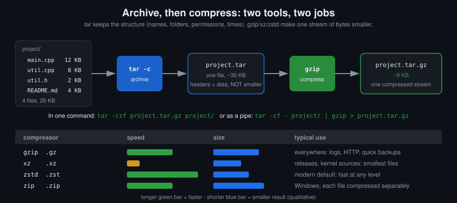

# Day 5: Archiving and Compression · Օր 5. Archive-ացում և compression

## Objectives · Նպատակներ
- Տարբերել **archive-ացումը** (շատ ֆայլ → մեկ ֆայլ) և **compression-ը** (ֆայլ → ավելի փոքր ֆայլ)
- Ստեղծել, դիտել և բացել archive-ներ `tar`-ով, `zip`-ով
- Սեղմել և բացել `gzip`-ով, `bzip2`-ով, `xz`-ով, `zstd`-ով և համեմատել դրանք
- Բացատրել, թե ինչ կա `.tar` ֆայլի ներսում (ustar ձևաչափ)
- Բացատրել compression-ի գաղափարը. ավելորդություն, RLE, LZ77, lossless և lossy
- Կազմակերպել backup-ներ և տվյալների փոխանցում pipe-ով, ստուգել ամբողջականությունը checksum-ով

## Key Concepts · Հիմնական գաղափարներ
- Archive, compression, `.tar.gz`
- `tar -c -t -x -v -f -z -j -J -C`
- ustar header, 512-բայթանոց block-եր
- Lossless և lossy compression, compression ratio
- RLE, LZ77 (dictionary), Huffman
- `gzip`, `bzip2`, `xz`, `zstd`, `zip`
- Checksum. `sha256sum`

## Definitions · Սահմանումներ

*Այսօր ներմուծվող տերմինները։ Նույն տեքստը կա [GLOSSARY.md](../GLOSSARY.md)-ում։*

**Archive** — Մեկ ֆայլ, որը պարունակում է շատ ֆայլեր՝ իրենց անուններով, permission-ներով, owner-ներով և ժամերով։ Archive-ը ինքնին չի compression. `.tar`-ը մոտավորապես նույն չափն ունի, ինչ ֆայլերը միասին։

**Compression** — Տվյալների կոդավորում ավելի փոքր չափով՝ օգտագործելով դրանց ավելորդությունը (կրկնվող հատվածներ, հաճախ հանդիպող նիշեր)։

**Lossless / lossy** — **Lossless** compression-ից հետո տվյալները վերականգնվում են բիթ առ բիթ (gzip, xz, zip, PNG)։ **Lossy** compression-ը դեն է նետում մարդու համար աննկատ մանրամասներ և ճշգրիտ չի վերականգնվում (JPEG, MP3, H.264)։ Ծրագրերը, տեքստը և archive-ները միայն lossless են սեղմվում։

**Compression ratio** — Սեղմված չափի հարաբերությունը սկզբնականին։ Տեքստը սովորաբար փոքրանում է 60–70%-ով, իսկ արդեն սեղմված տվյալները (JPEG, MP4, `.gz`) գրեթե չեն փոքրանում։

**`tar` (tape archive)** — Unix-ի ստանդարտ archive-ացնող ծրագիրը։ Անունը գալիս է մագնիսական ժապավեններից, որոնց վրա պահում էին backup-ները։

**ustar** — `tar` archive-ի POSIX ձևաչափը. յուրաքանչյուր ֆայլ՝ 512-բայթանոց header block, ապա պարունակությունը 512-բայթանոց block-երով, վերջում՝ երկու զրոյական block։

**`.tar.gz` (`.tgz`)** — `tar` archive, որը հետո սեղմված է `gzip`-ով։ Նույն կերպ՝ `.tar.bz2`, `.tar.xz`, `.tar.zst`։

**RLE (run-length encoding)** — Ամենապարզ compression-ը. կրկնվող նիշերի շարքը փոխարինվում է «նիշ + քանակ» զույգով. `aaaaabbb` → `a5b3`։

**LZ77** — Compression-ի ալգորիթմ, որը կրկնվող հատվածը փոխարինում է հղումով դեպի նախորդ նույն հատվածը. «վերադարձիր 120 բայթ հետ և պատճենիր 15 բայթ»։ `gzip`-ի, `zip`-ի, `zstd`-ի հիմքն է։

**Huffman coding** — Հաճախ հանդիպող սիմվոլներին տալիս է կարճ կոդեր, հազվադեպներին՝ երկար։ `gzip`-ը (deflate) LZ77-ից հետո կիրառում է Huffman։

**Checksum (hash)** — Ֆայլի պարունակությունից հաշվված կարճ թիվ (`sha256sum`)։ Եթե ֆայլում փոխվի գեթ մեկ բիթ, checksum-ը ամբողջովին կփոխվի. այդպես ստուգում են, որ ներբեռնված կամ պատճենված archive-ը վնասված չէ։

---

## 1. Archive և compression. երկու տարբեր քայլ

### Visual


Unix-ում երկու խնդիրը լուծում են երկու տարբեր ծրագրեր, ինչպես պահանջում է Unix-ի փիլիսոփայությունը (Օր 1).

1. **`tar`**-ը շատ ֆայլեր (իրենց անուններով, directory-ներով, permission-ներով, ժամերով) հավաքում է մեկ ֆայլի մեջ։ Չափը չի փոքրանում։
2. **`gzip`**-ը (կամ `xz`, `zstd`) սեղմում է **մեկ** ֆայլ։ Այն չգիտի ինչ է directory-ն։

Դրանք միացնում են pipe-ով կամ `tar`-ի option-ով.

```bash
tar -cf - project/ | gzip > project.tar.gz    # նույնն է, ինչ
tar -czf project.tar.gz project/
```

Windows-ում տարածված **zip**-ը անում է երկուսը միասին, բայց յուրաքանչյուր ֆայլ սեղմում է առանձին։ `.tar.gz`-ը սեղմում է ամբողջ archive-ը որպես մեկ stream, այդ պատճառով շատ նման փոքր ֆայլերի դեպքում (օրինակ՝ source code) այն սովորաբար ավելի փոքր է։ Փոխարենը zip-ից կարելի է բացել մեկ ֆայլ առանց ամբողջը կարդալու։

## 2. `tar`

`tar`-ի option-ները հիշելու համար. առաջին տառը **գործողությունն** է.

| Option | Գործողություն |
|---|---|
| `-c` | **c**reate. ստեղծել archive |
| `-t` | lis**t**. ցույց տալ պարունակությունը |
| `-x` | e**x**tract. բացել |
| `-r` | append. ավելացնել ֆայլ (միայն չսեղմված archive-ին) |

Եվ ձևափոխիչներ.

| Option | Իմաստ |
|---|---|
| `-f name` | Archive-ի ֆայլը։ `-f -`՝ stdin/stdout |
| `-v` | Տպել ամեն ֆայլի անունը |
| `-z`, `-j`, `-J`, `--zstd` | gzip, bzip2, xz, zstd |
| `-C dir` | Աշխատել այս directory-ում |
| `--exclude=pattern` | Բաց թողնել |
| `-p` | Պահպանել permission-ները բացելիս (root-ի համար լռելյայն է) |

```bash
tar -czvf backup-$(date +%F).tar.gz ~/projects     # backup-2026-11-25.tar.gz
tar -tzvf backup-2026-11-25.tar.gz | head          # նայել, առանց բացելու
mkdir restore && tar -xzf backup-2026-11-25.tar.gz -C restore
```

Երկու կարևոր նախազգուշացում.

- **Միշտ նայիր archive-ի պարունակությունը (`-t`) բացելուց առաջ.** Որոշ archive-ներ ներսում չունեն ընդհանուր directory և բացվելիս հարյուրավոր ֆայլեր են թափում ընթացիկ directory-ում («tarbomb»)։ `-C`-ով բացիր նոր directory-ում։
- GNU `tar`-ը ստեղծելիս path-ներից հանում է սկզբի `/`-ը (`Removing leading '/' from member names`), որ բացելիս ֆայլերը չվերագրեն համակարգային ֆայլերը։

## 3. Ինչ կա `.tar` ֆայլի ներսում

### Visual


`tar` ձևաչափը զարմանալիորեն պարզ է, և այսօրվա լաբորատորիայում դու ինքդ կգրես այն։ Archive-ը 512 բայթանոց **block**-երի հաջորդականություն է.

1. Յուրաքանչյուր ֆայլի համար **header block**. անունը, permission-ները, owner-ը, չափը, ժամը, տեսակը։
2. Ապա ֆայլի **պարունակությունը**՝ ամբողջ թվով block-երով. վերջին block-ի մնացած մասը լրացվում է զրոներով։
3. Archive-ի վերջում՝ **երկու զրոյական block**։

Header-ի դաշտերը (POSIX ustar).

| Դաշտ | Չափ | Offset | Ինչ է պահում |
|---|---|---|---|
| `name` | 100 | 0 | Ֆայլի անունը |
| `mode` | 8 | 100 | Permission-ները, octal. `0000644` |
| `uid`, `gid` | 8, 8 | 108, 116 | Owner-ի և group-ի համարները |
| `size` | 12 | 124 | Չափը բայթերով, octal |
| `mtime` | 12 | 136 | Փոփոխման ժամը, վայրկյաններ 1970-ից, octal |
| `chksum` | 8 | 148 | Header-ի checksum-ը |
| `typeflag` | 1 | 156 | `'0'`՝ ֆայլ, `'5'`՝ directory, `'2'`՝ symlink |
| `linkname` | 100 | 157 | Link-ի թիրախը |
| `magic`, `version` | 6, 2 | 257, 263 | `"ustar\0"`, `"00"` |
| `uname`, `gname` | 32, 32 | 265, 297 | Owner-ի և group-ի անունները |
| `prefix` | 155 | 345 | Երկար անունների սկիզբը |

Թվային դաշտերը գրվում են որպես **տեքստ** octal համակարգով, զրոներով լրացված և `'\0'`-ով ավարտված. `size` դաշտը (12 բայթ) 1000 բայթանոց ֆայլի համար `"00000001750\0"` է։ **Checksum**-ը header-ի բոլոր բայթերի գումարն է, որտեղ `chksum` դաշտը ինքը հաշվվում է որպես 8 բացատ։

Տես ինքդ.

```bash
echo hello > a.txt && tar -cf a.tar a.txt
ls -l a.tar                      # 10240. ինչու այդքան մեծ 6 բայթի համար
xxd a.tar | head -40             # header-ը, "ustar", ապա "hello"
```

GNU `tar`-ը լռելյայն archive-ը լրացնում է մինչև 10 KB (20 block), դրա համար փոքր archive-ը 10240 բայթ է։

## 4. Ինչպես է աշխատում compression-ը

Compression-ը հնարավոր է միայն այն պատճառով, որ իրական տվյալները **ավելորդ** են. կան կրկնվող բառեր, հաճախ հանդիպող տառեր, զրոներով լի հատվածներ։ Պատահական տվյալները սեղմել հնարավոր չէ։

**RLE**՝ ամենապարզ գաղափարը.

```
aaaaaaaaaabbbbbcc   (17 բայթ)  →   a10b5c2   (7 բայթ)
```

Լավ է աշխատում պարզ նկարների և զրոներով լի տվյալների համար, բայց սովորական տեքստի վրա նույնիսկ մեծացնում է չափը։

**LZ77 (dictionary)**. երբ տեքստում հանդիպում է արդեն տեսած հատված, այն փոխարինվում է հղումով.

```
to be or not to be   →   to be or not (13 հետ, 5 բայթ)
```

Սա `gzip`-ի, `zip`-ի, `zstd`-ի հիմքն է։ `gzip`-ը (deflate ալգորիթմ) դրանից հետո կիրառում է **Huffman** կոդավորում. հաճախ հանդիպող սիմվոլները ստանում են կարճ կոդեր։

**Lossy** compression-ը (JPEG, MP3, H.264) լրացուցիչ դեն է նետում մանրամասներ, որոնք մարդը չի նկատի։ Այն չի կարելի կիրառել ծրագրերի, տեքստի կամ archive-ների համար։

Արդեն սեղմված տվյալները կրկին սեղմելը իմաստ չունի.

```bash
gzip -k photo.jpg && ls -l photo.jpg photo.jpg.gz      # գրեթե նույն չափը
```

## 5. Compression-ի գործիքները

| Գործիք | Ընդլայնում | Արագություն | Compression | Որտեղ |
|---|---|---|---|---|
| `gzip` | `.gz` | Արագ | Միջին | Ամենուր, web (HTTP), log-եր |
| `bzip2` | `.bz2` | Դանդաղ | Լավ | Հին archive-ներ |
| `xz` | `.xz` | Շատ դանդաղ compression, արագ բացում | Ամենալավը | Ծրագրերի բաշխում, kernel-ի կոդը |
| `zstd` | `.zst` | Շատ արագ | Լավ, կարգավորելի (1–19) | Ժամանակակից համակարգեր, package-ներ, filesystem-ներ |
| `zip` | `.zip` | Արագ | Միջին | Windows-ի հետ փոխանակում |

`gzip`-ը լռելյայն **փոխարինում է** ֆայլը `.gz`-ով՝ պահպանելով permission-ները և ժամերը։ Մակարդակները՝ `-1` (ամենաարագ) մինչև `-9` (ամենաուժեղ), լռելյայնը `-6` է։ `-k`-ն պահում է սկզբնականը, `-c`-ն գրում է stdout, `-d`-ն բացում է, `-l`-ը ցույց է տալիս compression-ի աստիճանը։

Յուրաքանչյուր գործիք ունի բացող զույգ. `gunzip`, `bunzip2`, `unxz`, `unzstd` (նույնն են, ինչ `gzip -d`, `bzip2 -d` ...)։ `zip`-ը տարբերվում է. այն և՛ archive է, և՛ compression, և բացվում է `unzip`-ով (`unzip -l`-ը միայն ցույց է տալիս ցանկը)։ Սեղմված տեքստը կարելի է կարդալ առանց ֆայլը բացելու. `zcat`, `zless`, `zgrep`։

Ինքդ համեմատիր.

```bash
tar -cf src.tar /usr/include                 # ~ տասնյակ MB տեքստ
for z in gzip bzip2 xz zstd; do
    /usr/bin/time -f "$z %es" $z -k -f src.tar
done
ls -lh src.tar*
```

## 6. Գործնական օրինակներ

```bash
# Ամենօրյա backup՝ ամսաթվով, միայն փոփոխված ֆայլերը
tar -czf backup-$(date +%F).tar.gz --newer-mtime='1 day ago' ~/work

# Պատճենել directory-ն մեկ այլ համակարգչի, առանց ժամանակավոր ֆայլի
tar -czf - project/ | ssh student@server 'tar -xzf - -C ~/backup'

# Log-երը սովորաբար պահվում են սեղմված. կարդալ առանց բացելու
ls /var/log/*.gz
zcat /var/log/syslog.2.gz | grep -i error
zgrep -c error /var/log/syslog.*.gz

# Ստուգել, որ ներբեռնված archive-ը վնասված չէ
sha256sum ubuntu.iso                         # համեմատիր կայքում նշվածի հետ
sha256sum -c SHA256SUMS --ignore-missing

# Մեծ archive-ը բաժանել մասերի (օրինակ՝ email-ով կամ FAT32 flash-ով)
split -b 1G big.tar.gz big.tar.gz.part_
cat big.tar.gz.part_* > big.tar.gz
```

---

## Commands · Հրամաններ

*Ամփոփում. այս օրվա հրամանները, որոնք բացատրված են վերևում։ Անգիր անել պետք չէ. վերադարձիր այստեղ, երբ մոռանաս գրելաձևը։ Բոլոր օրերի հրամանների ցանկը [COMMANDS.md](../COMMANDS.md)-ում է։*

```bash
# tar
tar -cvf project.tar project/            # create, verbose, file
tar -tvf project.tar                     # list
tar -xvf project.tar                     # extract ընթացիկ directory-ում
tar -xvf project.tar -C /tmp/restore     # extract այլ directory-ում
tar -czf project.tar.gz project/         # + gzip
tar -cjf project.tar.bz2 project/        # + bzip2
tar -cJf project.tar.xz project/         # + xz
tar --zstd -cf project.tar.zst project/  # + zstd
tar -xf archive.tar.xz                   # extract-ը ինքն է ճանաչում compression-ը
tar -czf src.tar.gz --exclude='*.o' --exclude=build src/
tar -xf big.tar.gz path/inside/file.txt  # միայն մեկ ֆայլ

# Compression
gzip file ; gunzip file.gz ; gzip -k -9 file ; gzip -l file.gz
bzip2 file ; bunzip2 file.bz2
xz -T0 file ; unxz file.xz               # -T0. բոլոր core-երը
zstd file ; unzstd file.zst
zcat f.gz ; zless f.gz ; zgrep error log.gz   # առանց բացելու

# zip (Windows-ի հետ համատեղելի)
zip -r project.zip project/ ; unzip -l project.zip ; unzip project.zip -d out/

# Ամբողջականություն, բաժանում, network-ով
sha256sum project.tar.gz > project.tar.gz.sha256 ; sha256sum -c project.tar.gz.sha256
split -b 100M big.tar.gz part_ ; cat part_* > big.tar.gz
tar -czf - project/ | ssh user@host 'tar -xzf - -C /backup'
```

## Functions · Ֆունկցիաներ

*Ամփոփում. այս օրվա C/C++ ֆունկցիաները։ Ամբողջական ցանկը [API.md](../API.md)-ում է։*

```c
#include <sys/stat.h>
// Ֆայլի տվյալները header-ի համար. st_mode, st_uid, st_gid, st_size, st_mtime (Օր 3)
int stat(const char *path, struct stat *st);

#include <pwd.h>
#include <grp.h>
// uid → user-ի անուն (pw_name), gid → group-ի անուն (gr_name). NULL եթե չկա
struct passwd *getpwuid(uid_t uid);
struct group *getgrgid(gid_t gid);

#include <cstdio>
// Գրել թիվը տողում ֆորմատով. "%07o"՝ 7 նիշանոց octal զրոներով
int snprintf(char *buf, size_t size, const char *format, ...);
// Կարդալ թիվը տողից. strtoul(s, nullptr, 8)՝ octal
unsigned long strtoul(const char *s, char **end, int base);
```

## Resources · Աղբյուրներ
- [GNU tar manual](https://www.gnu.org/software/tar/manual/), մասնավորապես [Basic tar Format](https://www.gnu.org/software/tar/manual/html_node/Standard.html). ustar header-ի դաշտերը, checksum-ը, block-երը
- [GNU gzip manual](https://www.gnu.org/software/gzip/manual/gzip.html)
- [`tar(5)`](https://man7.org/linux/man-pages/man5/tar.5.html) ձևաչափը, [`xz(1)`](https://man7.org/linux/man-pages/man1/xz.1.html), [`zstd(1)`](https://man7.org/linux/man-pages/man1/zstd.1.html), [`sha256sum(1)`](https://man7.org/linux/man-pages/man1/sha256sum.1.html)
- [The Linux Command Line](https://linuxcommand.org/tlcl.php), William Shotts, Chapter 18 «Archiving and Backup»

## Hands-On Task · Գործնական առաջադրանք

Գրիր `tar`-ի փոքր տարբերակը, որը ստեղծում է **իսկական** ustar archive. [`template.cpp`](template.cpp)։

```bash
echo hello > a.txt ; seq 1 1000 > numbers.txt
./day05 -c out.tar a.txt numbers.txt      # ստեղծել
./day05 -t out.tar                        # քո list-ը
tar -tvf out.tar                          # իրական tar-ը պետք է կարդա քո archive-ը
mkdir x && tar -xf out.tar -C x && diff a.txt x/a.txt && diff numbers.txt x/numbers.txt && echo identical
tar -cf ref.tar a.txt && ./day05 -t ref.tar    # քո list-ը պետք է կարդա իրական tar-ի archive-ը
```

Լրացրու TODO-ները. octal դաշտեր, header-ի լրացում `stat`-ով, checksum, ֆայլի պարունակություն padding-ով, archive-ի վերջ, list ռեժիմ։ Եթե `tar -tvf`-ը տպում է `Skipping to next header` կամ `checksum error`, համեմատիր քո header-ը իրականի հետ `xxd`-ով։

## Self-Learning · Ինքնուրույն աշխատանք
1. Ստեղծիր 100 MB ֆայլ զրոներով (`head -c 100M /dev/zero > z`) և 100 MB պատահական տվյալներով (`head -c 100M /dev/urandom > r`)։ Սեղմիր երկուսն էլ `gzip`-ով։ Բացատրիր արդյունքը։
2. Գրիր RLE սեղմող և բացող ծրագիր C++-ում (`./rle -c < in > out`, `./rle -d < out > back`)։ Ստուգիր `cmp in back`-ով։ Որ ֆայլերի վրա է այն փոքրացնում չափը, որոնց վրա՝ մեծացնում։
3. Համեմատիր `gzip -1`, `gzip -9`, `xz -9`, `zstd -19`-ը `/usr/include`-ի tar-ի վրա. չափ և ժամանակ սեղմելու և բացելու համար։ Կազմիր աղյուսակ։
4. Ստեղծիր archive symlink-ով և hard link-ով (Օր 3)։ Ինչպես է `tar -tvf`-ը ցույց տալիս դրանք։ Քանի անգամ է պահվում hard link-ի պարունակությունը։
5. Ընդլայնիր template-ը. directory-ների աջակցություն (`typeflag '5'`, ռեկուրսիվ, Օր 3-ի `opendir`/`readdir`)։
6. Ընդլայնիր template-ը `-x` ռեժիմով. բացել archive-ը, վերականգնել permission-ները (`chmod`) և ժամը (`utimensat`)։
7. `tar -czf - dir | wc -c`. ինչպես իմանալ archive-ի չափը առանց այն disk-ի վրա պահելու։ Ինչու է սա կարևոր, երբ disk-ում տեղ չկա։

## Self-Check · Ինքնաստուգում
Պատասխաններ չկան։ Մտածիր ինքնուրույն։

1. Ինչու՞ Unix-ում archive-ացումը և compression-ը առանձին ծրագրեր են։ Ինչ առավելություն ունի դա։
2. Ինչու՞ `.tar.gz`-ը սովորաբար ավելի փոքր է, քան նույն ֆայլերի `.zip`-ը։ Իսկ ինչում է `.zip`-ն ավելի հարմար։
3. Ինչու՞ JPEG նկարների directory-ն `gzip`-ով սեղմելը գրեթե օգուտ չի տալիս։
4. Ինչու՞ 6 բայթանոց ֆայլի `tar` archive-ը 10 KB է։
5. tar header-ում թվերը պահվում են octal տեքստով, ոչ թե երկուական թվերով։ Ինչ առավելություն ունի դա։ Ինչ սահմանափակում է առաջացնում `size` դաշտի 12 բայթը։
6. Ինչու՞ checksum-ը հաշվելիս `chksum` դաշտը համարվում է բացատներով լի։
7. Ինչ վտանգ կա անծանոթ archive-ը առանց `tar -t`-ի բացելու մեջ։ Ինչու՞ GNU `tar`-ը հանում է path-ների սկզբի `/`-ը։
8. Պատահական տվյալները հնարավոր չէ սեղմել։ Ինչու՞։ Ինչ կասես ծրագրի մասին, որը խոստանում է սեղմել ցանկացած ֆայլ 10 անգամ։
9. `xz`-ը սեղմում է ավելի լավ, քան `gzip`-ը։ Ինչու՞ են log-երը դեռ compression `gzip`-ով։

## Code Template · Կոդի ձևանմուշ
Տե՛ս [`template.cpp`](template.cpp)-ը։

```bash
g++ -std=c++17 -Wall -Wextra -O2 template.cpp -o day05
./day05 -c out.tar template.cpp README.md && tar -tvf out.tar
```
