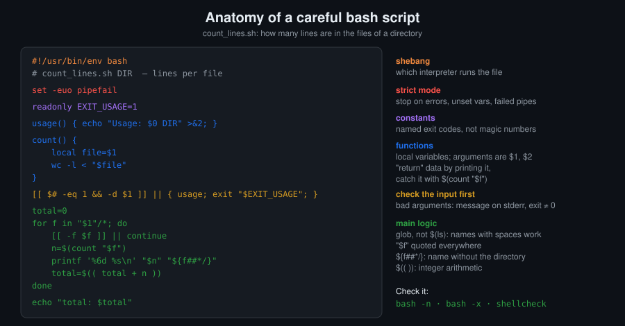
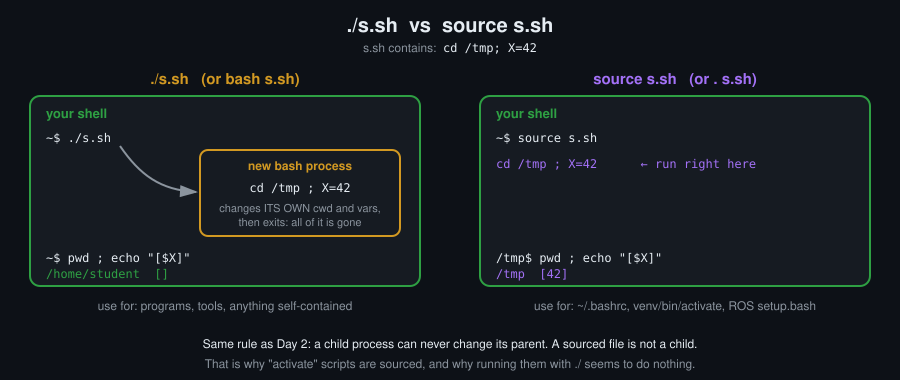

# Day 6: Bash Scripting · Օր 6. Bash script-եր

## Objectives · Նպատակներ
- Գրել, գործարկել և debug անել bash script-եր. shebang, `chmod +x`, `bash -x`
- Տարբերել `./script.sh`-ը և `source script.sh`-ը և բացատրել, թե ինչու է դա կարևոր environment-ի համար
- Օգտագործել փոփոխականներ, չակերտներ, parameter expansion, command substitution, թվաբանություն, զանգվածներ
- Կարդալ script-ի argument-ները (`$1`, `$#`, `"$@"`, `shift`, `getopts`)
- Գրել պայմաններ (`if`, `[ ]`, `[[ ]]`, `(( ))`, `case`) և ցիկլեր (`for`, `while`, `until`)
- Գրել ֆունկցիաներ և հուսալի script-եր. `set -euo pipefail`, `trap`, exit code-եր

## Key Concepts · Հիմնական գաղափարներ
- Shebang, executable script
- Run vs source
- Quoting, word splitting, globbing
- Parameter expansion. `${var:-default}`, `${f##*.}`, `${f%.*}`
- Command substitution `$(...)`, arithmetic `$((...))`
- Positional parameters, `getopts`
- `test`, `[ ]`, `[[ ]]`, `(( ))`, `case`
- `for`, `while read`, `until`
- Functions, `local`, return status
- `set -euo pipefail`, `trap`, `shellcheck`

## Definitions · Սահմանումներ

*Այսօր ներմուծվող տերմինները։ Նույն տեքստը կա [GLOSSARY.md](../GLOSSARY.md)-ում։*

**Shell script** — Տեքստային ֆայլ, որը պարունակում է shell-ի հրամաններ։ Այն կատարվում է տող առ տող, ինչպես եթե հրամանները գրեիր terminal-ում։

**Shebang** — Script-ի առաջին տողը, որը սկսվում է `#!`-ով և ասում է kernel-ին, թե որ ծրագիրը պետք է կատարի ֆայլը. `#!/usr/bin/env bash`, `#!/usr/bin/env python3`։

**Source (`.`)** — Script-ի կատարում **ընթացիկ** shell-ում՝ առանց նոր process-ի. `source file` կամ `. file`։ Script-ի փոփոխությունները (փոփոխականներ, `cd`) մնում են shell-ում։

**Word splitting** — Shell-ը չակերտներից դուրս գտնվող փոփոխականի արժեքը բաժանում է բառերի բացատներով։ `f="my file.txt"; rm $f` փորձում է ջնջել երկու ֆայլ. `my` և `file.txt`։ Դրանից պաշտպանում են կրկնակի չակերտները. `rm "$f"`։

**Parameter expansion** — `${...}` գրելաձևը, որով shell-ը փոփոխականի արժեքի հետ գործողություններ է անում. լռելյայն արժեք, երկարություն, մասի կտրում, փոխարինում։

**Command substitution** — `$(command)`. հրամանի ելքը տեղադրվում է տողի մեջ. `today=$(date +%F)`։

**Positional parameters** — Script-ի կամ ֆունկցիայի argument-ները. `$1`, `$2`, ..., `${10}`. `$#`՝ քանակը, `"$@"`՝ բոլորը, յուրաքանչյուրը առանձին բառ։

**`[[ ]]`** — Bash-ի պայմանի կառուցվածք, որը ավելի հուսալի է, քան `[ ]`-ը. ներսում չկա word splitting և globbing, աշխատում են `&&`, `||`, `<`, `>`, `=~` (regex)։

**`(( ))`** — Թվաբանական արտահայտություն։ Ներսում փոփոխականներին `$` պետք չէ։ Exit status-ը 0 է, եթե արդյունքը **զրո չէ**։

**Function** — Անվանված հրամանների խումբ script-ի ներսում։ Ստանում է argument-ներ `$1`, `$2`-ով, վերադարձնում է exit status (`return N`) և կարող է «վերադարձնել» տեքստ՝ տպելով այն stdout։

**`trap`** — Հրաման, որը կատարվում է, երբ script-ը ստանում է signal կամ ավարտվում է. `trap 'rm -f "$tmp"' EXIT`՝ մաքրել ժամանակավոր ֆայլերը ցանկացած դեպքում։

**`set -euo pipefail`** — Script-ը դարձնում է խիստ. `-e`՝ կանգնել առաջին սխալի վրա, `-u`՝ չսահմանված փոփոխականը սխալ է, `-o pipefail`՝ pipeline-ը ձախողված է, եթե ձախողվել է նրա ցանկացած հրաման։

## Commands · Հրամաններ

*Այսօրվա հրամանները։ Բոլոր օրերի հրամանների ցանկը [COMMANDS.md](../COMMANDS.md)-ում է։*

```bash
# Գործարկել
chmod +x script.sh && ./script.sh arg1 arg2
bash script.sh ; source script.sh ; . script.sh
bash -x script.sh                       # տպել ամեն հրամանը կատարելուց առաջ
bash -n script.sh                       # միայն ստուգել syntax-ը
shellcheck script.sh                    # գտնել տիպիկ սխալները (sudo apt install shellcheck)

# Փոփոխականներ և expansion
name="Linux" ; echo "Hello, ${name}!"
echo "${1:-default}" "${#name}" "${name,,}" "${name^^}"
f=photo.tar.gz ; echo "${f##*.}" "${f#*.}" "${f%.*}" "${f%%.*}"   # gz tar.gz photo.tar photo
echo "${f/photo/image}"                 # image.tar.gz
n=$(ls | wc -l) ; echo $(( n * 2 + 1 ))
arr=(a b "c d") ; echo "${arr[1]}" "${#arr[@]}" ; for x in "${arr[@]}"; do echo "$x"; done
declare -A count ; count[jpg]=3 ; echo "${!count[@]}" "${count[jpg]}"
read -r -p "Your name: " user

# Պայմաններ և ցիկլեր
[ -f file ] && echo exists ; [[ $s == *.txt ]] ; (( x > 5 ))
for f in *.txt; do echo "$f"; done
for ((i = 0; i < 10; i++)); do echo $i; done ; for i in {1..10}; do :; done
while IFS= read -r line; do echo "$line"; done < file.txt
case "$ext" in jpg|png) echo image ;; *) echo other ;; esac
```

## Functions · Ֆունկցիաներ

*Այսօր C ֆունկցիաներ չկան. bash-ի ներքին հրամանները, որոնք script-երում փոխարինում են դրանց. Ամբողջական ցանկը [API.md](../API.md)-ում է։*

```bash
getopts "nvh" opt        # option-ների մշակում, ինչպես C-ի getopt-ը (Օր 2). OPTARG, OPTIND
shift [N]                # տեղաշարժել positional parameter-ները ձախ
local var=value          # ֆունկցիայի տեղային փոփոխական
return [N]               # ֆունկցիայի exit status
exit [N]                 # script-ի exit status
trap 'commands' EXIT INT TERM   # կատարել ավարտվելիս / signal ստանալիս
shopt -s nullglob        # *.txt-ը, եթե ֆայլ չկա, դառնում է դատարկ, ոչ թե բառացի "*.txt"
declare -A map           # associative array (dictionary)
printf '%-10s %5d\n' "$name" "$n"   # ֆորմատավորված տպում, ինչպես C-ում
```

---

## 1. Առաջին script-ը

### Visual


```bash
#!/usr/bin/env bash
# hello.sh — first script
echo "Hello, $USER! Today is $(date +%A)."
echo "You are in $PWD and gave me $# arguments: $*"
```

```bash
chmod +x hello.sh       # առանց x իրավունքի ./hello.sh-ը կտա «Permission denied» (Օր 7)
./hello.sh one two
```

**Shebang**-ը (`#!`) kernel-ին ասում է, թե որ ծրագրով կատարել ֆայլը։ `#!/usr/bin/env bash`-ը փնտրում է `bash`-ը `PATH`-ում և ավելի տեղափոխելի է, քան `#!/bin/bash`-ը։ Նույն ձևով են աշխատում Python script-երը (Օր 1, `hello.py`)։

## 2. Գործարկել, թե source անել

### Visual


Օր 2-ի կանոնը. երեխան չի կարող փոխել ծնողին։ `./script.sh`-ը նոր process է, ուստի նրա `cd`-ն, `export`-ը և փոփոխականները անհետանում են, երբ այն ավարտվում է.

```bash
echo 'cd /tmp; X=42' > s.sh
bash s.sh ; pwd ; echo "[$X]"       # նույն թղթապանակը, X-ը դատարկ է
source s.sh ; pwd ; echo "[$X]"     # /tmp, [42]
```

`source`-ը (կամ `.`) կատարում է ֆայլը **ընթացիկ** shell-ում։ Այդպես են աշխատում `~/.bashrc`-ը, Python-ի `venv/bin/activate`-ը և ROS-ի `setup.bash`-ը. դրանց նպատակը հենց ընթացիկ shell-ի environment-ը փոխելն է։

## 3. Փոփոխականներ և չակերտներ

```bash
name="Linux kernel"      # = նշանի շուրջ բացատ չի կարելի
echo $name               # Linux kernel
echo "$name"             # Linux kernel
echo '$name'             # $name
echo "${name}s"          # Linux kernels. {}-ով սահմանում ենք անվան վերջը
```

**Գլխավոր կանոնը. փոփոխականները միշտ դիր կրկնակի չակերտների մեջ։** Առանց չակերտների shell-ը արժեքը բաժանում է բառերի (word splitting) և `*`-ը բացում է որպես ֆայլերի անուններ (globbing).

```bash
f="my file.txt"
touch "$f"
rm $f                    # rm: cannot remove 'my': No such file ...  — երկու argument
rm "$f"                  # ճիշտ
```

**Parameter expansion**.

| Գրելաձև | Արդյունք (`f=photo.tar.gz`, `s=Hello`) | Իմաստ |
|---|---|---|
| `${#s}` | `5` | Երկարություն |
| `${s,,}`, `${s^^}` | `hello`, `HELLO` | Փոքրատառ, մեծատառ |
| `${f##*.}` | `gz` | Ընդլայնում. հեռացնել ամենաերկար `*.` սկզբից |
| `${f#*.}` | `tar.gz` | Հեռացնել ամենակարճ `*.` սկզբից |
| `${f%.*}` | `photo.tar` | Հեռացնել ամենակարճ `.*` վերջից |
| `${f%%.*}` | `photo` | Հեռացնել ամենաերկար `.*` վերջից |
| `${f/photo/img}` | `img.tar.gz` | Փոխարինել առաջինը (`//`՝ բոլորը) |
| `${1:-default}` | | `$1`-ը, կամ `default`, եթե այն դատարկ է |
| `${var:?message}` | | Սխալ և ավարտ, եթե `var`-ը դատարկ է |

**Command substitution** և **թվաբանություն**.

```bash
today=$(date +%F)
files=$(ls | wc -l)
echo $(( files * 2 + 1 ))
(( count++ ))
echo $(( 7 / 2 )) $(( 7 % 2 )) $(( 2 ** 10 ))    # 3 1 1024. միայն ամբողջ թվեր
```

**Զանգվածներ**.

```bash
fruits=(apple "dragon fruit" kiwi)
echo "${fruits[1]}"           # dragon fruit
echo "${#fruits[@]}"          # 3
fruits+=(mango)
for f in "${fruits[@]}"; do echo "$f"; done       # "${arr[@]}"՝ ամեն տարր առանձին բառ

declare -A age                # associative array
age[anna]=21 ; age[aram]=23
for k in "${!age[@]}"; do echo "$k ${age[$k]}"; done
```

**Environment variable-ները և script-երը.** Script-ը ժառանգում է shell-ի **export արված** փոփոխականները (Օր 2)։ Script-ի ներսում սովորական փոփոխականը տեսանելի է միայն script-ին, իսկ `export`-ով՝ նաև նրա գործարկած ծրագրերին.

```bash
LOG_LEVEL=debug ./script.sh   # միայն այս գործարկման համար
```

## 4. Argument-ներ

| Գրելաձև | Իմաստ |
|---|---|
| `$0` | Script-ի անունը |
| `$1` ... `$9`, `${10}` | Argument-ները. 9-ից հետո՝ միայն `{}`-ով |
| `$#` | Argument-ների քանակը |
| `"$@"` | Բոլոր argument-ները, **յուրաքանչյուրը առանձին բառ**. գրեթե միշտ սա է պետք |
| `"$*"` | Բոլորը՝ **մեկ** բառում, բացատներով միացված |
| `shift` | `$2`-ը դառնում է `$1`, ... |

```bash
#!/usr/bin/env bash
echo "script: $0, count: $#"
for arg in "$@"; do echo "[$arg]"; done
```

```bash
./args.sh a "b c" d      # [a] [b c] [d]. "$@"-ը պահպանում է "b c"-ն
```

Option-ների համար կա `getopts`-ը, `getopt`-ի (Օր 2) bash-ի տարբերակը.

```bash
verbose=0 ; output=out.txt
while getopts "vo:h" opt; do
    case $opt in
        v) verbose=1 ;;
        o) output=$OPTARG ;;
        h) usage; exit 0 ;;
        *) usage >&2; exit 1 ;;
    esac
done
shift $(( OPTIND - 1 ))   # հիմա "$@"-ում մնացել են միայն ոչ-option argument-ները
```

## 5. Պայմաններ

`if`-ը ստուգում է **ցանկացած հրամանի exit status**, ոչ միայն փակագծերը (Օր 2).

```bash
if grep -q root /etc/passwd; then echo "root exists"; fi
if cd "$dir" 2>/dev/null; then echo "moved"; else echo "no such dir"; fi
```

`[ ]`-ը (`test` հրամանը), `[[ ]]`-ը և `(( ))`-ը նույնպես պարզապես հրամաններ են, որոնք վերադարձնում են 0 կամ 1.

| Ֆայլեր | Տողեր | Թվեր `[ ]`-ում | Թվեր `(( ))`-ում |
|---|---|---|---|
| `-e f` գոյություն ունի | `-z "$s"` դատարկ է | `-eq` = | `==` |
| `-f f` սովորական ֆայլ | `-n "$s"` դատարկ չէ | `-ne` ≠ | `!=` |
| `-d f` թղթապանակ | `"$a" = "$b"` հավասար | `-lt` < | `<` |
| `-L f` symlink | `"$a" != "$b"` | `-le` ≤ | `<=` |
| `-r` `-w` `-x f` իրավունքներ | `[[ $s == *.txt ]]` glob | `-gt` > | `>` |
| `-s f` դատարկ չէ | `[[ $s =~ ^[0-9]+$ ]]` regex (Օր 4) | `-ge` ≥ | `>=` |

```bash
if [[ -f "$file" && -r "$file" ]]; then
    echo "readable file"
elif [[ -d "$file" ]]; then
    echo "directory"
else
    echo "something else"
fi

if (( $# < 1 )); then echo "usage: $0 FILE" >&2; exit 1; fi
```

Թակարդներ.

- Փակագծերի ներսում **բացատները պարտադիր են**. `[ -f "$f" ]`, ոչ թե `[-f "$f"]`. `[`-ը հրամանի անուն է։
- `[ ]`-ում ցանկացած ոչ դատարկ տող true է, այդ թվում `0`-ն և `"false"`-ը։
- `[ $x = y ]`-ը կկոտրվի, եթե `x`-ը դատարկ է կամ բացատ ունի. գրիր `[ "$x" = y ]` կամ օգտագործիր `[[ ]]`։
- `(( ))`-ը true է, երբ արդյունքը **զրո չէ**. `(( 0 ))`-ի exit status-ը 1 է։ `set -e`-ի հետ `(( count++ ))`-ը, երբ `count`-ը 0 է, կկանգնեցնի script-ը։

**`case`**՝ glob ձևանմուշներով ընտրություն.

```bash
case "${file,,}" in
    *.jpg|*.jpeg|*.png) echo image ;;
    *.txt|*.md)         echo text ;;
    *)                  echo other ;;
esac
```

## 6. Ցիկլեր

```bash
for planet in Mercury Venus Earth; do echo "$planet"; done    # ցանկ
for f in *.txt; do wc -l "$f"; done                           # glob
for u in $(cut -d: -f1 /etc/passwd); do echo "$u"; done       # command substitution
for ((i = 1; i <= 10; i++)); do echo $i; done                 # C-ի ձևով
for i in {1..10}; do echo $i; done                            # brace expansion
for arg; do echo "$arg"; done                                 # առանց in. "$@"-ի վրա

while IFS= read -r line; do                                   # ֆայլը տող առ տող
    echo "line: $line"
done < input.txt

until ping -c1 -W1 server &>/dev/null; do sleep 1; done       # սպասել, մինչև server-ը արթնանա
```

`break`-ը դուրս է գալիս ցիկլից, `continue`-ն անցնում է հաջորդ քայլին։ Եթե `do`-ն նույն տողում է, պետք է `;`. `for x in list; do`։

Երկու տիպիկ սխալ.

- `for f in $(ls)`-ը կոտրվում է բացատներով անունների վրա. օգտագործիր `for f in *`։
- Եթե `*.txt` ֆայլ չկա, `for f in *.txt`-ը կկատարվի մեկ անգամ՝ `f="*.txt"` բառացի արժեքով։ Լուծումը՝ `shopt -s nullglob` կամ ստուգում `[[ -e "$f" ]] || continue`։

## 7. Ֆունկցիաներ

```bash
greet() {
    local name=${1:-world}      # local. տեսանելի միայն ֆունկցիայում
    echo "Hello, $name"         # «վերադարձնել» տեքստ = տպել այն
}

is_even() {
    (( $1 % 2 == 0 ))           # exit status-ը դառնում է ֆունկցիայի արդյունքը
}

msg=$(greet Anna)               # վերցնել ֆունկցիայի ելքը
if is_even 42; then echo even; fi
```

Ֆունկցիան «վերադարձնում» է երկու բան. **exit status** (0–255, `return N`)՝ պայմանների համար, և **ելք** (`echo`)՝ տվյալների համար։ Թիվ վերադարձնելու համար օգտագործիր `echo`, ոչ թե `return`. `return 300`-ը կդառնա 44։

## 8. Հուսալի script-եր

```bash
#!/usr/bin/env bash
set -euo pipefail               # կանգնել սխալի վրա, չսահմանված փոփոխականը սխալ է, pipe-ի սխալները չկորչեն

tmp=$(mktemp -d)                # Օր 2
trap 'rm -rf "$tmp"' EXIT       # կմաքրվի ցանկացած դեպքում. նորմալ ավարտ, սխալ, Ctrl+C

log() { echo "[$(date +%T)] $*" >&2; }   # հաղորդագրությունները՝ stderr

[[ $# -eq 1 ]] || { echo "usage: $0 DIR" >&2; exit 1; }
[[ -d $1 ]]    || { echo "$1: not a directory" >&2; exit 2; }
```

Debug անելու գործիքներ.

```bash
bash -n script.sh        # միայն syntax
bash -x script.sh        # տպել ամեն հրամանը՝ փոփոխականները բացված. կամ script-ի ներսում set -x ... set +x
shellcheck script.sh     # ստատիկ վերլուծություն. գտնում է չակերտների բացակայություն, սխալ համեմատություններ և այլն
```

`shellcheck`-ը ամենաօգտակար գործիքն է bash սովորողի համար. գործարկիր այն ամեն script-ի վրա։

---

## Resources · Աղբյուրներ
- [Advanced Bash-Scripting Guide](https://tldp.org/LDP/abs/html/), TLDP. [Loops](https://tldp.org/LDP/abs/html/loops1.html), [Test Constructs](https://tldp.org/LDP/abs/html/testconstructs.html), [Positional Parameters](https://tldp.org/LDP/abs/html/othertypesv.html), [Loops and Branches](http://tldp.org/LDP/abs/html/loops.html) (հին դասի հղումը)
- [GNU Bash Reference Manual](https://www.gnu.org/software/bash/manual/bash.html)
- [The Linux Command Line](https://linuxcommand.org/tlcl.php), William Shotts, Part 4 «Writing Shell Scripts»
- [ShellCheck](https://www.shellcheck.net/). script-երի ստուգում online
- [BashFAQ](https://mywiki.wooledge.org/BashFAQ) և [Bash Pitfalls](https://mywiki.wooledge.org/BashPitfalls), Greg's Wiki

## Hands-On Task · Գործնական առաջադրանք

Գրիր script, որը կարգի է բերում թղթապանակը. ֆայլերը տեղափոխում է ենթաթղթապանակների ըստ տեսակի. [`template.sh`](template.sh)։

```bash
chmod +x template.sh
./template.sh --selftest            # ստեղծում է փորձնական թղթապանակ և ստուգում քո ֆունկցիաները
./template.sh -n ~/Downloads        # dry run. միայն ցույց տալ, ինչ կտեղափոխվեր
./template.sh -v ~/Downloads        # տեղափոխել և պատմել
```

```
~/Downloads/                       ~/Downloads/
  photo.JPG                          images/photo.JPG, images/my photo.png
  my photo.png        ──────►        documents/notes.txt
  notes.txt                          code/build.sh
  build.sh                           archives/backup.tar.gz
  backup.tar.gz                      other/Makefile
  Makefile
```

Լրացրու չորս TODO-ները. `category_of` (`case` ընդլայնման վրա), `parse_args` (`getopts`), `organize` (ցիկլ, dry run, մի վերագրիր եղած ֆայլերը), `report` (associative array)։ `--selftest`-ը ցույց կտա `PASS`/`FAIL` ամեն ստուգման համար։ Վերջում գործարկիր `shellcheck template.sh`։

## Self-Learning · Ինքնուրույն աշխատանք
1. Գրիր script, որը հաշվում է հաշվիչը environment variable-ներով, ինչպես Օր 2-ի C++ ծրագիրը. `x=10 y=20 ./calc.sh x+y`։ Համեմատիր երկու իրականացումները։
2. Գրիր `backup.sh DIR`, որը ստեղծում է `DIR-YYYY-MM-DD.tar.gz` (Օր 5), պահում է միայն վերջին 7 backup-ները և ջնջում հներին։
3. Գրիր script, որը `/var/log/auth.log`-ից (կամ `journalctl -u ssh`) հաշվում է SSH-ի ձախողված մուտքերը ըստ IP-ի և տպում 5 ամենաշատը (Օր 4)։
4. Գրիր `watch_dir.sh DIR`, որը ամեն 2 վայրկյանը մեկ ստուգում է, թե արդյոք թղթապանակում նոր ֆայլ է հայտնվել, և տպում նրա անունը։ Ctrl+C-ով կանգնեցնելիս թող տպի «bye» (`trap ... INT`)։
5. Համեմատիր `for arg in "$@"`, `for arg in $@`, `for arg in "$*"`-ը `./t.sh a "b c" d`-ի վրա։ Բացատրիր արդյունքները։
6. Գրիր ռեկուրսիվ ֆունկցիա, որը հաշվում է ֆակտորիալը։ Ինչ է պատահում 21!-ի դեպքում և ինչու (64-bit ամբողջ թվեր)։
7. Վերցրու քո script-երից մեկը և գործարկիր `shellcheck`։ Ուղղիր բոլոր զգուշացումները և բացատրիր, թե ինչ սխալներ էին դրանք։
8. Ընդլայնիր template-ը `-r` option-ով. տեղափոխել ֆայլերը նաև ենթաթղթապանակներից (`find ... -print0` + `while IFS= read -r -d ''`)։

## Self-Check · Ինքնաստուգում
Պատասխաններ չկան։ Մտածիր ինքնուրույն։

1. Ինչո՞ւ `./script.sh`-ը, որը կատարում է `cd /tmp`, չի փոխում քո terminal-ի թղթապանակը։ Ինչպես գրել script, որը փոխում է այն։
2. Ինչ կանի `rm $file`-ը, եթե `file="-rf /"`։ Իսկ `rm -- "$file"`-ը։
3. Ինչ տարբերություն կա `"$@"`-ի և `"$*"`-ի միջև։ Ինչ կլինի առանց չակերտների։
4. Ինչո՞ւ է `[ -f $f ]`-ը աշխատում սովորական անունների վրա, բայց կոտրվում `my file.txt`-ի վրա։
5. `if [ 0 ]; then echo yes; fi`-ը կտպի՞ yes։ Իսկ `if (( 0 )); then echo yes; fi`-ը։
6. Ինչ են տպում `${f%.*}`-ը և `${f%%.*}`-ը `f=archive.tar.gz`-ի համար։
7. Ինչո՞ւ է `for f in $(ls)`-ը վատ միտք։
8. Ինչպես կարող է ֆունկցիան վերադարձնել տող։ Իսկ 1000 թիվը։
9. Ինչ է անում `set -o pipefail`-ը։ Ինչ կլինի `false | true`-ի հետ առանց դրա և դրանով (Օր 2)։
10. Ինչու՞ է `trap 'rm -rf "$tmp"' EXIT`-ը ավելի լավ, քան `rm -rf "$tmp"`-ը script-ի վերջում։

## Code Template · Կոդի ձևանմուշ
Տե՛ս [`template.sh`](template.sh)-ը։ Այս օրը կոդը bash է, ոչ թե C++. CMake-ը այն չի հավաքում։

```bash
chmod +x template.sh
./template.sh --selftest
```
