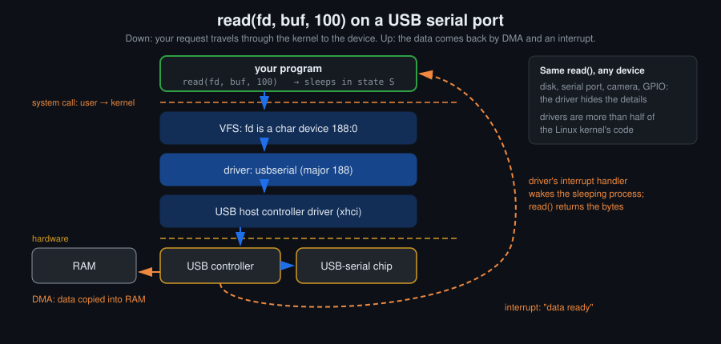

# Day 9: Hardware and Drivers · Օր 9. Hardware և driver-ներ

## Objectives · Նպատակներ
- Բացատրել, թե ինչպես է ծրագրի խնդրանքը հասնում սարքին. system call, VFS, driver, bus, interrupt
- Պարզել համակարգչի hardware-ը. CPU, memory, disk-ներ, PCI և USB սարքեր, network քարտեր
- Տարբերել character և block սարքերը, բացատրել major/minor համարները և `/dev`-ը
- Բացատրել, թե ինչպես են սարքերի ֆայլերը հայտնվում ավտոմատ (udev) և գրել udev կանոն
- Կառավարել kernel module-ները. `lsmod`, `modinfo`, `modprobe`, `rmmod`
- Կարդալ և փոխել kernel-ի և սարքերի պարամետրերը `/proc`-ում և `/sys`-ում, C++-ից նույնպես

## Key Concepts · Հիմնական գաղափարներ
- Device driver, bus (PCIe, USB, I2C, SPI)
- Interrupt, DMA, memory-mapped I/O
- Character device, block device, major/minor number
- `/dev`, devtmpfs, udev
- Special devices. `/dev/null`, `/dev/zero`, `/dev/urandom`, loop
- Kernel module. `.ko`, `modprobe`
- `/proc` և `/sys` (sysfs)
- `ioctl`

## Definitions · Սահմանումներ

*Այսօր ներմուծվող տերմինները։ Նույն տեքստը կա [GLOSSARY.md](../GLOSSARY.md)-ում։*

**Device driver** — Kernel-ի կոդ, որը գիտի, թե ինչպես աշխատել կոնկրետ սարքի կամ սարքերի ընտանիքի հետ, և այն ներկայացնում է մնացած համակարգին ստանդարտ ինտերֆեյսով (ֆայլ `/dev`-ում, network ինտերֆեյս, block սարք)։

**Bus** — Կապի ուղի CPU-ի և սարքերի միջև՝ իր կանոններով. **PCIe** (վիդեոքարտ, NVMe disk, network քարտ), **USB**, իսկ embedded բորդերում նաև **I2C**, **SPI**, **UART**։

**Interrupt** — Ազդանշան սարքից CPU-ին. «ինձ ուշադրություն է պետք» (ստեղնը սեղմվեց, packet-ը եկավ, disk-ը ավարտեց կարդալը)։ CPU-ն ընդհատում է ընթացիկ աշխատանքը և կանչում driver-ի **interrupt handler**-ը։

**DMA (Direct Memory Access)** — Սարքը ինքն է պատճենում տվյալները RAM-ում՝ առանց CPU-ի մասնակցության, և ավարտելուց հետո ուղարկում է interrupt։

**Character device** — Սարք, որի հետ աշխատում են բայթերի stream-ով, առանց պատահական դիմման. terminal, serial port, ձայնային քարտ, `/dev/null`։ `ls -l`-ում՝ `c`։

**Block device** — Սարք, որի հետ աշխատում են ֆիքսված չափի block-երով և ցանկացած հերթականությամբ. disk-ներ, flash, SD քարտ։ `ls -l`-ում՝ `b`։ Ծրագրերը սովորաբար դրանց հետ աշխատում են ոչ ուղիղ, այլ filesystem-ի միջոցով։

**Major / minor number** — Սարքի ֆայլի երկու համարը։ **Major**-ը որոշում է driver-ը, **minor**-ը՝ կոնկրետ սարքը կամ նրա մասը այդ driver-ի ներսում։ `/dev/sda`-ն 8,0 է, `/dev/sda1`-ը՝ 8,1։

**udev** — User space service, որը kernel-ից ստանում է հաղորդագրություններ սարքերի միացման և անջատման մասին և ստեղծում, անվանում, permission-ներ է տալիս `/dev`-ի ֆայլերին՝ ըստ **կանոնների**։

**Kernel module** — Kernel-ի կոդի կտոր (`.ko` ֆայլ), որը կարելի է բեռնել և հեռացնել աշխատող համակարգում։ Driver-ների մեծ մասը module-ներ են։

**sysfs (`/sys`)** — Վիրտուալ filesystem, որը ցույց է տալիս kernel-ի սարքերի մոդելը. սարքեր, bus-եր, դասեր, driver-ներ։ Յուրաքանչյուր ֆայլ սովորաբար պարունակում է **մեկ** արժեք, և որոշները կարելի է փոխել։

**`ioctl`** — Համընդհանուր system call սարքին հատուկ հրամաններ ուղարկելու համար, որոնք չեն տեղավորվում `read`/`write`-ի մեջ. ստանալ էկրանի չափը, փոխել serial port-ի արագությունը, բացել CD-ROM-ը։

---

## 1. Ծրագրից մինչև սարք

### Visual


Օր 1-ում ասացինք, որ ծրագիրը չի կարող ուղիղ դիմել hardware-ին։ Ահա ինչ է կատարվում, երբ ծրագիրը կարդում է, օրինակ, serial port-ից.

1. Ծրագիրը կանչում է `read(fd, buf, 100)` → **system call**, CPU-ն անցնում է kernel mode։
2. **VFS**-ը (Օր 3) տեսնում է, որ `fd`-ն character սարք է major 188-ով, և փոխանցում է խնդրանքը **driver**-ին (`usbserial`)։
3. Driver-ը գիտի սարքի «լեզուն». նա ուղարկում է հրամաններ **bus**-ի controller-ին (USB)։
4. Եթե տվյալներ դեռ չկան, process-ը քնում է (`S` վիճակ, Օր 8)։
5. Երբ սարքը ստանում է բայթեր, այն դրանք գրում է RAM-ում (**DMA**) և ուղարկում **interrupt**։
6. Kernel-ը կանչում է driver-ի interrupt handler-ը, որը արթնացնում է process-ը։ `read`-ը վերադարձնում է բայթերը։

Driver-ը սարքի ռեգիստրներին դիմում է **memory-mapped I/O**-ով. սարքի ռեգիստրները երևում են որպես հասցեներ memory-ի մեջ, և դրանցում գրելը սարքին հրաման ուղարկելն է։

Driver-ները Linux kernel-ի կոդի կեսից ավելին են։ Դրա շնորհիվ նույն `read`-ը աշխատում է հազարավոր տարբեր սարքերի հետ։

## 2. Ինչ hardware ունեմ

| Ինչ | Հրաման | Որտեղից |
|---|---|---|
| CPU | `lscpu`, `nproc` | `/proc/cpuinfo`, `/sys/devices/system/cpu` |
| Memory | `free -h` | `/proc/meminfo` |
| Disk-ներ | `lsblk`, `df -h` | `/sys/block`, `/proc/partitions` |
| PCI սարքեր | `lspci -k` | `/sys/bus/pci/devices` |
| USB սարքեր | `lsusb`, `lsusb -t` | `/sys/bus/usb/devices` |
| Network | `ip link` | `/sys/class/net` |
| Ջերմաստիճան | `sensors` | `/sys/class/thermal`, `/sys/class/hwmon` |
| Interrupt-ներ | | `/proc/interrupts` |
| Ամեն ինչ | `sudo lshw -short`, `inxi -F` | |

`sudo dmidecode -t memory`-ը կարդում է BIOS/UEFI-ի աղյուսակները (RAM-ի մոդուլներ, motherboard). աշխատում է PC-ների վրա, բայց ոչ ARM board-երի մեծ մասի վրա, որոնք փոխարենը ունեն device tree (embedded Օր 1)։

`lspci -k`-ը ցույց է տալիս նաև, թե որ driver-ն է սպասարկում յուրաքանչյուր սարքը.

```
00:1f.6 Ethernet controller: Intel Corporation Ethernet Connection (7) I219-V
        Kernel driver in use: e1000e
        Kernel modules: e1000e
```

Ուշադրություն դարձրու. այս հրամանները պարզապես կարդում և գեղեցիկ տպում են `/proc`-ի և `/sys`-ի ֆայլերը։ Լաբորատորիայում նույնը կանես C++-ով։

## 3. Սարքերի ֆայլեր

### Visual


Սարքի ֆայլը տվյալներ չի պահում disk-ի վրա. այն **դուռ է դեպի driver**։ Ինչ գրում ես այնտեղ, գնում է driver-ին, ինչ կարդում ես՝ գալիս է driver-ից։

```bash
ls -l /dev/sda /dev/sda1 /dev/ttyS0 /dev/null
# brw-rw---- 1 root disk    8,  0 ... /dev/sda       ← block, major 8 (SCSI/SATA disk), minor 0
# brw-rw---- 1 root disk    8,  1 ... /dev/sda1      ← նույն disk-ի 1-ին partition
# crw-rw---- 1 root dialout 4, 64 ... /dev/ttyS0     ← character, serial port
# crw-rw-rw- 1 root root    1,  3 ... /dev/null
```

Չափի տեղում `ls`-ը ցույց է տալիս **major, minor** համարները։ **Major**-ը ընտրում է driver-ը, **minor**-ը՝ սարքը այդ driver-ի ներսում։ Բեռնված driver-ների major համարները `/proc/devices`-ում են։

Ծրագրում նույնը տալիս է `stat()`-ի `st_rdev` դաշտը (§7, Functions), իսկ terminal-ում՝ `stat -c '%t:%T %n' /dev/sda` (major:minor, hex)։

Սարքի ֆայլ կարելի է ստեղծել ձեռքով `mknod`-ով (միայն root). ֆայլի անունը նշանակություն չունի, կարևոր են տեսակը և համարները.

```bash
sudo mknod ./mynull c 1 3       # նույն սարքը, ինչ /dev/null
echo hello > mynull ; cat mynull    # ոչինչ. տվյալները անհետացան
sudo rm mynull                  # ջնջվում է միայն դուռը, ոչ թե driver-ը
```

Գործնականում ձեռքով ոչինչ չենք ստեղծում. `/dev`-ը **devtmpfs** filesystem է, որը kernel-ը լրացնում է ինքը, իսկ **udev**-ը սարքերը միացնելիս տալիս է անուններ, permission-ներ և symlink-եր։

### udev

USB սարք միացնելիս kernel-ը ուղարկում է **uevent**, և `systemd-udevd`-ն կիրառում է կանոնները `/lib/udev/rules.d/`-ից և `/etc/udev/rules.d/`-ից.

```bash
udevadm monitor --udev           # միացրու USB flash. տես իրադարձությունները
udevadm info -a -n /dev/ttyUSB0  # սարքի հատկությունները. idVendor, idProduct, serial
```

Կանոնի օրինակ. ամեն անգամ, երբ միանում է կոնկրետ GPS ընդունիչը, տալ նրան կայուն անուն և permission-ներ.

```bash
# /etc/udev/rules.d/99-gps.rules
SUBSYSTEM=="tty", ATTRS{idVendor}=="1546", ATTRS{idProduct}=="01a7", SYMLINK+="gps", GROUP="dialout", MODE="0660"
```

```bash
sudo udevadm control --reload && sudo udevadm trigger
ls -l /dev/gps                   # /dev/gps -> ttyACM0. անունը չի փոխվի, ինչ հերթականությամբ էլ սարքերը միանան
```

Սա հատկապես կարևոր է բորդերի և ռոբոտների համար, որտեղ մի քանի USB սարք կա, և `ttyUSB0`/`ttyUSB1` համարները կարող են փոխվել ամեն boot-ի ժամանակ։

## 4. Հատուկ սարքեր

| Սարք | Կարդալիս | Գրելիս | Օգտագործում |
|---|---|---|---|
| `/dev/null` | EOF անմիջապես | Ամեն ինչ անհետանում է | `cmd 2>/dev/null` |
| `/dev/zero` | Անվերջ զրոներ | Անհետանում է | Ֆայլ զրոներով. `head -c 1M /dev/zero > f` |
| `/dev/full` | Զրոներ | Միշտ «No space left on device» | Ստուգել, թե ինչպես է ծրագիրը մշակում լիքը disk-ը |
| `/dev/urandom` | Պատահական բայթեր | — | Key-եր, պատահական թվեր |
| `/dev/tty` | Ընթացիկ terminal-ը | Ընթացիկ terminal-ը | Հարցնել password, նույնիսկ եթե stdin-ը ուղղորդված է |
| `/dev/loopN` | Ֆայլի պարունակությունը | Ֆայլի մեջ | Ֆայլը որպես disk (Օր 3). `losetup`, `mount -o loop` |

Բինար տվյալները տեսնելու համար օգտագործիր `xxd` (hex dump). `head -c 16 /dev/urandom | xxd`։

`/dev/urandom`-ը kernel-ի պատահական թվերի գեներատորն է, որը սնվում է hardware-ի աղմուկով (interrupt-ների ժամանակներ, սարքերի ազդանշաններ)։ Բոլոր կրիպտոգրաֆիկ key-երը գեներացվում են դրանից։

## 5. Kernel module-ներ

Linux-ի driver-ների մեծ մասը **module**-ներ են (`.ko`), որոնք բեռնվում են, երբ համապատասխան սարքը հայտնաբերվում է.

```bash
lsmod | head                     # բեռնված module-ները, չափը, ով է օգտագործում
modinfo e1000e                   # ֆայլը, license-ը, հեղինակը, պարամետրերը, ինչ սարքերի համար է (alias)
sudo modprobe loop               # բեռնել (dependency-ների հետ միասին)
sudo modprobe -r loop            # հեռացնել
ls /lib/modules/$(uname -r)/kernel/drivers/
```

Ինչ է անում driver-ը բեռնվելիս, երևում է kernel-ի log-ում. `sudo dmesg -w`-ը (`-w`՝ սպասել նոր հաղորդագրությունների) բաց պահիր մեկ terminal-ում և մյուսում բեռնիր module-ը կամ միացրու USB սարք։

`modprobe`-ը ավելի խելացի է, քան ցածր մակարդակի `insmod`-ը և `rmmod`-ը. այն գիտի module-ների կախվածությունները (`modules.dep`)։ Module-ի բեռնումը արգելելու համար՝ `blacklist` տող `/etc/modprobe.d/`-ում։

Module-ը, որ բեռնվում է, աշխատում է kernel space-ում՝ լրիվ permission-ներով։ Այդ պատճառով.

- միայն root-ը կարող է բեռնել module-ներ,
- Secure Boot-ով համակարգերում module-ը պետք է ստորագրված լինի,
- ոչ GPL module-ը «աղտոտում» է kernel-ը (taint, Օր 1)։

Սեփական module գրելը (hello module, պարզ character driver) [embedded դասընթացի Օր 3](../../embedded/README.md)-ի թեման է։ Այստեղ՝ միայն Self-Learning առաջադրանք։

## 6. `/proc` և `/sys`

Երկուսն էլ վիրտուալ են (Օր 3). kernel-ը ստեղծում է ֆայլի պարունակությունը, երբ դու այն կարդում ես։

**`/proc`**-ը ավելի հին է և պարունակում է ամեն ինչ մեկտեղ.

| Ֆայլ | Ինչ կա |
|---|---|
| `/proc/PID/` | Ամեն process-ի մասին (Օր 8) |
| `/proc/cpuinfo`, `/proc/meminfo` | CPU, memory |
| `/proc/interrupts` | Քանի interrupt է ստացել ամեն սարքը, ամեն CPU-ի վրա |
| `/proc/devices` | Driver-ների major համարները |
| `/proc/partitions`, `/proc/mounts` | Partition-ներ, mount-եր |
| `/proc/uptime`, `/proc/loadavg` | Աշխատանքի ժամանակը, ծանրաբեռնվածությունը |
| `/proc/sys/` | Kernel-ի կարգավորելի պարամետրեր. `sysctl` |

**`/sys`**-ը (sysfs) կառուցվածքային է և ցույց է տալիս kernel-ի **սարքերի մոդելը**. ամեն սարք՝ directory, ամեն հատկություն՝ ֆայլ մեկ արժեքով.

```bash
ls /sys/class                          # դասեր. net, block, tty, thermal, leds, gpio ...
ls /sys/class/net                      # eth0 lo wlan0
cat /sys/class/net/eth0/address        # MAC հասցեն
cat /sys/class/net/eth0/operstate      # up / down
cat /sys/block/sda/size                # չափը 512-բայթանոց sector-ներով
cat /sys/block/sda/queue/rotational    # 1՝ պտտվող disk, 0՝ SSD
ls /sys/bus/usb/devices                # USB ծառը
cat /sys/bus/usb/devices/1-1/idVendor /sys/bus/usb/devices/1-1/product
```

Որոշ ֆայլեր կարելի է **գրել**, և դա փոխում է սարքի վարքը.

```bash
echo powersave | sudo tee /sys/devices/system/cpu/cpu0/cpufreq/scaling_governor
echo 1 | sudo tee /sys/class/leds/led0/brightness        # Raspberry Pi-ի LED-ը
sudo sysctl -w net.ipv4.ip_forward=1                     # = echo 1 > /proc/sys/net/ipv4/ip_forward
```

Embedded բորդերում հենց այսպես են կառավարում LED-երը, GPIO-ն, PWM-ը, ջերմաստիճանի սենսորները ([embedded դասընթացի Օր 2](../../embedded/README.md))։

## 7. `ioctl`

`read`-ը և `write`-ը բավական չեն բոլոր գործողությունների համար։ Ինչպես իմանալ terminal-ի չափը, փոխել serial port-ի արագությունը կամ բացել CD-ROM-ը։ Դրա համար կա `ioctl`-ը. «ուղարկել driver-ին հրաման համար N-ով».

```cpp
#include <sys/ioctl.h>
#include <unistd.h>

winsize ws;
if (0 == ioctl(STDOUT_FILENO, TIOCGWINSZ, &ws))
    std::printf("terminal: %d columns, %d rows\n", ws.ws_col, ws.ws_row);
```

Հրամանների համարները սահմանում է ամեն driver, և դրանք նկարագրված են նրա header-ներում և փաստաթղթերում։

---

## Commands · Հրամաններ

*Ամփոփում. այս օրվա հրամանները, որոնք բացատրված են վերևում։ Անգիր անել պետք չէ. վերադարձիր այստեղ, երբ մոռանաս գրելաձևը։ Բոլոր օրերի հրամանների ցանկը [COMMANDS.md](../COMMANDS.md)-ում է։*

```bash
# Ինչ hardware ունեմ
lscpu ; nproc ; cat /proc/cpuinfo | head -30
free -h ; cat /proc/meminfo | head
lsblk ; lsblk -o NAME,SIZE,TYPE,MOUNTPOINT,MODEL ; cat /proc/partitions
lspci ; lspci -k                         # PCI սարքերը և նրանց driver-ները
lsusb ; lsusb -t                         # USB սարքերը, ծառի տեսքով
ip link ; cat /sys/class/net/eth0/address
sudo lshw -short ; sudo dmidecode -t memory ; inxi -F
sensors                                  # ջերմաստիճաններ (lm-sensors)
cat /proc/interrupts ; cat /proc/devices

# Սարքերի ֆայլեր
ls -l /dev/sda /dev/null /dev/tty
stat -c '%t:%T %n' /dev/sda             # major:minor, hex
sudo mknod ./mynull c 1 3                # ձեռքով ստեղծել սարքի ֆայլ
udevadm monitor                          # միացրու USB flash և դիտիր իրադարձությունները
udevadm info -a -n /dev/ttyUSB0          # սարքի բոլոր հատկությունները կանոնների համար

# Հատուկ սարքեր
head -c 16 /dev/urandom | xxd ; cat /dev/zero | head -c 1M > zeros.bin ; echo test > /dev/null
echo x > /dev/full                       # No space left on device
sudo losetup -f --show disk.img          # ֆայլը որպես block սարք (Օր 3)

# Module-ներ
lsmod ; modinfo e1000e ; modinfo -F license snd
sudo modprobe loop ; sudo modprobe -r loop
ls /lib/modules/$(uname -r)/kernel/drivers
sudo dmesg -w                            # դիտիր, ինչ է տպում driver-ը միացնելիս

# /sys
ls /sys/class ; ls /sys/class/net ; cat /sys/block/sda/size
cat /sys/class/thermal/thermal_zone*/temp
cat /sys/devices/system/cpu/cpu0/cpufreq/scaling_governor
```

## Functions · Ֆունկցիաներ

*Ամփոփում. այս օրվա C/C++ ֆունկցիաները։ Ամբողջական ցանկը [API.md](../API.md)-ում է։*

```c
#include <fcntl.h>
#include <unistd.h>
// Սարքի ֆայլը բացվում և կարդացվում է ինչպես սովորական ֆայլը
int open(const char *path, int flags);          // O_RDONLY, O_WRONLY, O_RDWR. վերադարձնում է fd
ssize_t read(int fd, void *buf, size_t count);   // կարդացած բայթերի քանակը, 0՝ EOF
ssize_t write(int fd, const void *buf, size_t count);
int close(int fd);

#include <sys/ioctl.h>
// Սարքին հատուկ հրաման. request-ը driver-ի սահմանած կոդն է
int ioctl(int fd, unsigned long request, ...);

#include <sys/sysmacros.h>
// Սարքի համարից (st_rdev) առանձնացնել major-ը և minor-ը
unsigned int major(dev_t dev);
unsigned int minor(dev_t dev);
```

```cpp
#include <filesystem>
// C++17. directory-ի entry-ների ցիկլ (opendir/readdir-ի փոխարեն, Օր 3)
for (auto &entry : std::filesystem::directory_iterator("/sys/class/net"))
    std::cout << entry.path().filename() << '\n';
```

## Resources · Աղբյուրներ
- *Advanced Linux Programming*, Chapter 6 «Devices» և Chapter 7 «The /proc File System». [`docs/linux_book.pdf`](../docs/linux_book.pdf). Նկատի ունեցիր, որ գիրքը 2001 թ. է. `/dev/hda`-ի փոխարեն այսօր `/dev/sda` և `/dev/nvme0n1` է, իսկ `/dev`-ը կառավարում է udev-ը
- [The Linux Kernel documentation: Linux allocated devices](https://docs.kernel.org/admin-guide/devices.html). major/minor համարների ցանկը
- [`sysfs(5)`](https://man7.org/linux/man-pages/man5/sysfs.5.html), [`proc(5)`](https://man7.org/linux/man-pages/man5/proc.5.html), [`udev(7)`](https://man7.org/linux/man-pages/man7/udev.7.html), [`modprobe(8)`](https://man7.org/linux/man-pages/man8/modprobe.8.html), [`null(4)`](https://man7.org/linux/man-pages/man4/null.4.html), [`random(4)`](https://man7.org/linux/man-pages/man4/random.4.html), [`ioctl(2)`](https://man7.org/linux/man-pages/man2/ioctl.2.html)
- [The Linux Kernel Module Programming Guide](https://sysprog21.github.io/lkmpg/)

## Hands-On Task · Գործնական առաջադրանք

Գրիր hardware-ի «գույքագրում», որը կարդում է միայն `/proc`-ը, `/sys`-ը և `/dev`-ը. [`template.cpp`](template.cpp)։

```
=== Hardware inventory ===
cpu      : Intel(R) Core(TM) i7-8565U CPU @ 1.80GHz, 8 logical CPUs
block    : nvme0n1   476.9 GiB  259:0   fixed
block    : sda        14.6 GiB    8:0   removable
net      : enp0s31f6  d8:9e:f3:12:34:56  up
net      : wlp2s0     a0:c5:89:ab:cd:ef  down
usb      : 046d:c52b  USB Receiver
random   : 8f3a91c0e2b45d17   (8 bytes from /dev/urandom)
```

Լրացրու TODO-ները. CPU-ի մոդելը (x86-ի `model name` և ARM-ի `Model`/`Hardware`), block սարքերը `/sys/block`-ից (բաց թողնել 0 չափ ունեցողները), network ինտերֆեյսները, USB սարքերը, 8 պատահական բայթ `/dev/urandom`-ից `open`/`read`-ով։ Համեմատիր արդյունքը `lscpu`-ի, `lsblk`-ի, `ip link`-ի, `lsusb`-ի հետ։ Գործարկիր նաև բորդի վրա. ինչ է տարբեր։

## Self-Learning · Ինքնուրույն աշխատանք
1. Գործարկիր `udevadm monitor` և միացրու USB flash։ Գրիր, թե ինչ իրադարձություններ եկան և ինչ հերթականությամբ։ Ինչ հայտնվեց `dmesg`-ում։
2. Գրիր udev կանոն քո USB flash-ի կամ USB-serial մալուխի համար, որը ստեղծում է կայուն symlink `/dev/myflash`։
3. Կարդա `/proc/interrupts`-ը երկու անգամ 10 վայրկյան տարբերությամբ։ Որ սարքն է ամենաշատ interrupt-ներ ստացել։ Շարժիր մկնիկը և կրկնիր։
4. Գրիր ծրագիր, որը գրում է `/dev/full`-ում և ճիշտ մշակում է սխալը (`ENOSPC`)։ Ինչ է անում `echo x > /dev/full`-ը, և ինչ exit status է վերադարձնում։
5. Ստեղծիր 100 MB ֆայլ, դարձրու այն loop սարք (`losetup`), ստեղծիր ext4 նրա վրա և mount արա (Օր 3)։ Տես `lsblk`-ում։
6. Հավաքիր «hello» kernel module-ը [LKMPG](https://sysprog21.github.io/lkmpg/)-ի «Hello World» բաժնից (VM-ում, ոչ իրական համակարգչում)։ Բեռնիր `insmod`-ով և գտիր նրա հաղորդագրությունը `dmesg`-ում, տես նրան `lsmod`-ում, հեռացրու։
7. Template-ը ընդլայնիր PCI սարքերով `/sys/bus/pci/devices/*/vendor`, `device` և `driver` symlink-ից (`readlink`, Օր 3)։ Համեմատիր `lspci -k`-ի հետ։
8. Գրիր ծրագիր, որը `ioctl(TIOCGWINSZ)`-ով տպում է terminal-ի չափը և թարմացնում այն, երբ պատուհանը փոխում ես (`SIGWINCH`, Օր 8)։

## Self-Check · Ինքնաստուգում
Պատասխաններ չկան։ Մտածիր ինքնուրույն։

1. Ինչ է կատարվում kernel-ում `read()`-ի ժամանակ serial port-ից, երբ տվյալներ դեռ չկան։ Ով և ինչպես է արթնացնում process-ը։
2. Ինչ տարբերություն կա character և block սարքերի միջև։ Բեր երկուական օրինակ։
3. `/dev/sda`-ն ջնջեցիր `rm`-ով։ Ինչ պատահեց disk-ի հետ։ Ինչպես վերականգնել ֆայլը։
4. Ինչ են ցույց տալիս major և minor համարները։ Ինչու են `/dev/sda1`-ը և `/dev/sda2`-ը նույն major-ով։
5. Ինչու են USB-serial սարքերը երբեմն `ttyUSB0`, երբեմն՝ `ttyUSB1`։ Ինչպես լուծել այս խնդիրը։
6. Ինչ տարբերություն կա `insmod`-ի և `modprobe`-ի միջև։
7. Ինչու է վտանգավոր բեռնել անծանոթ kernel module, նույնիսկ ավելի, քան գործարկել անծանոթ ծրագիր root-ով։
8. `lsblk`-ը, `lsusb`-ը, `lscpu`-ն որտեղից են վերցնում տվյալները։
9. Ինչ տարբերություն կա `/proc`-ի և `/sys`-ի միջև։ Ինչու է `/sys`-ում մեկ ֆայլ՝ մեկ արժեք։
10. Ինչի համար է `ioctl`-ը, եթե կան `read`-ը և `write`-ը։

## Code Template · Կոդի ձևանմուշ
Տե՛ս [`template.cpp`](template.cpp)-ը։

```bash
g++ -std=c++17 -Wall -Wextra -O2 template.cpp -o day09 && ./day09
```
